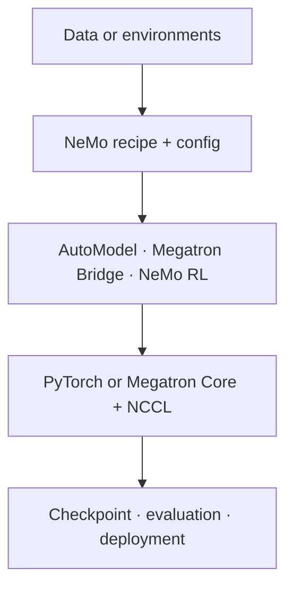

**NVIDIA NeMo** is NVIDIA's open-source, GPU-accelerated family of software for building, training, adapting, evaluating, and deploying generative AI models and agents. The name can describe the broader NeMo ecosystem or, more narrowly, the NeMo Framework training stack.

The NeMo ecosystem connects model implementations, training backends, recipes, data pipelines, checkpoint conversion, evaluation, reinforcement learning, and deployment. Large-model training commonly places NeMo above [PyTorch](glossary://pytorch) and [NVIDIA Megatron](glossary://nvidia-megatron): NeMo supplies integration and lifecycle machinery while Megatron Core partitions model computation across GPUs.

## Intuition

Think of NeMo as a workshop containing specialized tools. A recipe describes the job. A training backend executes model math. Supporting libraries prepare data, launch jobs, evaluate results, convert checkpoints, or package the trained model for inference.

Saying "we use NeMo" is therefore incomplete. The useful follow-up is: which NeMo component, which backend, which version, and which checkpoint format?

## Which component does what

| Component | Primary role | perimeter to remember |
| --- | --- | --- |
| **Megatron Bridge** | Megatron Core pretraining, supervised fine-tuning, LoRA, and Hugging Face checkpoint conversion | Conversion support depends on the model architecture |
| **NeMo AutoModel** | PyTorch-native distributed training with [DTensor](glossary://dtensor) and Hugging Face-compatible model definitions | Uses a different training path from Megatron Core |
| **NeMo RL** | Post-training with algorithms such as GRPO, PPO, DPO, and SFT, plus distributed rollout generation | Orchestrates learning and generation; its backend still performs model computation |
| **NeMo Speech** | Speech recognition, speech generation, and related audio models | Speech and audio workloads |
| **NeMo Run** | Configure and launch experiments across local, Slurm, and Kubernetes environments | Measure the launched job's GPU topology and efficiency |
| **Curator, Evaluator, Gym, Guardrails, and Export-Deploy** | Data curation, evaluation, agent environments, runtime controls, and model export or deployment | Each component owns a distinct lifecycle problem; NeMo Framework is the training stack |

## architecture seam



The layers can overlap in practice, but ownership remains useful while debugging. A bad recipe may request an impossible mesh. A correct recipe can still expose a slow collective. A valid distributed checkpoint can still fail conversion when source and destination model graphs disagree.

## Example

A Megatron-based fine-tuning run can start from a Hugging Face checkpoint:

```python
from megatron.bridge import AutoBridge

bridge = AutoBridge.from_hf_pretrained("org/model")
provider = bridge.to_megatron_provider()
provider.tensor_model_parallel_size = 8
provider.pipeline_model_parallel_size = 1
provider.finalize()

model = provider.provide_distributed_model(wrap_with_ddp=False)
```

Megatron Bridge selects model-specific mappings, builds a Megatron provider, and configures distributed model construction. Megatron Core then executes tensor, pipeline, context, data, or expert parallel work. [NCCL](glossary://nccl) moves tensors between ranks. Export reverses the mapping so an inference system such as [vLLM](glossary://vllm) can load a compatible checkpoint.

Custom architectures still need explicit support. Extra MoE routers, MLA projections, DSA indexers, or MTP heads change parameter names, shapes, and sharding rules. Validate parity by comparing key sets, tensor shapes, configuration, and reference logits after import or export.

## NeMo 2.0 and the modular stack

Older material often presents NeMo as the monolithic `nemo_toolkit` package, with Hydra or OmegaConf configuration, PyTorch Lightning training, and `.nemo` archives. Those concepts still appear in maintained workflows, especially speech and older model recipes.

NVIDIA is restructuring the broader framework into focused repositories such as Megatron Bridge, AutoModel, NeMo RL, and NeMo Speech. Current large-model work should follow documentation for the exact component and release rather than mixing commands from different generations of the stack.

## Common mistake

**NeMo, Megatron Core, Megatron Bridge, NeMo RL, and NeMo Guardrails name distinct components.**

- Megatron Core implements distributed model building blocks and parallel execution.
- Megatron Bridge integrates supported models and checkpoints with Megatron Core.
- NeMo AutoModel provides a PyTorch DTensor and Hugging Face-compatible training path.
- NeMo RL coordinates post-training algorithms, learners, and rollout generation.
- NeMo Guardrails controls conversational and agent behavior at runtime.

When a failure is described only as a "NeMo issue," first locate that ownership perimeter.

## Operational trade-offs

- **Version coupling:** CUDA, PyTorch, [Transformer Engine](glossary://transformer-engine), Megatron Core, and NeMo component versions must agree. Pinned NVIDIA containers reduce ambiguity.
- **Model coverage:** custom architectures and auxiliary heads may need explicit conversion mappings, even when the base Hugging Face model identifier is supported.
- **Checkpoint formats:** distributed checkpoints, Hugging Face checkpoints, and legacy `.nemo` archives have different metadata and portability specifications.
- **Configuration depth:** recipes simplify common runs but can hide effective TP, PP, CP, DP, or EP choices. Log the resolved configuration.
- **Migration cost:** repository partitions and APIs are evolving during the modular restructuring. Match examples to the installed release.

## Why it matters here

NeMo connects several stages that are easy to confuse: model integration, distributed training, checkpoint conversion, post-training, evaluation, and deployment. In a large RL stack, SkyRL or NeMo RL may orchestrate trajectories and updates, Megatron Core may train the learner, Megatron Bridge may translate checkpoints, NCCL may carry collectives, and vLLM may generate rollouts.

Naming each layer precisely makes performance and correctness investigations tractable. "Training is slow" becomes a measurable question about recipe overhead, model kernels, collectives, checkpoint I/O, rollout generation, or weight synchronization.

## Official references

- [NVIDIA NeMo organization and component map](https://github.com/NVIDIA-NeMo)
- [NeMo Framework documentation](https://docs.nvidia.com/nemo-framework/user-guide/latest/nemotoolkit/index.html)
- [Megatron Bridge documentation](https://docs.nvidia.com/nemo/megatron-bridge/latest/index.html)
- [NeMo AutoModel overview](https://docs.nvidia.com/nemo/automodel/get-started/about)
- [NeMo RL documentation](https://docs.nvidia.com/nemo/rl/latest/index.html)
- [NeMo ecosystem overview](https://docs.nvidia.com/nemo/gym/main/about/ecosystem)

## Related terms

- [NVIDIA Megatron](glossary://nvidia-megatron)
- [Megatron Bridge](glossary://megatron-bridge)
- [PyTorch](glossary://pytorch)
- [PyTorch DTensor](glossary://dtensor)
- [NVIDIA Transformer Engine](glossary://transformer-engine)
- [NCCL](glossary://nccl)
- [Model checkpoint](glossary://model-checkpoint)
- [Tensor parallelism](glossary://tensor-parallelism)
- [GRPO](glossary://grpo)
- [vLLM](glossary://vllm)
