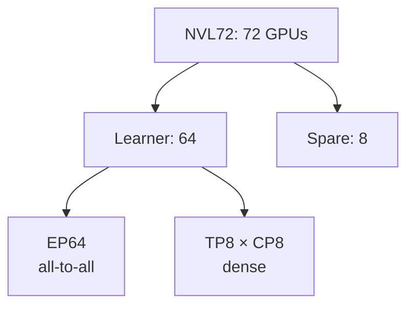

**NVL72** describes an NVIDIA rack-scale system whose NVLink domain contains 72 GPUs. A GB200 NVL72 rack combines compute trays, NVLink switch trays, Grace CPUs, Blackwell GPUs, networking, and cooling into one large communication domain.

The useful systems fact isn't the rack label by itself. It is that up to 72 GPUs can participate in high-bandwidth GPU-to-GPU communication without crossing the ordinary scale-out network for every exchange. That shape is attractive for large [mixture-of-experts](glossary://mixture-of-experts) models whose token dispatch generates frequent collective traffic.

## Domain versus job allocation

A job doesn't need to consume all 72 GPUs. Using 64 ranks can produce clean powers-of-two TP, CP, and EP groups while leaving eight GPUs for another workload. Scheduling labels still need to reflect physical connectivity; similar rack names don't prove two allocations share one NVLink domain.

## Diagram

## Example

Placing an EP64 group inside one NVL72 domain keeps expert dispatch on the rack fabric. If rank placement accidentally spans another domain, the same EP setting can push token traffic through slower inter-rack links.

## Why it matters here

The supplied configuration assigns 64 learner GPUs to one rack label. NVL72 motivates that placement; verify actual topology with NCCL and platform inventory before treating the suffix as a hardware map.

## Related terms

- [GB200](glossary://gb200)
- [NVLink](glossary://nvlink)
- [Expert parallelism](glossary://expert-parallelism)
- [NCCL](glossary://nccl)
- [GPU partitioning](glossary://gpu-partitioning)
