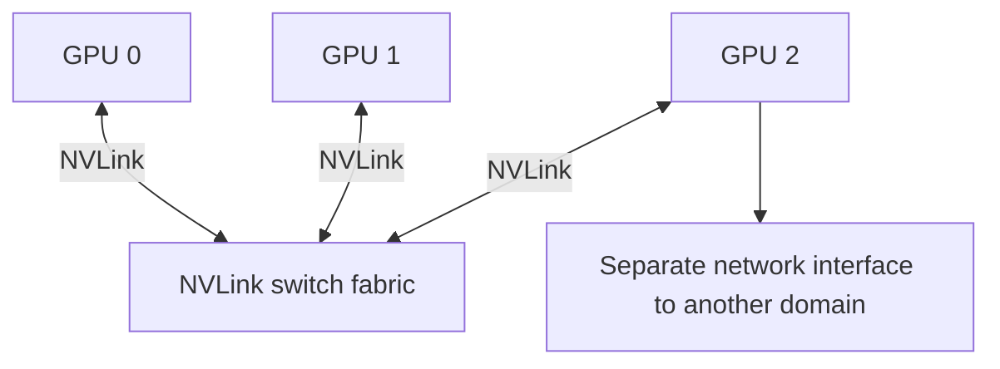

**NVLink** is NVIDIA's high-bandwidth interconnect for moving data between GPUs. The related NVLink-C2C interconnect connects CPU and GPU components in Grace Hopper and Grace Blackwell superchips. Distributed model code sees collectives such as all-reduce or all-to-all. NVLink and NVLink switches provide the physical fabric that can make those collectives fast inside a supported topology.

[NCCL](glossary://nccl) selects and executes collective communication algorithms; NVLink is one transport path those algorithms can use. Jobs spanning multiple NVLink domains also need an external network such as InfiniBand or Ethernet between domains.

## Topology matters

Bandwidth numbers alone don't describe a job. Rank grouping decides which tensor exchanges remain local to the NVLink fabric. Tensor-parallel collectives happen in nearly every layer, while MoE expert routing can perform large all-to-all exchanges. Mapping either group across a slow boundary can dominate step time.

## Diagram

## Example

Two Megatron configurations may both report TP=8. One keeps eight ranks inside an NVLink domain; another spreads them across nodes connected by a slower path. Model math is identical, but every layer's collective latency can make the second layout far slower.

## Why it matters here

The GLM-5.3 masterclass's candidate combines TP, CP, and EP collectives on the same physical learner ranks. NVLink topology affects whether those coordinate systems provide efficient sharding or create a communication bottleneck. Verify process-group placement against detected topology and link telemetry before attributing performance to the requested layout.

## Related terms

- [NCCL](glossary://nccl)
- [NVL72](glossary://nvl72)
- [All-reduce](glossary://all-reduce)
- [All-to-all](glossary://all-to-all)
- [GB200](glossary://gb200)
