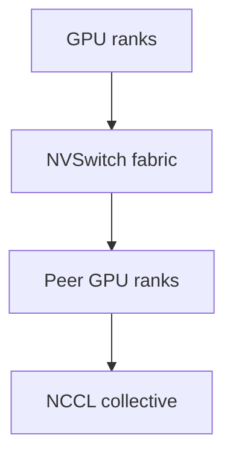

**NVSwitch** is NVIDIA switching silicon that connects multiple GPUs into high-bandwidth NVLink fabric. It lets GPU communicate across fabric without requiring every GPU pair to have direct physical link.

In rack-scale systems, NVSwitch topology matters for tensor, context, and expert-parallel collectives. A process-group layout that crosses slower boundary can dominate step time even when each GPU is fast.

Fabric health is operational dependency. Inspect topology, link status, counters, and collective bandwidth instead of assuming rack label equals one healthy NVLink domain.

## Collective behavior

NCCL maps process groups onto available NVLink and NVSwitch paths, choosing algorithms by topology and message size. Ring, tree, and specialized fabric paths emphasize different latency/bandwidth tradeoffs. Stable mean bandwidth can hide one rank tail. Test exact world size and payload distribution, then inspect per-rank traces and link counters under concurrent job load.

## Diagram

## Example

EP64 all-to-all sends token shards between many GPU ranks through NVSwitch fabric. One degraded link can create rank-tail delay that stalls whole layer.

## Why it matters here

Large MoE training combines expert dispatch with tensor- and context-parallel collectives. The GLM-5.3 candidate therefore needs an explicit map from those process groups to the available fabric. Verify the map with topology and link telemetry to identify congestion, unhealthy links, and poor group placement.

## Related terms

- [NVLink](glossary://nvlink)
- [GB200](glossary://gb200)
- [NCCL](glossary://nccl)
