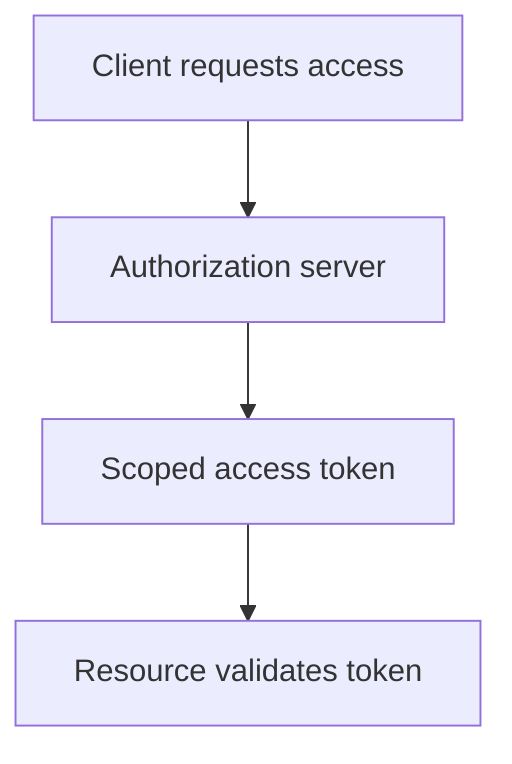

**OAuth** is an authorization framework that lets a client obtain limited access to a protected resource without receiving the resource owner's password. An authorization server issues access tokens; the resource-server role validates them before serving an API or tool request. These are distinct roles that can run on the same service.

## A token grants scoped access

The client requests a specific scope and intended resource. The user or organization approves access through the authorization server, and the resulting token is presented to the correct protected API. The resource server must verify token issuer, expiration, audience or intended resource, scopes, and the current tenant or user context.

OAuth covers delegated authorization. Authenticate users through the application's identity protocol, and enforce agent trust through runtime policy. An authenticated agent still cannot execute an action outside its granted scope, and a valid token for one service must not be replayed against another.

For interactive authorization-code flows, use PKCE and validated redirect URIs under current OAuth security guidance. Access tokens may be opaque or JWTs; opaque tokens require trusted server-side introspection, while JWTs require signature and claim validation. Client-credentials grants authorize a client acting on its own behalf through client authentication, without an end-user approval screen.

## Example

An agent needs read-only access to an incident-document server. Its client discovers the approved authorization server, requests the `documents:read` scope for that exact server, and receives an access token after user approval.

The incident server checks the token's issuer, resource audience, expiration, and scope. A model-proposed `documents:delete` call remains denied even though the user completed authorization. A token issued for a different tool server is also rejected.

## Why it matters here

Model Context Protocol and tool-use lessons depend on keeping delegated access, token audience, tenant identity, and server-side policy explicit. OAuth provides the authorization plumbing, but secure agent execution still requires least privilege, correctly bound tokens, validated tool arguments, and a trusted runtime.

## Related terms

- [Least privilege](glossary://least-privilege)
- [Permission boundary](glossary://permission-boundary)
- [MCP](glossary://mcp)
- [Secrets management](glossary://secrets-management)
