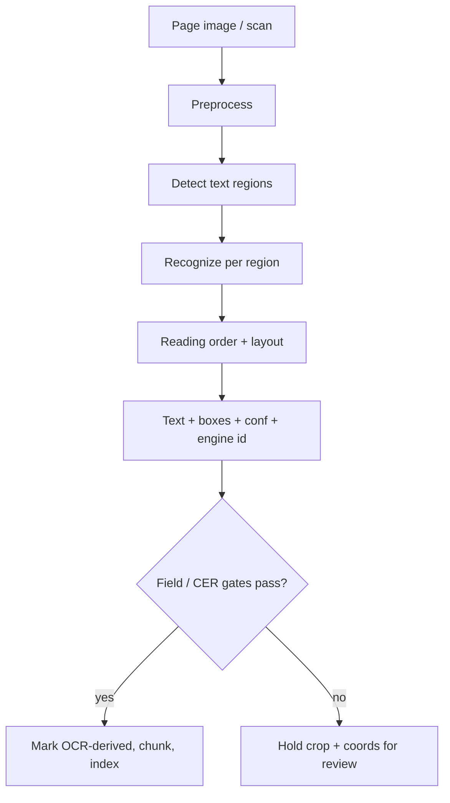

OCR (optical character recognition) turns text that exists only as pixels (scans, photos, screenshots, faxed PDFs, UI captures) into machine-readable characters, words, and often layout metadata. It is a **lossy transduction**: the output string is a model hypothesis inferred from the image, so verify critical text against the source document.

## Intuition

Native digital text (a clean PDF text layer, HTML, Markdown) already stores characters. OCR exists when that layer is missing, broken, or untrusted, and the only evidence is visual. Production OCR finds text regions, normalizes geometry, recognizes sequences, recovers reading order, and optionally rebuilds tables. Each step can fail while still producing plausible English.

Treat OCR output as a second document with provenance. Characters can be wrong, columns can interleave, and tables can collapse into soup that still embeds well enough to pollute retrieval.

## How it works

A modern document OCR path usually has these stages:

1. **Page render / preprocess.** Rasterize a PDF page or load an image. Deskew, denoise, binarize, or scale so strokes are readable. Bad DPI and heavy JPEG compression destroy thin glyphs (especially digits and punctuation).
2. **Text detection (localization).** Find word or line boxes, polygons, or masks. Detectors range from classical connected components to deep detectors (EAST-style, DBNet-style segmentation). Output is geometry, not strings.
3. **Recognition.** Crop or warp each region, then map the image strip to a character or subword sequence. Neural recognizers often combine convolutional features, sequence models such as LSTMs, and **CTC** (connectionist temporal classification) so the network need not pre-segment characters. Older non-neural recognizers can use character-pattern matching. Transformer OCR (for example TrOCR) uses a vision encoder and an autoregressive text decoder on line crops. Full-page multimodal models and document VLMs can skip explicit boxes and emit markdown-like structure, but they still make recognition mistakes.
4. **Layout and reading order.** Sort boxes top-to-bottom / left-to-right for simple pages, or run a layout model (title, paragraph, table, figure, caption) when multi-column, sidebars, or forms matter. Wrong order is a silent failure: every word may be correct while the paragraph is nonsense.
5. **Post-process.** Language models, dictionaries, regex for IDs, and table structure models clean hypotheses. These helpers can fix real errors or invent confident wrong digits.

**Classic engines vs neural OCR.** Open-source Tesseract 4+ uses an LSTM line recognizer (with a legacy character-pattern engine still available). Toolkits such as PaddleOCR and DocTR package detection + recognition + structure helpers. Cloud Document AI APIs add form and table extractors on top of the same idea: pixels in, text and boxes out.

OCR is the scan branch of a [document parser](glossary://document-parser). Prefer a faithful native text layer when it exists; route to OCR only when native extract is empty, gibberish, or fails quality gates.

## Diagram



## Formula

Accuracy is usually reported with **character error rate (CER)**, the character-level analogue of word error rate in speech. Align hypothesis $H$ to reference $R$ with minimum edit distance (Levenshtein), then:

$$
\mathrm{CER} = \frac{S + D + I}{N}
$$

where $S$, $D$, and $I$ are substitutions, deletions, and insertions, and $N = |R|$ is the number of characters in the reference (sometimes written $n$ for ground-truth length). Lower is better. CER can exceed $1$ when the system inserts more noise than the reference length. Define an explicit policy for empty references, where this denominator is zero. CER needs a reference transcription: use it on labeled evaluation samples; live ingestion gates must rely on field checks, calibrated quality signals, or human review when no reference exists.

**Word error rate (WER)** uses the same edit counts at the word level. Average CER can look fine while IDs, amounts, and dates (the fields RAG and tools actually act on) are wrong. Prefer **field-level accuracy** on critical spans in addition to CER/WER.

## Worked numbers

Reference (ground truth):

```text
page on-call within 15 minutes
```

Hypothesis (OCR):

```text
page on-call within 1S minutes
```

Character alignment needs one substitution (`5` → `S`). With $S=1$, $D=0$, $I=0$, and $N=30$ (spaces counted):

$$
\mathrm{CER} = \frac{1}{30} \approx 0.033 \ (3.3\%)
$$

That looks "good" as a page average, yet the only number that matters for escalation policy is wrong. A second common case, `S0` vs `50`, is a single glyph swap with full semantic inversion. Measure those fields separately; do not trust mean CER alone.

## Example

A scanned incident runbook PDF has no usable text layer. The ingestion path renders page 8 at 300 DPI, runs detection + LSTM recognition, and indexes:

```text
Rollback failure: page on-call within 1S minutes with deploy ID.
Escalation severity: 50 (Sev-0 path).
```

Ground truth was `15 minutes` and severity `S0`. Downstream:

| Consumer | What goes wrong |
|---|---|
| BM25 / dense index | Plausible tokens still retrieve the page |
| LLM answer | Cites "1S minutes" or invents "50" as a number |
| Tool / policy gate | Wrong SLA or wrong severity if it acts on the string |
| Human audit | Compare the OCR string with the page crop and bounding box |

A minimal OCR-aware record for provenance:

```python
span = {
    "source_id": "incident-runbook-v3.pdf",
    "page": 8,
    "bbox": [120, 440, 890, 478],  # page coords of the line crop
    "text": "page on-call within 1S minutes",
    "ocr_engine": "tesseract5-lstm",
    "ocr_version": "5.3.4",
    "mean_conf": 0.91,  # normalized pipeline score, not a calibrated probability
    "derived": "ocr",
    "review_status": "unreviewed",
    "checksum": "sha256:9f2c...",
}
```

Confidence $0.91$ did not prevent the digit error. Keep the crop so a reviewer can correct the field without re-running the whole pipeline.

## What fails in production

| Failure | Symptom | Mitigation |
|---|---|---|
| Glyph confusions | `0`/`O`, `1`/`l`/`I`, `5`/`S`, `S0`/`50` | Field validators; domain dictionaries; dual-pass engines |
| Layout / reading order | Multi-column text interleaved; captions glued to body | Layout model; column-aware order; do not naive-sort by $y$ only on complex pages |
| Table collapse | Headers misaligned; numbers in wrong columns | Table structure model; emit CSV/HTML, not flat lines |
| Low quality input | Skew, blur, stamps, handwriting, 72 DPI phone photos | Reject/re-scan gates; preprocess; human review |
| Over-trusting confidence | High token scores, wrong paragraph | Field-level eval; gold anchors; never auto-act on OCR-only critical values |
| Engine / version drift | Same scan, different text after upgrade | Pin engine id; content checksum; re-eval before reindex |
| Index pollution | OCR noise ranked as clean truth | Mark `derived=ocr`; show uncertainty in citations |

For RAG and agents: mark OCR-derived text before indexing, preserve page coordinates and engine version, chunk with structure when tables and headings survive, and keep enough image context for human review when a value drives legal, financial, safety, or access-control decisions.

## Why it matters here

Document AI and multimodal RAG expand coverage to scans, screenshots, and image-only PDFs. OCR (or a VLM doing OCR-like work) is often the only path to evidence. Without provenance, CER discipline, and field checks, the system treats noisy hypotheses as source truth, and model "hallucinations" are actually upstream recognition failures.

## Related terms

- [Document parser](glossary://document-parser)
- [Provenance](glossary://provenance)
- [Chunking](glossary://chunking)
- [Vision-language model](glossary://vision-language-model)
- [Checksum](glossary://checksum)
