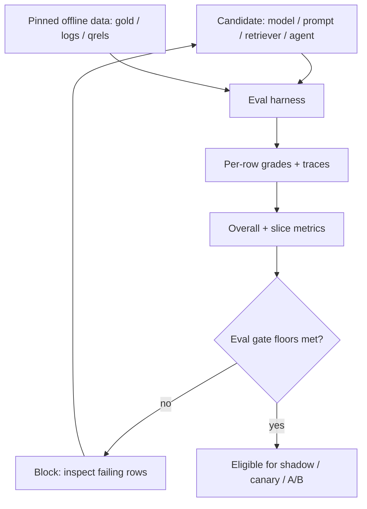

**Offline evaluation** scores a candidate model, prompt, retriever, ranker, agent, or full pipeline on **fixed data** (a labeled test set, golden suite, logged interactions, or frozen benchmark) **before** that candidate serves live users or mutates production state. You run the system under test through an [eval harness](glossary://eval-harness), grade each case against a known policy, and aggregate metrics and [evaluation slices](glossary://evaluation-slice). No new user-facing decisions depend on the candidate during the run.

"Offline" means *decoupled from live source of truth*. A CI job that freezes dataset `policy-qa-gold@v14`, temperature $0$, and grader `cite-v3` is offline evaluation. A/B tests, canaries that answer customers, and bandits that spend traffic are online. [Shadow evaluation](glossary://shadow-evaluation) sits between them: realistic inputs, candidate outputs logged without source of truth to act.

The idea is old in information retrieval and recommender systems. Cranfield-style IR evaluation (and later TREC) fixes a document collection, a topic/query set, and relevance judgments (qrels), then ranks systems with metrics such as [NDCG](glossary://ndcg) or [recall@k](glossary://recall-at-k). Recommender and ranking teams often add a second offline mode: **counterfactual / off-policy evaluation (OPE)** that reweights logged clicks under the old policy to estimate a new policy without shipping it. LLM product teams reuse the same schema: frozen test cases, pinned graders, slice report, then an [eval gate](glossary://eval-gate) before traffic.

## Intuition

Use offline evaluation as a **repeatable preflight** before measuring business impact in a canary or A/B test.

| Property | Offline eval | Online eval (A/B, canary) |
| --- | --- | --- |
| Inputs | Fixed test cases / logs | Live user traffic |
| Risk to users | No candidate decisions reach users when tools and side effects are isolated | Real decisions and side effects |
| Speed and cost | Repeatable; model calls and large suites can still be expensive | Needs traffic and statistical power |
| What it measures | Behavior vs labels, rubrics, or logged outcomes | User and business outcomes under real mix |
| Failure mode | Wrong dataset, contamination, grader drift | Underpowered tests, SRM, novelty effects |

A small teaching test case can demonstrate the harness or protect a regression. A versioned [golden dataset](glossary://golden-dataset) with representative slices, denominators, and floors is a release instrument. Offline eval ranks candidates and blocks known regressions; canaries or A/B tests measure live CTR, retention, and trust.

## How it works

Production-grade offline evaluation is a pipeline that pins inputs, runs the system under test, grades outputs, and reports slices:

1. **Pin the claim.** Name the product surface (RAG answer, code fix, ranking list) and the metrics that matter (citation accuracy, pass rate, NDCG@10, refusal correctness, p95 latency).
2. **Freeze data.** [Golden dataset](glossary://golden-dataset), public benchmark holdout, or logged sample with known propensities. Record dataset version, corpus/index version for retrieval, label guideline, and contamination risk.
3. **Pin the system under test.** Model id, prompt template, tools, decoding settings, agent scaffold, retriever and chunker versions. Silent config drift makes score deltas uninterpretable.
4. **Run through a harness.** Load each row, execute, capture traces, grade (exact match, unit tests, rubrics, [model judge](glossary://model-judge)), keep skips and timeouts in the denominator.
5. **Aggregate with slices.** Overall mean plus named cohorts (language, long context, abstain, multi-hop, incident regressions). Report support $n_s$ per slice.
6. **Decide with a gate or ranker.** Absolute floors and allowed regressions vs a baseline for release; pairwise deltas for research ranking. Fail closed on hard safety and isolation rows.
7. **Promote only eligibility.** Green offline status qualifies a candidate for canary or shadow evaluation; live evidence establishes whether it improves user outcomes.

### Two offline families

**1. Labeled / Cranfield-style (most LLM and RAG suites)**

You have inputs $x_i$, optional context (docs, tools), and a grade $g_i$ from gold labels or a rubric. For $N$ cases and binary pass $y_i \in \{0,1\}$:

$$
\hat{m} = \frac{1}{N}\sum_{i=1}^{N} y_i
$$

For graded scores $s_i$ (rubric mean, continuous judge score), use the same average. For ranking, replace $y_i$ with list metrics such as $\mathrm{NDCG@}k$ or $\mathrm{Recall@}k$ averaged over queries. Always keep **support** and **invalid/skip** counts: dropping hard rows inflates $\hat{m}$.

**2. Counterfactual offline policy evaluation (logged ranking / bandits)**

When labels are sparse and you only have feedback under an old logging policy $\pi_0$, inverse propensity scoring (IPS) estimates the value of a new policy $\pi$ from logged triples $(x_i, a_i, r_i)$:

$$
\hat{V}_{\mathrm{IPS}}(\pi) = \frac{1}{N}\sum_{i=1}^{N} \frac{\pi(a_i \mid x_i)}{\pi_0(a_i \mid x_i)}\, r_i
$$

For unbiased IPS, use the true logging propensities, require logging-policy support wherever the target policy assigns probability, and assume the logged context and reward mechanism match the population being estimated. Estimated propensities can introduce bias. Extreme weights cause high variance; clipping trades bias for variance, and self-normalized IPS (SNIPS) is generally biased at finite sample sizes. Doubly robust estimators combine propensity and reward models. This is the offline path for "would this ranker have earned more clicks?" without an A/B. LLM golden-set eval is usually family (1); recommendation and ad ranking often need family (2).

## Diagram



## Example

A support document-QA stack must answer with citations or abstain. Before promoting a new reranker, the team runs offline evaluation on frozen suite `support-qa@v14`:

| Piece | Pin |
| --- | --- |
| Data | $N = 400$ adjudicated tickets; corpus `policies@2026-03-01` |
| Slices | `supported` ($250$), `unsupported_abstain` ($80$), `multi_hop` ($40$), `long_pdf` ($30$) |
| System | prompt `reply-v7`, index pin above, temperature $0$, max $512$ tokens |
| Graders | citation-id exact match; abstain label match; schema-valid JSON |
| Gate | citation accuracy $\ge 0.92$; correct abstain $\ge 0.90$; tenant isolation fails $= 0$; p95 latency $\le 2.5\,\mathrm{s}$ |

In this hypothetical run, the baseline production stack scores citation $0.94$, abstain $0.93$, isolation $0$, p95 $1.9\,\mathrm{s}$. Candidate reranker: citation $0.905$, abstain $0.91$, isolation $0$, p95 $2.1\,\mathrm{s}$. **Offline result: block** on citation floor. Slice report shows the observed drop concentrated in `long_pdf` and `multi_hop`; inspect paired failures and uncertainty before generalizing from these small slices. Engineers open failing [eval rows](glossary://eval-row), fix packing and the index filter, re-run the **same** dataset and grader versions, clear the gate, then open a small canary because live query length and cache hit rates are not fully represented offline.

Minimal operational sketch:

```python
def offline_pass_rate(rows, grade_fn) -> dict:
    passed = 0
    total = 0
    skipped = 0
    for row in rows:
        total += 1
        if row.get("skip"):
            skipped += 1
            continue
        grade = grade_fn(row)  # binary release grade
        if grade not in (0, 1):
            raise ValueError("expected a binary grade")
        passed += grade
    return {
        "mean": passed / total if total else None,
        "support": total,
        "scored_support": total - skipped,
        "skipped": skipped,
    }
```

This binary release gate counts skipped cases as failures; the harness must also convert timeouts into failed or skipped rows. Report `mean`, `support`, `scored_support`, and `skipped` per slice. Continuous metrics need an explicit missing-case policy and coverage report rather than silently averaging only successful rows.

## Dataset and grading schema

An offline run is only comparable to another if these are named and frozen:

| schema field | Why it matters |
| --- | --- |
| Dataset version / content hash | Silent label edits fake progress |
| Corpus / index / tool stubs | Retrieval and agent scores depend on side context |
| Label policy and rater guideline | "Correct" must mean the same thing |
| Grader version (code or judge prompt) | Judge drift is a measurement bug |
| Decoding and scaffold settings | Temperature, retries, and tools change the claim |
| Contamination risk | Training or few-shot demos on gold inflate scores |
| Product behavior approximated | Suite must mirror the real failure classes |

Public benchmarks (MMLU-style, HumanEval [pass@k](glossary://pass-at-k), SWE-bench) are offline evaluations under a shared harness. Product offline eval adds private gold, incident regressions, and policy rows that leaderboards never cover. HELM-style work stresses the other half of The schema: multi-metric comparison under **standardized conditions**, with raw prompts and completions available for audit alongside accuracy.

## What fails in production

| Failure | Symptom | Mitigation |
| --- | --- | --- |
| **Offline-online gap** | Green suite, angry users | Shadow, canary, live monitors; refresh gold from traffic |
| **Trophy set** | Only easy FAQs | Add abstains, long context, incidents, adversarial rows |
| **Benchmark contamination** | Public or internal gold leaked into train/demos | Hold out gold; private variants; [benchmark contamination](glossary://benchmark-contamination) checks |
| **Mean-only reading** | Overall up, safety slice down | Slice floors in the gate |
| **Judge / label drift** | Score moves with no product change | Pin graders; calibrate judges on human gold; version labels |
| **Unpinned harness** | Incomparable runs | Pin dataset, prompt, model, tools, harness SHA |
| **Wrong offline mode** | IPS with missing propensities, or exact-match on open prose | Match method to data: labels vs logged propensities vs unit tests |
| **Treating offline as final** | Ship on suite alone | Offline = eligibility; live impact still needs online evidence |

## Trade-offs

- **Coverage vs speed.** Full suites catch rare regressions; they burn tokens and wall time. Common split: tiny PR smoke + nightly full offline.
- **Deterministic graders vs judges.** Exact match and unit tests are stable; judges cover open answers but add variance and need their own gold calibration.
- **Strict freeze vs realism.** Frozen indexes and sandboxes make scores attributable; live tools and live corpora look more like production but blur cause.
- **Public benchmarks vs private gold.** Public numbers enable external comparison; private gold tracks *your* product risk. Use both; gate on private.

## Why it matters here

Almost every LeetLLM lesson that changes a model, prompt, retriever, or agent ends in the same discipline: measure on frozen data first. Offline evaluation is how you compare candidates cheaply, block known regressions with an [eval gate](glossary://eval-gate), and keep score movement attributable through a pinned [eval harness](glossary://eval-harness) and [golden dataset](glossary://golden-dataset). Report slices, denominators, and contamination alongside leaderboard scores. Offline success is a prerequisite for safe promotion; live evaluation measures user value.

## Related terms

- [Eval harness](glossary://eval-harness)
- [Golden dataset](glossary://golden-dataset)
- [Eval gate](glossary://eval-gate)
- [Evaluation slice](glossary://evaluation-slice)
- [Shadow evaluation](glossary://shadow-evaluation)
