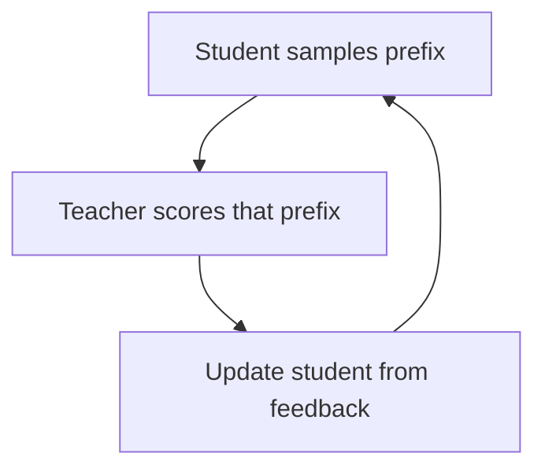

On-policy distillation (OPD) trains a student using teacher feedback on prefixes or trajectories generated by the student itself. The student determines which situations the training data visits; the teacher supplies a learning signal there. This differs from copying only teacher-generated demonstrations, whose prefixes may be unlike the student's own mistakes.

## Who generates and who supervises?

The essential distinction is data origin. A student samples an answer, and a teacher evaluates next-token distributions along that sampled prefix. The student then learns to better match the chosen teacher signal. Objectives can use different divergence directions, mixtures of on-policy and offline data, or other feedback formulations. OPD names the collection strategy, not one mandatory loss.

The [TRL generalized knowledge-distillation documentation](https://huggingface.co/docs/trl/main/en/gkd_trainer) provides a concrete implementation of student-generated data with teacher supervision. Full distribution matching also needs aligned token vocabularies or an explicit alternative representation.

## Example

A student starts an investigation by checking CPU, even though the teacher would have checked traces first. The teacher scores useful next actions after the student's CPU observation, so training teaches recovery from a state the student actually reaches alongside behavior along ideal teacher trajectories.

## Why it matters here

OPD helps distinguish vendor post-training descriptions from the GRPO loop in the masterclass. GRPO compares rewarded siblings; teacher-distribution matching is a different signal. Pin student and teacher versions, prefix tokens, teacher settings, and the objective. Stale student rollouts or mismatched templates can undermine the claimed on-policy data distribution.

## Related terms

- [Teacher-student distillation](glossary://teacher-student-distillation)
- [On-policy learning](glossary://on-policy)
- [KL divergence](glossary://kl-divergence)
- [GRPO](glossary://grpo)
- [Rollout staleness](glossary://rollout-staleness)
