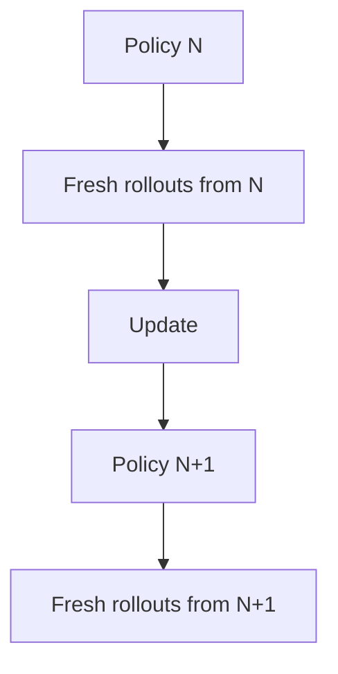

**On-policy learning** updates policy using trajectories sampled by current policy or declared near-current approximation. Data distribution changes as policy changes, so rollouts usually can't be reused indefinitely without correction.

Each new policy version collects its own fresh rollouts before the next update.

[PPO](glossary://ppo), [RLOO](glossary://rloo), and [GRPO](glossary://grpo) are commonly used as on-policy methods. Fully asynchronous training blurs boundary: trajectories are fresh but may come from version N while learner is already N+2. Policy ratio and [rollout staleness](glossary://rollout-staleness) quantify approximation.

Online and on-policy aren't synonyms. Online system can generate new data with lagged behavior policy. On-policy estimator can run from bounded stored batch before update.

## Failure modes

- Weight refresh lags behind learner.
- Multiple update epochs make same batch progressively stale.
- Rollout and learner execute different tokenizer, router, or attention path.
- “Two steps stale” hides large parameter movement per step.

## Example

Generator samples with policy 130. Learner updates from same trajectories before weights move far. Ratio stays near one and policy-version metadata proves origin.

## Why it matters here

On-policy assumptions justify policy-gradient estimator. Async throughput is valuable only while rollout freshness and execution parity remain within validated envelope.

## Related terms

- [Off-policy learning](glossary://off-policy)
- [RL rollout](glossary://rl-rollout)
- [Policy ratio](glossary://policy-ratio)
- [Rollout staleness](glossary://rollout-staleness)
