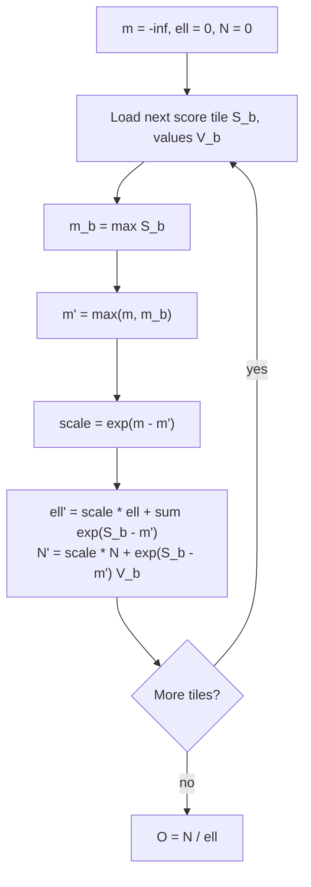

Online softmax (also called online normalizer calculation) computes a numerically stable [softmax](glossary://softmax) while streaming scores one element or tile at a time. It keeps a running maximum $m$ and a rescaled sum of exponentials $\ell$, so later values can raise the max without invalidating earlier partial sums. The final distribution matches full-row stable softmax up to floating-point reorderings; it is exact math, not an approximation.

Milakov and Gimelshein (2018) introduced the single-pass normalizer for classical softmax to cut memory passes. FlashAttention and related attention kernels reuse the same algebra at block scale so $\mathrm{softmax}(QK^{\top})V$ never needs the full score matrix in [HBM](glossary://hbm).

## Intuition

Stable softmax subtracts the row maximum before `exp` so large scores do not overflow. That is easy when the whole row sits in registers or fast memory: compute $m=\max_i s_i$, then $\ell=\sum_i e^{s_i-m}$, then $p_i=e^{s_i-m}/\ell$.

Streaming breaks that plan. Attention kernels process a query row in tiles of keys. After tile 1 you may have already accumulated $e^{s_j-m^{(1)}}$. Tile 2 can contain a larger score, so the true max is higher and every earlier exponential is too large relative to the new baseline. Online softmax fixes this with a **rescale identity**:

$$
e^{s-m_{\mathrm{new}}} = e^{s-m_{\mathrm{old}}}\cdot e^{m_{\mathrm{old}}-m_{\mathrm{new}}}.
$$

When the max jumps, multiply the old sum (and any weighted value accumulator) by $e^{m_{\mathrm{old}}-m_{\mathrm{new}}}$ before adding the new block. Old mass is restated under the new max; nothing needs a second full pass over previous tiles.

## Formula

**Safe softmax** on a full vector $x\in\mathbb{R}^{V}$:

$$
y_i=\frac{e^{x_i-m}}{\sum_{j=1}^{V}e^{x_j-m}},\qquad m=\max_k x_k.
$$

**Online update (scalar stream)** from Milakov and Gimelshein. Maintain $m_0=-\infty$, $d_0=0$. For each new score $x_j$:

$$
m_j=\max(m_{j-1},x_j),\qquad
d_j=d_{j-1}\cdot e^{m_{j-1}-m_j}+e^{x_j-m_j}.
$$

At the end, $m_V=\max_k x_k$ and $d_V=\sum_j e^{x_j-m_V}$. A second pass (or a fused write) forms $y_i=e^{x_i-m_V}/d_V$. When $m_j=m_{j-1}$, the factor $e^{0}=1$ and the update is just “add another exp.” When $x_j$ wins, old mass is scaled down by $e^{m_{j-1}-x_j}$.

**Associative combine** for parallel or tile-wise merges. Pairs $(m,d)$ combine with

$$
\begin{bmatrix}m_i\\ d_i\end{bmatrix}
\oplus
\begin{bmatrix}m_j\\ d_j\end{bmatrix}
=
\begin{bmatrix}
\max(m_i,m_j)\\
d_i\,e^{m_i-\max(m_i,m_j)}+d_j\,e^{m_j-\max(m_i,m_j)}
\end{bmatrix}.
$$

The operation is associative (and commutative) in real arithmetic, so independent thread or tile states can reduce correctly, with floating-point differences from reduction order. Treat empty or fully masked states specially: combining two $m=-\infty$ states naively evaluates $-\infty-(-\infty)$ and produces NaN.

**Attention block form** (FlashAttention-style). For a query row, after block $j$ of scores $S^{(j)}$ and values $V^{(j)}$:

$$
\begin{aligned}
m^{(j)} &= \max\bigl(m^{(j-1)},\,\mathrm{rowmax}(S^{(j)})\bigr),\\
\ell^{(j)} &= e^{m^{(j-1)}-m^{(j)}}\,\ell^{(j-1)}
  + \mathrm{rowsum}\bigl(e^{S^{(j)}-m^{(j)}}\bigr),\\
N^{(j)} &= e^{m^{(j-1)}-m^{(j)}}\,N^{(j-1)}
  + e^{S^{(j)}-m^{(j)}}V^{(j)}.
\end{aligned}
$$

Final output is $O=N^{(\mathrm{last})}/\ell^{(\mathrm{last})}$ (or an equivalent delayed-normalize form as in FlashAttention-2). $N$ is the unnormalized $\sum p\cdot V$ accumulator under the current max. Local-per-tile softmax without rescaling is **not** the same operator.

## Worked numbers

Stream $x=[1,\,2,\,100]$ with late global max (the classic bug catcher).

| Step | $x_j$ | $m_j$ | $d_j$ |
|------|-------|-------|-------|
| start | (none) | $-\infty$ | $0$ |
| $j=1$ | $1$ | $1$ | $e^{0}=1$ |
| $j=2$ | $2$ | $2$ | $1\cdot e^{1-2}+e^{0}=e^{-1}+1$ |
| $j=3$ | $100$ | $100$ | $(e^{-1}+1)\cdot e^{2-100}+e^{0}\approx 1$ |

So $d_3\approx 1$ and probabilities are essentially $[0,\,0,\,1]$, matching full stable softmax on $[1,2,100]$. If step 3 forgot to multiply the old sum by $e^{2-100}$, adding the new term would give $d\approx 2+e^{-1}$ instead of $1$, and the row would not normalize to the true distribution.

Two attention tiles (scores then values):

```python
import math

# Tile A: scores [1, 2], values [10, 20]
# Tile B: score [0.5], value [40]
m_a, weights_a = 2.0, [math.exp(1 - 2), math.exp(2 - 2)]  # e^{-1}, 1
l_a = sum(weights_a)  # ~1.368
n_a = weights_a[0] * 10 + weights_a[1] * 20  # ~23.679

m_b, l_b, n_b = 0.5, 1.0, 40.0  # relative to local max 0.5
m = max(m_a, m_b)  # 2.0
scale_a, scale_b = math.exp(m_a - m), math.exp(m_b - m)
l = scale_a * l_a + scale_b * l_b
n = scale_a * n_a + scale_b * n_b
online = n / l  # ~20.493

# Dense reference
s = [1.0, 2.0, 0.5]
v = [10.0, 20.0, 40.0]
m_full = max(s)
w = [math.exp(si - m_full) for si in s]
dense = sum(wi * vi for wi, vi in zip(w, v)) / sum(w)
assert abs(online - dense) < 1e-12
```

If tile B instead held score $3.0$, both $l_a$ and $n_a$ must be multiplied by $e^{2-3}$ before combining. Skipping that rescale is the usual production bug in hand-written kernels.

## Diagram



## Example

FlashAttention never writes the full $N\times N$ score matrix to HBM. For each query tile it streams key/value tiles through on-chip SRAM, updates $(m,\ell,N)$ with the block rule above, and writes only the final output row (plus compact stats for the backward pass). The operator is still dense $\mathrm{softmax}(QK^{\top})V$; tiles change **when** max and sum are known, not **what** the attention formula is.

The same online normalizer applies outside attention: fused softmax+TopK at large vocabulary size (the original NVIDIA use case), streaming reductions across warps, and any kernel that must form a stable partition function without a second full read of the logits.

## Debug path

When a custom or fused kernel disagrees with `torch.softmax` / dense attention:

1. Build a row where the **global max is in the last tile** (e.g. `[1, 2, 100]` or a random row with the largest entry forced late). Missing $e^{m_{\mathrm{old}}-m_{\mathrm{new}}}$ almost always shows up here.
2. Log per-tile $(m,\ell)$ and the scale applied when $m$ changes. After a max update, old $\ell$ must move before new exps are added.
3. Confirm you do **not** renormalize each tile to sum to 1 and then average tiles. Local softmax is a different, approximate operator.
4. Keep $N$ unnormalized until every tile for that row is done (or use an equivalent delayed-normalize form). Early divide-by-$\ell$ locks the wrong scale.
5. Compare against a float64 dense reference on small shapes; allow only floating-point tolerance, not structural error.
6. For causal or padding masks, apply the mask **before** the online update (masked positions contribute $0$ to $\ell$ and $N$, often via $-\infty$ scores). Skip fully masked tiles or guard the $-\infty-(-\infty)$ case. An entirely masked row has $\ell=0$, so define its output explicitly rather than dividing by zero.

## Why it matters here

Long-context LLM training and inference are limited by memory traffic as much as by FLOPs. Online softmax is the numerical device that lets exact attention run in tiles that fit in SRAM: no full $N\times N$ score matrix in HBM, auxiliary / score-matrix memory linear in sequence length (outputs remain $O(N\,d_v)$ as in standard attention; the win is eliminating $O(N^2)$ scores plus keeping $O(N)$ row stats), same math as textbook attention. Per query row the running state is only scalars $(m,\ell)$ plus an unnormalized value accumulator of width $d_v$. If you read FlashAttention, SDPA backends, Triton attention tutorials, or write a fused decode kernel, that state and the rescale-on-new-max step are the core invariant. Getting the algebra wrong silently corrupts attention weights; getting it right is what makes memory-efficient exact attention possible.

## Related terms

- [Softmax](glossary://softmax)
- [Log-sum-exp](glossary://log-sum-exp)
- [FlashAttention](glossary://flashattention)
- [HBM](glossary://hbm)
- [Self-attention](glossary://self-attention)
