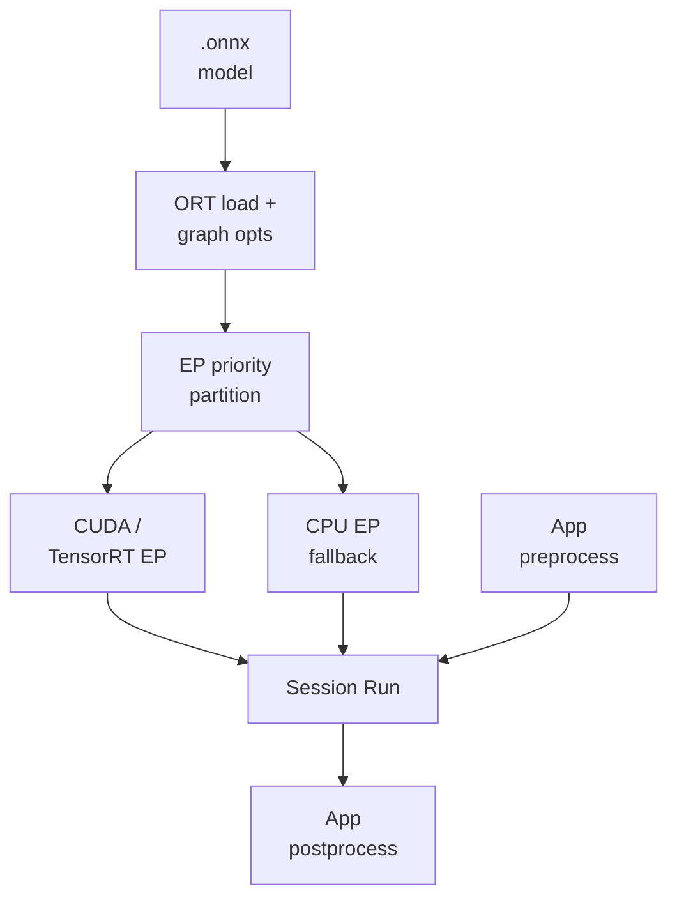

**ONNX Runtime (ORT)** is Microsoft's open, cross-platform engine that loads an [ONNX](glossary://onnx) model graph and executes it for inference (and, in separate paths, training). The `.onnx` file is the portable description of ops and weights. ONNX Runtime is what actually allocates tensors, runs kernels, applies graph optimizations, and routes work to hardware through **execution providers (EPs)** such as CPU, CUDA, TensorRT, OpenVINO, DirectML, or CoreML.

Exporting a model to ONNX starts the runtime validation. A session must support the graph's operators and opset, receive inputs with the same names, ranks, dtypes, and preprocessing the training path used, and place work on the intended EP. Silent CPU fallback, missing external weight files, and preprocessing drift are common "the model regressed" incidents that never change weights.

## Intuition

Think of three layers:

| Layer | Owns |
|-------|------|
| Training framework ([PyTorch](glossary://pytorch), etc.) | Differentiable modules, training loop, research flexibility |
| ONNX file | Typed computation graph + initializers (weights); the handoff schema |
| ONNX Runtime | Session, optimizations, kernels, EP partitioning, multi-language bindings |

ORT is deliberately **heterogeneous**. One model may split across providers: a CUDA EP takes the large MatMuls it can run, and the default CPU EP runs supported leftover ops. Official design docs describe partitioning by querying each EP's `GetCapability()` for nodes or subgraphs, then fusing assigned partitions when the provider supports compilation. CPU fallback cannot rescue an operator, dtype or opset unsupported by every registered provider; session creation can fail.

A production deployment follows a **runtime interfaces**:

- Opset and operator coverage for every node
- Input/output names, ranks, dtypes, and dynamic axis ranges
- Chosen EP list and the provider that actually executed
- Preprocessing and postprocessing that still live outside the graph
- Numerical parity test cases against the training framework before any FP16/INT8 pass

## Diagram



## How it works

### Session lifecycle

1. Create an environment and `SessionOptions` (threads, graph optimization level, memory patterns, optimized model path).
2. Register execution providers in **priority order**. Example: `['CUDAExecutionProvider', 'CPUExecutionProvider']` means CUDA if capable, else CPU.
3. Construct `InferenceSession` from the `.onnx` path (and external data files if weights are external). At load time ORT:
   - Parses and validates the graph
   - Runs enabled graph optimizations
   - Partitions nodes across registered EPs
   - Compiles EP-assigned subgraphs
4. Call `Run` (or IO-binding variants) with named NumPy / OrtValue inputs. Concurrent calls depend on provider and feature restrictions: for example, CUDA Graphs disallow concurrent `Run` calls on the same session. Do not infer universal thread safety from the session API alone.

Warm sessions amortize load and optimization cost. Cold-starting a large graph on every request pays partition and compile cost again; production services keep a long-lived session (or a small pool) per model version.

### Graph optimizations

ORT applies graph-level rewrites before and after partitioning. Levels (official docs; all enabled by default with `ORT_ENABLE_ALL`):

| Level | Role |
|-------|------|
| **Basic** | Semantics-preserving: constant folding, redundant node elimination, simple fusions (for example Conv+Add as bias). Runs before partitioning; applies to all EPs. |
| **Extended** | Heavier fusions (GELU, LayerNorm, attention-related patterns, MatMul+Add, and so on). After partitioning; only nodes assigned to CPU, CUDA, or ROCm. |
| **Layout** | Data-layout transforms (for example NCHWc) after partitioning; applied to CPU EP nodes for higher throughput on compatible hardware (for example AVX2). |

**Online mode** optimizes at every session creation. **Offline mode** writes an optimized `.onnx` via `optimized_model_filepath` so later sessions can load the rewritten graph with optimizations disabled, cutting startup. Offline artifacts are tied to the EP set and often to CPU layout features (for example AVX2); do not ship a GPU-preoptimized graph to a CPU-only host and expect the same plan.

### Execution providers

EPs abstract hardware libraries. Common production choices:

| EP | Typical use |
|----|-------------|
| `CPUExecutionProvider` | Default fallback; edge and CI parity |
| `CUDAExecutionProvider` | NVIDIA GPU kernels via CUDA / cuDNN |
| `TensorrtExecutionProvider` | [TensorRT](glossary://tensorrt) engine for more aggressive fusion and tuning |
| OpenVINO, DirectML, CoreML, QNN, XNNPACK, … | Intel, Windows GPU, Apple, mobile NPUs, and so on |

Packages matter: the CPU and GPU wheels provide different execution providers. `onnxruntime-gpu` must match the CUDA / cuDNN versions the EP docs require. Listing CUDA in `providers` does not force GPU use if the build cannot load the EP or the EP declines nodes; check `session.get_providers()` after creation and profile which device actually ran.

### Responsibilities outside ORT

Tokenizers, image decode/resize/normalize, label maps, decision thresholds, chat templates, and product post-processing almost always stay in application code. ORT runs the graph you give it. [Training-serving skew](glossary://training-serving-skew) still appears when that outer pipeline drifts from training.

For generative LLMs, **ONNX Runtime GenAI** (separate library) adds the generate loop: tokenization, ORT inference, logits processing, sampling, and KV-cache handling. Large multi-tenant LLM serving still often uses specialized engines ([vLLM](glossary://vllm), TensorRT-LLM, llama.cpp). ORT remains a workhorse for classifiers, embedding and reranker models, vision towers, speech components, classical ML ONNX graphs, and multi-language edge or server deployment without shipping a full training stack.

## Example

Export is covered under [ONNX](glossary://onnx). Here is the **runtime** side: pin providers, check CUDA was registered, and run a shape smoke check. Inspect profiling to confirm GPU node placement and compare reference logits to verify numerical parity.

```python
import numpy as np
import onnxruntime as ort

MODEL = "tiny_clf.onnx"
# Priority list: first EP that can take a node wins that node
WANT = ["CUDAExecutionProvider", "CPUExecutionProvider"]

so = ort.SessionOptions()
so.graph_optimization_level = ort.GraphOptimizationLevel.ORT_ENABLE_ALL
# Optional: so.optimized_model_filepath = "tiny_clf.opt.onnx"  # offline warm start

sess = ort.InferenceSession(MODEL, sess_options=so, providers=WANT)
active = sess.get_providers()
print("active providers:", active)
if "CUDAExecutionProvider" not in active:
    raise RuntimeError(f"GPU required but session got {active}")

# Metadata is part of The schema
inp = sess.get_inputs()[0]
out = sess.get_outputs()[0]
print(inp.name, inp.shape, inp.type)  # e.g. features, ['batch', 16], tensor(float)

x = np.random.randn(8, 16).astype(np.float32)
logits = sess.run([out.name], {inp.name: x})[0]
assert logits.shape == (8, 3)

# Parity test case: same x, same preprocess, compare to training-framework logits
# np.testing.assert_allclose(logits, ref_logits, rtol=1e-5, atol=1e-5)
```

For vision models, extend the test case: fixed PNG bytes, the exact resize/crop/mean/std used at train time, batches 1 and $N$, and at least one hard case (near-threshold class scores). After enabling FP16 or [quantization](glossary://quantization), re-run the suite with product tolerances (labels may flip even when MSE looks small).

## Debug path

When "ORT is wrong" or "ORT is slow":

1. **Load vs run.** Session create fails: missing external data, bad opset, unsupported custom op, EP library not found. `Run` fails: wrong input name, rank, dtype, or dynamic shape outside the exported axes.
2. **Provider truth.** Log `get_available_providers()` and `session.get_providers()`. A silent CPU plan looks like a model performance regression.
3. **Names and shapes.** Dump `get_inputs()` / `get_outputs()`. `input` vs `features`, NCHW vs NHWC, and batch-1 after export-at-batch-2 are classic breaks.
4. **Parity stages.** Framework FP32 → ORT FP32 → ORT + EP optimizations → FP16/INT8. Diff each stage with a frozen test case to localize regressions, then validate the full pipeline.
5. **Threads and concurrency.** Tune `intra_op_num_threads` / `inter_op_num_threads` against CPU oversubscription when many sessions or processes share a box.
6. **Outer pipeline.** Re-check preprocess constants, label order, and thresholds against training. Graph math can be correct while the product path is skewed.

## Trade-offs

**Strengths.** One inference API across languages (Python, C/C++, C#, Java, JS/Web, and others); EP plug-ins for many devices; strong fit for portable classifiers, embeddings, and edge without the training framework; graph opts and EP fusion can improve fixed-graph inference; session reuse suits request servers and [Triton](glossary://triton-inference-server) ORT backends, subject to provider concurrency restrictions.

**Limits.** Opset and custom-op gaps force partial graphs onto CPU or hard failures; EP priority plus fallback can hide hardware misconfiguration; aggressive opts and low precision need re-validation; offline optimized models are environment-specific; large autoregressive LLM serving is usually better on engines built for continuous batching and paged KV than on a bare ORT graph alone.

## Why it matters here

LeetLLM's systems material treats deploy as a schema: graph + runtime + preprocess + hardware path. ONNX Runtime is the concrete engine that turns an ONNX export into timed, hardware-backed inference. Understanding sessions, execution providers, graph optimization, and parity test cases is how you ship portable models without inventing "framework-specific serving" for every classifier, and how you debug latency and correctness when the notebook and the edge box disagree.

## Related terms

- [ONNX](glossary://onnx)
- [TensorRT](glossary://tensorrt)
- [Quantization](glossary://quantization)
- [Training-serving skew](glossary://training-serving-skew)
- [PyTorch](glossary://pytorch)
