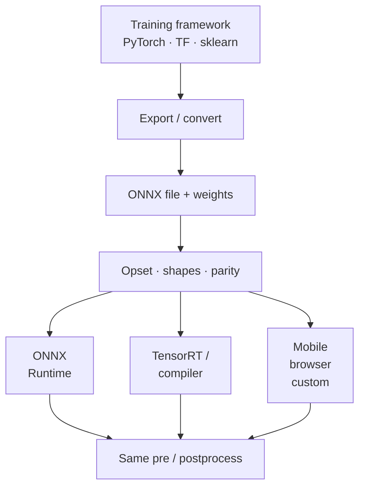

ONNX (Open Neural Network Exchange) is an open, runtime-agnostic format for representing machine-learning models as typed computation graphs. It defines (1) an intermediate representation (IR) for models and graphs, (2) standard tensor and related data types, and (3) versioned operator sets whose nodes implement inference math. A model is usually serialized as a Protocol Buffers file (`.onnx`), optionally with external weight files for large checkpoints.

ONNX defines a portable graph schema. Frameworks such as [PyTorch](glossary://pytorch) export into it; engines such as [ONNX Runtime](glossary://onnx-runtime), [TensorRT](glossary://tensorrt), browser/WASM runtimes, and mobile/edge backends load and run it. Export success verifies that the graph is valid ONNX. Validate operator, shape, dtype, and performance support in each target runtime.

## Intuition

Training frameworks optimize for research and differentiability. Production runtimes optimize for latency, memory, and hardware kernels. ONNX sits between them as a common language for the **inference function**: a directed acyclic graph of operators over tensors, plus constants (weights) and metadata.

A tiny linear map $y = xA + b$ is already an ONNX graph: a `MatMul` (or `Gemm`) node and an `Add` node, with $A$ and $b$ as **initializers** (constants) and $x$ as a graph input. The same idea scales to CNN classifiers, embedding models, and many classical ML graphs via the `ai.onnx.ml` domain (trees, one-hot encoders, and so on).

Tokenizers, image resize/normalize pipelines, label maps, decision thresholds, chat templates, and product post-processing remain separate artifacts. Bundle and version them alongside the graph to prevent training-serving skew.

## Diagram



## How it works

### Model and graph

Per the ONNX IR, the top-level object is a **Model** (`ModelProto`). It binds metadata to a **Graph** that is evaluated at inference time:

| Field | Role |
|-------|------|
| `ir_version` | Which ONNX IR the file assumes |
| `opset_import` | Domains and opset versions the graph may use (default domain is `""`, often labeled `ai.onnx`) |
| `graph` | Nodes, inputs, outputs, initializers |
| `producer_name` / `producer_version` | Tool that wrote the file |
| `model_version`, `doc_string`, `metadata_props` | Optional lineage |

The graph is a topologically ordered list of **nodes**. Each node is a call to an operator (`op_type` + `domain`) with named tensor inputs/outputs and optional **attributes** (static constants such as `axis` or `alpha`). Graphs use single static assignment: each node output name is unique. Values flow when a later node names an earlier output (or a graph input / initializer).

**Initializers** hold weights and other constants. An initializer that shares a name with a graph input can act as a default value a caller may override; pure constants should appear only as initializers.

### Operators and opsets

Operators live in versioned **operator sets**. The default domain is the empty string `""` (docs and tools often label it `ai.onnx`): neural ops such as `Conv`, `MatMul`, `Softmax`, `LayerNormalization`, and control flow like `If` / `Loop` / `Scan`. Classical ML ops often use `ai.onnx.ml`.

A model's declared opset version selects which **semantics** each op follows. Operator `Add` was revised across several opset versions; a graph imported at opset $v$ uses the latest definition of each op with `since_version` $\le v$. Runtimes reject or partial-support models whose opset or custom ops they do not implement. Pin and document opset on every export.

Custom domains and **functions** (composite ops expanded to a body of standard ops) extend the format. A runtime may implement a function as a fused kernel or expand it.

### Types and shapes

ONNX is strongly typed: element types include float32, float16, bfloat16, common ints, bool, string, and newer low-precision floats/ints used in quantized graphs. Implicit casts are not allowed; insert explicit `Cast` when needed.

A tensor type carries element type plus a **static shape**. Dimensions may be fixed integers or **dimension variables** (string params such as `"batch"` or `"seq"`). Top-level model inputs and outputs must declare rank (a shape list of known length), even when some lengths are symbolic. That is the format-level story behind export-time **dynamic axes**: you mark which dimensions vary so the graph is not frozen to the dummy batch and sequence length used at export.

### Serialization and large models

Protobuf encodes the model for disk and network transfer. A single protobuf message has a practical size limit of about **2 GB**. Larger models store tensor payloads as **external data**: the `.onnx` file keeps the graph and tensor metadata (location, offset, length); weights live beside it (often `model.onnx.data` or sharded files). Moving only the `.onnx` without its data files is a common deploy failure.

### Runtime perimeter

ONNX defines graph representation; each consumer chooses how to execute it by interpreting nodes, code-generating kernels, or lowering the graph into another engine (TensorRT, OpenVINO, Core ML, and so on). Shape inference in the ONNX package can fill intermediate types/shapes to help optimizers. Production speed depends on the runtime and hardware path.

## Example

Export a small classifier from PyTorch, pin the opset, allow a dynamic batch axis, validate the file, and check numerical parity before any optimization step.

```python
import numpy as np
import torch
import torch.nn as nn

class TinyClf(nn.Module):
    def __init__(self, d_in=16, n_class=3):
        super().__init__()
        self.net = nn.Sequential(
            nn.Linear(d_in, 32),
            nn.ReLU(),
            nn.Linear(32, n_class),
        )

    def forward(self, x):
        return self.net(x)  # logits

model = TinyClf().eval()
dummy = torch.randn(2, 16)  # example batch only; batch will be dynamic
batch = torch.export.Dim("batch", min=1)

torch.onnx.export(
    model,
    (dummy,),
    "tiny_clf.onnx",
    input_names=["features"],
    output_names=["logits"],
    dynamo=True,
    dynamic_shapes={"x": {0: batch}},
    opset_version=17,  # pin; match what your runtime supports
)

# Structural check (path form also works with external data)
import onnx
onnx.checker.check_model("tiny_clf.onnx")
m = onnx.load("tiny_clf.onnx")
print("IR", m.ir_version, "opsets", [(o.domain, o.version) for o in m.opset_import])

# Numerical parity: same test case, both paths
x = np.random.randn(5, 16).astype(np.float32)
with torch.no_grad():
    ref = model(torch.from_numpy(x)).numpy()

import onnxruntime as ort
sess = ort.InferenceSession("tiny_clf.onnx", providers=["CPUExecutionProvider"])
got = sess.run(["logits"], {"features": x})[0]

# Agree absolute/relative tolerances with the product (logits vs labels)
np.testing.assert_allclose(got, ref, rtol=1e-5, atol=1e-5)
```

A real export schema also records: input/output names and dtypes, dynamic dimension names and legal ranges, opset, producer tool versions, unsupported or custom ops, external data layout, and a multi-example test case (batch sizes 1 and $N$, edge shapes, and at least one hard case). Most ONNX incidents are **graph-schema** failures, not a sudden change in model intelligence.

For LLM-sized weights, expect external data and a different packaging path than local GGUF workflows. Many large generative stacks skip classic ONNX serving in favor of specialized engines ([vLLM](glossary://vllm), [TensorRT-LLM](glossary://tensorrt-llm), [llama.cpp](glossary://llama-cpp)). ONNX remains common for embedding models, rerankers, classifiers, vision towers, speech components, and classical ML that must run on heterogeneous hardware.

## Trade-offs

**Strengths.** One portable graph for many runtimes; clear operator semantics; inspectable with tools such as Netron; natural input to optimizers (fusion, constant folding, quantization passes); strong fit for edge and multi-language deployment where you do not want the full training framework in the box.

**Limits.** Not every training op has a faithful ONNX mapping; control-flow-heavy or highly dynamic PyTorch can export poorly or with oversized graphs; opset and execution-provider gaps cause silent CPU fallback or hard load errors; low precision and [quantization](glossary://quantization) can move scores enough to flip decisions; the file rarely owns the full feature pipeline, so [training-serving skew](glossary://training-serving-skew) remains your problem.

## Debug path

When ONNX "works in the notebook" but fails in production:

1. **Load vs run.** Does `onnx.checker` / the runtime fail at session creation (opset, missing custom op, external data path) or only at `run` (shape, dtype, name)?
2. **Names and ranks.** Log session input metadata. Mismatched names (`input` vs `features`) and wrong rank are the usual first errors.
3. **Dynamic axes.** Export with batch 2, serve batch 1 (or long sequences) and confirm symbolic dims were actually exported.
4. **Parity suite.** Compare framework vs ONNX on a fixed test case before TensorRT/FP16/INT8. After each optimization stage, re-check with the same suite and product thresholds.
5. **Provider truth.** Confirm which execution provider ran. A silent fallback to CPU looks like a model regression when it is a packaging or GPU build issue.
6. **Pre/post outside the graph.** Re-verify tokenizer, image decode, normalization constants, label order, and threshold code against the training path.

## Why it matters here

Model portability depends on a tested schema across the graph, opset, shapes, external weights, and preprocessing. ONNX lets production stacks move a trained network from a research framework into a lean inference process, then into TensorRT or edge runtimes, without rewriting the math by hand. Understanding the IR and its preprocessing perimeter lets you debug export, parity, and latency work with the same vocabulary the runtimes use.

## Related terms

- [ONNX Runtime](glossary://onnx-runtime)
- [TensorRT](glossary://tensorrt)
- [Model checkpoint](glossary://model-checkpoint)
- [Training-serving skew](glossary://training-serving-skew)
- [Tokenizer artifact](glossary://tokenizer-artifact)
