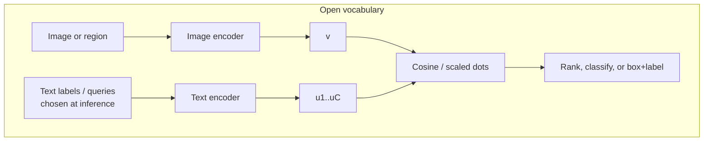

Open-vocabulary systems score or retrieve concepts described at inference time instead of choosing from a fixed class list baked into a trained head. In modern vision and multimodal products, that usually means comparing an image (or region) embedding with free-form text embeddings so a user can query "rusted blue toolbox under a workbench" without ever training a `rusted_blue_toolbox` class.

The phrase also appears in NLP: *open-vocabulary translation* represents rare or unseen words as subword pieces (Sennrich, Haddow, and Birch, BPE for NMT, 2016). Coverage still depends on the tokenizer's base characters or byte fallback; a tokenizer can emit `[UNK]` for Unicode strings outside that coverage. In LeetLLM and most VLM work, "open-vocabulary" describes a *label menu* that can change at inference time; tokenizer coverage is a separate issue.

## Intuition

A closed classifier is a fixed catalog: $C$ named classes, one softmax head of size $C$, and a new class means a new head (or at least new labels and usually more training). An open-vocabulary system is closer to a search bar over a shared meaning space. You write what you want; the model ranks inputs by how well they match that description.

A common practical engine is the pattern CLIP made standard (Radford et al., 2021): train image and text towers so matched pairs land near each other, then treat class names or prompts as *dynamic weights* in embedding space. To change the vocabulary, embed the new strings and score them against image vectors; this avoids changing a fixed $C$-way classifier head. Alternatives use fused image-text representations or generative grounding.

Recognition quality is bounded by the concepts represented in pre-training and fine-tuning. Rare jargon, fine species, negation, counting, and domain shift still fail unless you evaluate and often specialize.

## How it works

1. **Encode the input.** An image, crop, or region proposal becomes a vector $v$ (and optionally many region vectors for detection).
2. **Encode the vocabulary as text.** Class names, short phrases, or longer queries become vectors $u_1,\ldots,u_C$ with a text encoder. $C$ can change every request.
3. **Score by similarity.** Usually cosine similarity (equivalently dot product of L2-normalized vectors), often scaled by a learned temperature or logit scale.
4. **Decide.** $\arg\max$ for classification; top-$k$ for retrieval; per-region $\arg\max$ plus box regression for open-vocabulary detection (OWL-ViT and successors).
5. **Operate offline where possible.** Gallery images can be embedded once and indexed. New text queries only run the text tower (dual-encoder / bi-encoder pattern).

**Classification (CLIP-style zero-shot).** Class list becomes prompts such as `"a photo of a {name}"`. Text embeddings act as the rows of a linear classifier over image features. No fixed $W \in \mathbb{R}^{C \times d}$ trained for those names.

**Detection (open-vocabulary object detection).** Zareian et al. (OVR-CNN, CVPR 2021) formalized detecting categories without box labels for every class, using base-box supervision plus broader language (captions). OWL-ViT (Minderer et al., 2022) transfers image-text models to detection: class-agnostic localization plus region-text similarity for labels supplied at inference.

**Tokenization sense (secondary).** Subword units make *string* vocabulary open while the model still has a fixed token table. That is a different problem (rare words as pieces) and is covered under BPE; do not confuse it with open label sets.

## Formula

Take L2-normalized image embedding $v$ and text embeddings $u_c$ for candidate labels $c = 1,\ldots,C$. CLIP multiplies cosine scores by a learned scale $1/\tau$ (in code, `logit_scale` is usually stored as $\log(1/\tau)$ and applied after `exp`; after `exp`, the effective scale $1/\tau$ often sits near $100$):

$$
s_c = \frac{v^\top u_c}{\tau}, \qquad
p(c \mid v) = \frac{\exp(s_c)}{\sum_{c'=1}^{C}\exp(s_{c'})}
$$

Predicted label: $\hat{c} = \arg\max_c s_c$ (or $\arg\max_c p(c\mid v)$). Treat this softmax as a relative score over the supplied candidates. Object-presence probabilities need a separate model or a calibrator validated for the same candidate-set construction. Adding or removing candidates changes the normalized values. The candidate set $\{u_c\}$ is supplied at inference; expanding the menu does not grow a trained class matrix.

For retrieval over a gallery $\{v_i\}$, rank by $v_i^\top u_{\text{query}}$ (or multi-vector / late-interaction variants). Detection replaces global $v$ with per-region features and adds localization losses during fine-tuning; the open-vocabulary *classification* step remains region-text similarity.

## Diagram

## Example

**Data-center photo, no custom class head.** You need to search inspection photos for new failure descriptions. Yesterday's closed model knew `{rack, cable, server}`. Today an operator asks for "coolant leak below a GPU rack" and "loose fiber connector."

Embed the photo once. Embed three prompts:

| Prompt | Cosine to image | Role |
|---|---:|---|
| a photo of coolant leaking below a GPU rack | $0.31$ | intended match |
| a photo of a fiber cable | $0.12$ | wrong object |
| a photo of an empty rack aisle | $0.08$ | background |

With effective scale $1/\tau = 100$ (illustrative; near a trained CLIP logit scale after `exp`), the scaled scores are $31$, $12$, and $8$. Softmax mass concentrates on the coolant-leak prompt. No `coolant_leak` training class was required. Swap the prompt list tomorrow for "bent connector pin" without redeploying a new head; re-embed text only.

**What fails in production.** The same pipeline may rank "no coolant visible" poorly under negation, confuse a reflective floor patch with liquid under harsh lighting, or fire high similarity on a training-distribution lookalike. Prompt templates, score calibration, and human review matter. Use open-vocabulary scoring to generate candidates; safety decisions need audited class definitions and stable thresholds.

**Detection sketch.** OWL-ViT-style systems propose boxes, embed each region, and match regions to text queries such as `"coolant leak"` and `"fiber connector"`. New object names ride the text tower; you still validate localization and false positives on your cameras.

## Neighboring ideas

| Term | What it optimizes for |
|---|---|
| **Closed-set / closed vocabulary** | Restricted to fixed training classes; labels are selected before deployment |
| **Open-vocabulary** | Accept arbitrary (or very large) text-defined labels at inference via language alignment |
| **Zero-shot** | Generalize to classes with no labeled examples for that task; open-vocabulary systems often enable zero-shot *transfer* when text covers the new class |
| **Open-set** | Detect or reject unknowns; open-vocabulary systems can name new text queries |
| **Open-world** | Discover and learn new classes over time after deployment |

Open-vocabulary is about a flexible *name space* (usually natural language). Open-set is about *rejection*. Zero-shot is about *no task labels*. Products often combine them, but the engineering contracts differ.

## Trade-offs

| Strength | Limit |
|---|---|
| New labels without a new classifier head | Quality is bounded by pre-training coverage and domain shift |
| Natural-language and long-tail queries for search and tagging | Weak on counting, fine spatial layout, hard negation, and tiny OCR unless the model is built for them |
| Dual encoders: index images offline, query with text online | Similarity ranks candidates; calibrate probabilities and verify legal claims separately |
| Fast product iteration: change prompts and eval slices | Prompt sensitivity; template wording can flip rankings |
| Strong fit for exploration, catalog search, auto-tag suggestions | Weak fit alone for billing, medical, legal, or safety gates that need stable audited class definitions |

## Why it matters here

Open-vocabulary behavior is why CLIP-style dual encoders, image embeddings, and vision-language models feel flexible in search and zero-shot classification while still needing slice-level evaluation. Curriculum topics on contrastive learning, InfoNCE, multimodal RAG, and production VLMs all assume this contract: text defines the menu at runtime, and embedding geometry performs the matching. Use open-vocabulary components for retrieval and candidate generation, then attach thresholds, review, or specialist heads where decisions must be stable and auditable.

## Related terms

- [CLIP](glossary://clip)
- [Embedding](glossary://embedding)
- [Vision-language model](glossary://vision-language-model)
- [Image embedding](glossary://image-embedding)
- [Cosine similarity](glossary://cosine-similarity)
