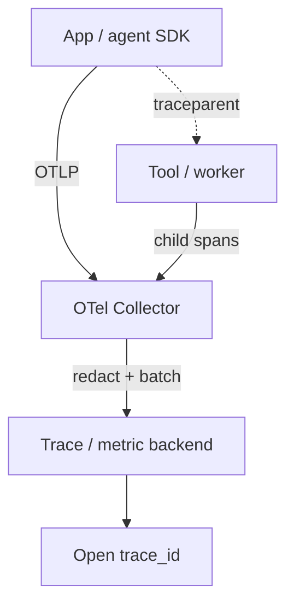

**OpenTelemetry** (OTel) is a vendor-neutral CNCF observability framework for **instrumenting**, **generating**, **collecting**, and **exporting** telemetry: mainly [traces](glossary://tracing), metrics, and logs. It is an API and data-model standard plus language SDKs and a Collector. It is **not** a storage backend or UI. Applications emit OTLP (OpenTelemetry Protocol); the Collector can process and forward to Jaeger, [Prometheus](glossary://prometheus), vendor APM, or other backends without rewriting instrumentation.

For AI/ML systems, OTel is how you turn a multi-hop path (gateway, retrieval, model, tools, gates) into a shared language of spans, attributes, and metrics so latency, cost, and failure can be attributed without vendor lock-in.

## Intuition

Think of OpenTelemetry as a **wiring standard**, not a dashboard. Your code (or auto-instrumentation) creates spans and meters; the SDK batches and exports; a Collector scrubber/router may sit in the middle; any compatible backend stores and renders. Swap Datadog for Grafana Tempo or keep both: the instrumentation stays.

A single user question that hits a RAG stack is one **trace** (one `trace_id`). Each hop is a **span** with start/end timestamps and attributes. Metrics (for example request duration histograms, token usage) answer fleet questions. Logs carry high-detail events correlated by the same context. Without that shared context, you only have disconnected numbers.

## How it works

### 1. Signals

| Signal | What it records | Typical AI use |
|---|---|---|
| **Traces / spans** | Nested timeline of one request | Gateway → retrieve → chat → tool → gate |
| **Metrics** | Aggregated measurements over time | p95 TTFT, tokens/s, error rate, queue depth |
| **Logs** | Timestamped events (structured preferred) | Policy deny reason, provider error body class |

Profiles (CPU/memory sampling) are a fourth, still-maturing signal. Most LLM product debugging still centers on traces + metrics + structured logs. **Baggage** is not a signal: it is key-value context (for example tenant tier or experiment flag) propagated with the request, never secrets.

### 2. Pipeline components

1. **API**: stable surface your app or library calls (`start_span`, meters).
2. **SDK**: sampling, resource attributes (`service.name`, deploy version), batching, export.
3. **OTLP**: wire protocol (commonly gRPC `:4317` or HTTP `:4318`).
4. **Collector**: optional but production-standard receive → process (filter, redact, batch) → export.
5. **Backend**: store and query; OTel deliberately leaves this out of the core project.

Resource attributes identify *who* produced telemetry (service, environment, region). Span attributes identify *what happened* on that operation.

### 3. Context propagation

Distributed tracing only works if context crosses process and async boundaries. OpenTelemetry's default propagator follows **W3C Trace Context**. Callers inject headers such as:

```text
traceparent: 00-<trace-id>-<parent-span-id>-<flags>
```

Example value shape:

```text
00-a0892f3577b34da6a3ce929d0e0e4736-f03067aa0ba902b7-01
```

Receivers extract that context so the child span keeps the same `trace_id` and points at the correct parent. HTTP libraries often do this automatically. **Queues, worker pools, streaming callbacks, and agent tool loops need suitable instrumentation or explicit propagation.** Verify that message headers or job carriers preserve context and that async work attaches it; otherwise delayed tool calls can become orphan root spans. Batch consumers may use span links to represent multiple producer contexts instead of one parent.

Span **kind** guides backends: `SERVER` for inbound API, `CLIENT` for outbound model/provider calls, `INTERNAL` for in-process stages, `PRODUCER`/`CONSUMER` for async jobs.

### 4. GenAI semantic conventions

OpenTelemetry maintains **GenAI semantic conventions** in its separate GenAI conventions repository (attributes and metrics under the `gen_ai.*` namespace, currently Development status). Pin the version your instrumentation library emits. Core ideas for inference spans:

| Attribute / metric | Role |
|---|---|
| `gen_ai.operation.name` | Operation type (`chat`, `text_completion`, `embeddings`, …) |
| `gen_ai.provider.name` | Provider discriminator (`openai`, `anthropic`, custom internal name) |
| `gen_ai.request.model` | Requested model id when known |
| `gen_ai.usage.input_tokens` / `gen_ai.usage.output_tokens` | Token accounting (include cached input when the provider reports it) |
| `gen_ai.client.operation.duration` | Client-side operation duration histogram (seconds) |
| `gen_ai.client.inference.usage.input_tokens` / `.output_tokens` | Monotonic token-usage counters, broken down by `gen_ai.token.modality` |
| `gen_ai.client.inference.operation.input_tokens` / `.output_tokens` | Per-operation token histograms for percentiles, not total cost accounting |

Conventions distinguish **client** first-chunk timing (`gen_ai.client.operation.time_to_first_chunk`) from **server** first-token timing (`gen_ai.server.time_to_first_token`). Document which clock your product calls [TTFT](glossary://ttft): user-visible first token on the wire is not always the same as model-server prefill complete.

Prompt text, full messages, and system instructions are **opt-in** in the convention because they are sensitive. Default production posture: identifiers and shapes only; raw content behind short retention, sampling, and access control.

### 5. Span design for AI request paths

Name spans by **operation**, not free prose. Prefer nested structure that matches ownership:

```text
http.server  (SERVER)
├── auth.internal
├── retrieve.hybrid
├── rerank
├── chat {model}          (CLIENT, gen_ai.operation.name=chat)
├── tool.web_search       (CLIENT)
└── policy.serve_gate
```

Attach **bounded** attributes: model, provider, route, retriever name, document count, cache hit/miss, token counts, retry count, error class, gate decision, prompt template id, index version. Avoid raw user text, full retrieved passages, and high-cardinality metric labels (user id, full prompt hash on Prometheus series). Put bulky detail in sampled spans or short-lived events, not on every time series.

## Diagram



## Example

Support chat request arrives at an LLM gateway. One root span covers the HTTP handler; children cover retrieval, chat, and a tool call. Partial span view for `trace_id=5b8aa5a2…`:

| Span | Kind | Duration | Attributes (subset) |
|---|---|---:|---|
| `POST /v1/chat` | SERVER | $1.64\,\mathrm{s}$ | `http.route=/v1/chat`, `tenant=acme` |
| `retrieve.hybrid` | INTERNAL | $180\,\mathrm{ms}$ | `retriever=hybrid_v2`, `docs=8` |
| `chat gpt-4o-mini` | CLIENT | $1.20\,\mathrm{s}$ | `gen_ai.operation.name=chat`, `gen_ai.provider.name=openai`, `gen_ai.request.model=gpt-4o-mini`, input $1{,}240$ / output $180$ tokens |
| first-chunk event | (on chat span) | at $T_0+0.42\,\mathrm{s}$ | client time-to-first-chunk $\approx 420\,\mathrm{ms}$ |
| `tool.web_search` | CLIENT | $210\,\mathrm{ms}$ | `tool.name=web_search`, `status=ok` |
| `policy.serve_gate` | INTERNAL | $8\,\mathrm{ms}$ | `decision=serve` |

In this hypothetical trace, the model call occupies most of the request duration; client first-chunk timing helps separate startup wait from streamed generation. It does not by itself identify model-server prefill time. Aggregating the same `gen_ai.*` fields over a 15-minute window lets you chart p95 client duration and token burn by model without inventing a private schema.

Minimal Python-style instrumentation sketch (SDK wiring omitted):

```python
from opentelemetry import trace

tracer = trace.get_tracer("llm.gateway")

def handle_chat(req):
    with tracer.start_as_current_span(
        "POST /v1/chat", kind=trace.SpanKind.SERVER,
    ) as root:
        root.set_attribute("http.route", "/v1/chat")
        with tracer.start_as_current_span(
            f"chat {req.model}",
            kind=trace.SpanKind.CLIENT,
        ) as span:
            span.set_attribute("gen_ai.operation.name", "chat")
            span.set_attribute("gen_ai.provider.name", req.provider)
            span.set_attribute("gen_ai.request.model", req.model)
            result = call_provider(req)
            span.set_attribute("gen_ai.usage.input_tokens", result.input_tokens)
            span.set_attribute("gen_ai.usage.output_tokens", result.output_tokens)
            return result
```

If `call_provider` runs in a thread pool or streams tokens via a callback, wrap that work so the active context is attached; otherwise the chat span ends empty and child events never nest.

## Debug path

When production is slow, expensive, or wrong:

1. **Start from an exemplar** request id / `trace_id` (from logs, client headers, or a metric exemplar), not from a lone average.
2. **Walk spans in path order.** Stop at the first hop that is slow, empty, errored, or policy-wrong.
3. **Check GenAI attributes** on the model span: model, provider, token counts, status. Confirm which timer is TTFT vs total duration.
4. **Look for broken context.** Orphan roots after a queue hop mean missing propagation; fix the carrier before tuning the model.
5. **Inspect Collector processors.** Over-aggressive sampling, dropped attributes, or redaction bugs can make a healthy app look blind.
6. **Separate product outcome from transport status.** HTTP 200 can conceal a failed answer or empty retrieval. Record outcome attributes and use error status for unexpected failures; an intended policy block is successful enforcement, not automatically a span error or SLO failure.

What fails often in production:

- Context lost across async workers and streaming handlers
- 100% trace export under load blowing cost; no head/tail sampling policy
- High-cardinality labels on metrics (`user_id`, free-text error)
- Full prompts stored indefinitely without privacy review
- Mixing custom attribute names so every team invents `model_name` vs `gen_ai.request.model`

## Trade-offs

| Choice | Gain | Cost |
|---|---|---|
| Auto-instrumentation only | Fast HTTP/DB coverage | Misses retrieval, tools, agent loops |
| Manual GenAI spans | Product-level timelines | Code ownership and version discipline |
| Collector in path | Central redaction, routing, multi-export | Another component to run and scale |
| Full content capture | Fast content debugging | Privacy, storage, legal risk |
| Aggressive sampling | Lower cost | Harder rare-bug reconstruction |

Bias toward **standard `gen_ai.*` fields**, **complete context across async edges**, and **Collector-side governance** of sensitive data.

## Why it matters here

LeetLLM systems are multi-hop by design: routing, retrieval, providers, tools, and safety gates. OpenTelemetry is the portable way to instrument that path once, export OTLP, and still debug [TTFT](glossary://ttft), token cost, and failed stages when the backend or vendor changes. Without it, each layer invents private logs and you cannot assemble one request's story.

## Related terms

- [Tracing](glossary://tracing)
- [Observability](glossary://observability)
- [Request path](glossary://request-path)
- [SLO](glossary://slo)
- [Prometheus](glossary://prometheus)
