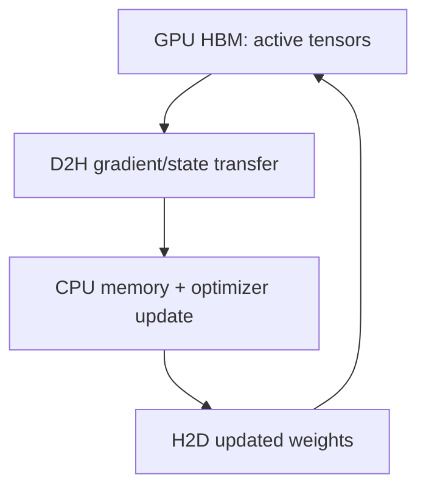

**Optimizer offload** moves some or all optimizer state and update work out of GPU HBM, commonly into CPU memory. It trades scarce accelerator memory for transfer bandwidth, host capacity, and synchronization complexity.

Offload isn't free memory. Before an update, required gradients, parameters, or moment shards must reach the processor performing optimizer math. Updated weights then return to the GPU path. Fast coherent CPU-GPU links make this trade less painful, but transfers can still dominate a step when overlap fails.

## D2H and H2D phases

Profiles often label transfers **D2H** (device to host) and **H2D** (host to device). Double buffering can move one bucket while GPUs compute another, but dependency boundaries eventually expose any unfinished transfer. Host memory bandwidth and CPU optimizer throughput also matter.

## Diagram

## Example

In a system with a configurable partial-offload fraction, 0.8 asks it to keep most eligible optimizer state outside HBM. The denominator and transfer policy depend on that implementation. Reducing it to 0.5 uses more GPU memory but may shorten exposed host work and transfers if enough headroom exists.

## Why it matters here

A GB200 training configuration might offload 80 percent of eligible optimizer state. That illustrative choice can help fit full-parameter training, but it needs a measured sweep: CPU update throughput, coherent-link traffic and overlap determine whether the extra memory capacity is worth the step-time cost.

## Related terms

- [Optimizer state](glossary://optimizer-state)
- [Distributed optimizer](glossary://distributed-optimizer)
- [HBM](glossary://hbm)
- [GB200](glossary://gb200)
- [Mixed precision](glossary://mixed-precision)
