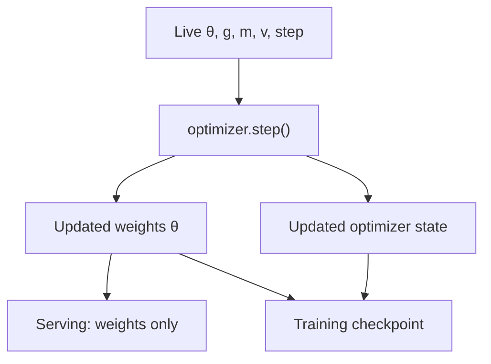

**Optimizer state** is the per-parameter memory an [optimizer](glossary://optimizer) keeps *beyond* the current weights and gradients so it can compute the next update. For adaptive methods such as Adam / [AdamW](glossary://adamw), that state is mainly the first and second moment buffers $m$ and $v$ (and, in mixed precision, often an FP32 master copy of the weights). Without those tensors the update rule is incomplete: the algorithm can still step, but not with the same adaptive history.

Optimizer state is part of what the ZeRO paper calls **model states** (optimizer state + gradients + parameters). It is usually the largest slice of that footprint, which is why sharding, offloading, and 8-bit moments all target it first.

## Intuition

A plain SGD step needs only the gradient. Momentum and Adam remember the past. Adam's $m$ is a smoothed gradient direction; $v$ is a smoothed squared-gradient scale that sets a per-coordinate effective learning rate. Those buffers have the same shape as the trainable parameters, so their size grows linearly with model size and stays live for the whole run.

In production this shows up three ways:

1. **VRAM.** A 7B model's training budget includes weights, gradients, optimizer state, activations, and temporary buffers.
2. **Checkpoints.** Resume dumps often dwarf the weight-only export because moments ride along.
3. **Distributed training.** [ZeRO](glossary://zero) stage 1 and [FSDP](glossary://fsdp) exist largely so every GPU does not keep a full replica of those moments.

## What is stored

For Adam / AdamW, after the first `step()`, each parameter tensor $p$ typically has:

| State | PyTorch key (Adam) | Meaning | Usual dtype |
| --- | --- | --- | --- |
| First moment | `exp_avg` | $m_t$ EMA of gradients | FP32 |
| Second moment | `exp_avg_sq` | $v_t$ EMA of squared gradients | FP32 |
| Step counter | `step` | $t$ for bias correction | scalar |
| Master weights | (AMP / fused optimizers) | FP32 copy used for the update when compute weights are FP16/BF16 | FP32 |

These FP32 sizes assume FP32 optimizer buffers. Plain PyTorch Adam initializes moments with `zeros_like(p)`, so directly using BF16 parameters ordinarily gives BF16 moments; FP32 moments require the appropriate training or optimizer implementation. SGD with momentum stores one velocity buffer per parameter (~4 bytes/param in FP32). Adam stores two moment tensors (~8 bytes/param in FP32). In classic [mixed-precision](glossary://mixed-precision) Adam, Rajbhandari et al. (ZeRO) count the FP32 master weights *with* the moments as the optimizer block: $4 + 4 + 4 = 12$ bytes per parameter ($K=12$).

Bias-corrected Adam moments (Kingma & Ba):

$$
\begin{aligned}
m_t &= \beta_1 m_{t-1} + (1-\beta_1)\,g_t \\
v_t &= \beta_2 v_{t-1} + (1-\beta_2)\,g_t^2 \\
\hat{m}_t &= \frac{m_t}{1-\beta_1^t},\quad
\hat{v}_t = \frac{v_t}{1-\beta_2^t}
\end{aligned}
$$

The update uses $\hat{m}_t$ and $\hat{v}_t$. Resetting $m$, $v$, and $t$ is equivalent to a cold start of the adaptive statistics even if $\theta$ is unchanged.

## Memory sizing

**Replicated mixed-precision Adam** (one full replica per data-parallel rank), for $\Psi$ parameters:

| Tensor | Bytes / param | Notes |
| --- | --- | --- |
| Compute weights | 2 | FP16 / BF16 |
| Gradients | 2 | same width as compute (typical) |
| FP32 master weights | 4 | part of optimizer block in ZeRO's $K$ |
| First moment $m$ | 4 | FP32 |
| Second moment $v$ | 4 | FP32 |
| **Model-state total** | **$\approx 16$** | before activations / workspace |

This $16$ B/param table is the classic FP16 mixed-precision teaching model (compute + grad + FP32 masters + $m{+}v$). Many pure BF16 LLM stacks keep FP32 moments **without** a separate FP32 master copy, so model state is closer to $12$ B/param ($2+2+4+4$) before activations. Drop the masters line when that is your stack.

ZeRO's cumulative reductions when partitioning those states across $N_d$ data-parallel ranks:

| Stage | What is partitioned | Approx. model-state per rank |
| --- | --- | --- |
| Baseline DP | nothing (full replica) | $16\Psi$ |
| Stage 1 ($P_{os}$) | optimizer block ($12\Psi$) | $4\Psi + 12\Psi/N_d$ |
| Stage 2 ($P_{os+g}$) | + gradients | $2\Psi + 14\Psi/N_d$ |
| Stage 3 ($P_{os+g+p}$) | + parameters | $16\Psi/N_d$ (+ temporary gathers) |

Activations, CUDA workspace, and fragmentation sit on top of this. [Activation checkpointing](glossary://activation-checkpointing) attacks activation memory, not optimizer state.

## Worked numbers

Take $\Psi = 7\times 10^9$ (a ~7B model).

| Piece | Formula | Size |
| --- | --- | --- |
| BF16 weights | $7\times 10^9 \times 2$ | $\approx 14$ GB |
| BF16 grads | $7\times 10^9 \times 2$ | $\approx 14$ GB |
| FP32 masters | $7\times 10^9 \times 4$ | $\approx 28$ GB |
| Moments $m+v$ | $7\times 10^9 \times 8$ | $\approx 56$ GB |
| **Optimizer block alone** | masters + moments | **$\approx 84$ GB** |
| Full model state (replicated) | $16\Psi$ | **$\approx 112$ GB** |

So a 14 GB weight file can sit next to ~84 GB of optimizer-related tensors before you pay for activations. On 8 ranks with ZeRO-1 / FSDP-style optimizer sharding, that 84 GB block drops to about $84/8 \approx 10.5$ GB per GPU (plus communication and temporary buffers). That is the practical reason large LLM fine-tunes talk about world size and ZeRO stage before they talk about batch size.

## Example

Inspect and checkpoint AdamW state in plain PyTorch:

```python
import torch
from torch import nn

model = nn.Linear(4096, 4096)
opt = torch.optim.AdamW(model.parameters(), lr=2e-5, betas=(0.9, 0.999))

x = torch.randn(8, 4096)
loss = model(x).pow(2).mean()
loss.backward()
opt.step()

# Per-parameter state appears only after the first step
p = next(model.parameters())
st = opt.state[p]
print(st["exp_avg"].shape, st["exp_avg"].dtype)      # same shape as p, float32
print(st["exp_avg_sq"].shape, st["exp_avg_sq"].dtype)
print(st["step"])

# Resume-capable save: weights alone are not enough
torch.save(
    {
        "model": model.state_dict(),
        "optim": opt.state_dict(),  # includes exp_avg, exp_avg_sq, step
        "global_step": 1,
    },
    "ckpt.pt",
)

# Resume
ckpt = torch.load("ckpt.pt", map_location="cpu", weights_only=True)
model.load_state_dict(ckpt["model"])
opt.load_state_dict(ckpt["optim"])
```

Hugging Face `Trainer` writes the same idea as separate files (`optimizer.pt`, `scheduler.pt`, `scaler.pt`, `rng_state.pth`) next to the weight shards. For inference you keep weights + config + tokenizer; for preemption recovery you keep the full training bundle.

## Diagram



## Resume and production failure modes

| Situation | What breaks |
| --- | --- |
| Load weights only, rebuild optimizer empty | Moments and step counter reset; loss often jumps or learns more aggressively until $m,v$ warm up |
| Restore optimizer but not LR schedule / global step | Adaptive state matches step $t$, schedule does not; effective $\gamma$ is wrong |
| Restore model + optim but not GradScaler (FP16 AMP) | Scale factor restarts; can cause underflow/overflow spikes right after resume |
| Sharded dump loaded with a different world size without supported resharding | Rank-local shards may not line up; use a checkpoint loader that reconstructs the new partition, such as supported Distributed Checkpoint paths |
| Ship `optimizer.pt` to inference hosts | Huge, unused, and not needed for forward-only serving |
| Warm-start a *new* run from a pretrained base | Often intentional: load weights, **fresh** optimizer (and usually fresh schedule) |

Exact continuation needs model weights + optimizer state + schedule + step/RNG, data-loader or sampler position, and scaler if used; deterministic execution and any pending accumulation state matter too. Warm-starting from a base model for a new SFT job usually wants weights only and a clean optimizer.

## Reducing the footprint

| Technique | Effect on optimizer state |
| --- | --- |
| SGD (+ momentum) instead of Adam | One buffer or none instead of two full FP32 moments |
| ZeRO-1 / FSDP (shard optim) | $1/N_d$ of the optimizer block per rank |
| ZeRO-Offload / CPU offload | Moments (and often masters) live in host RAM; GPU HBM frees up; PCIe can bottleneck the step |
| 8-bit Adam (bitsandbytes; Dettmers et al.) | Quantize $m$ and $v$ with block-wise dynamic quantization; moments drop from ~8 to ~2 bytes/param (masters may still be FP32) |
| LoRA / adapters | Optimizer state only for trainable adapter tensors, not the full frozen base |

These are orthogonal: you can shard *and* offload *and* quantize moments, with different stability and throughput trade-offs.

## Why it matters here

LeetLLM training and systems lessons budget memory as a bill of materials. Optimizer state is usually the largest line item in that bill for AdamW LLM runs, the main reason ZeRO stage 1 exists, a dominant cost of resume checkpoints, and a frequent cause of "loss jumped after restart" when only `model_state_dict` was saved. Counting $m$, $v$, masters, and whether they are replicated or sharded is table stakes for sizing GPUs, writing checkpoints, and debugging interrupted fine-tunes.

## Related terms

- [Optimizer](glossary://optimizer)
- [AdamW](glossary://adamw)
- [ZeRO](glossary://zero)
- [FSDP](glossary://fsdp)
- [Model checkpoint](glossary://model-checkpoint)
