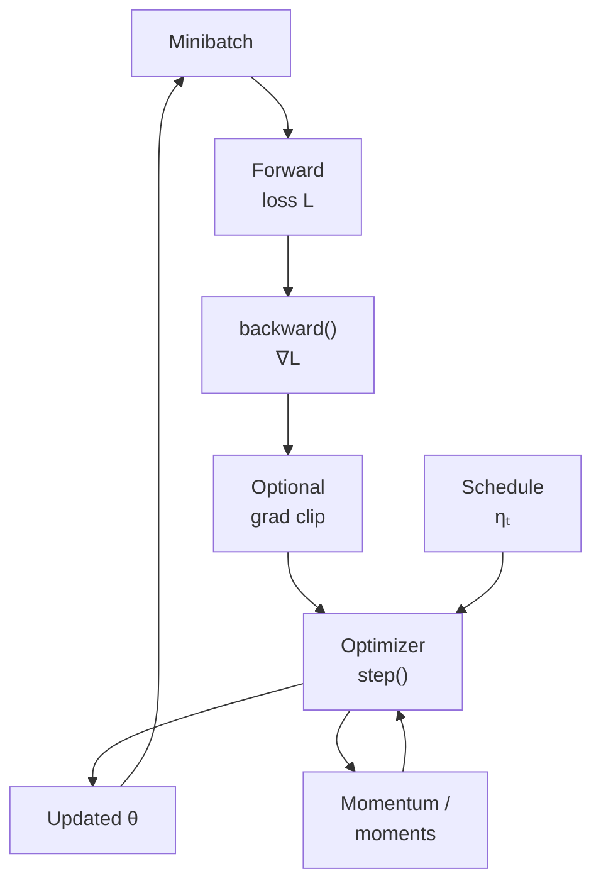

An **optimizer** is the training-time algorithm that turns parameter gradients into weight updates. After [backpropagation](glossary://backpropagation) fills $\nabla_\theta L$ for a minibatch loss $L$, the optimizer combines the current gradient, optional history (momentum or moments), and a [learning rate](glossary://learning-rate) into a descent step $\theta \leftarrow \theta - \eta\,\widehat{\Delta}$. Here $\widehat{\Delta}$ is the raw gradient, a momentum velocity, or an Adam-style adaptive direction. In frameworks such as PyTorch, that object is `torch.optim.*`: it holds hyperparameters, parameter groups, and mutable [optimizer state](glossary://optimizer-state), and exposes `zero_grad()` and `step()`.

The loss defines what "better" means. Gradients estimate local direction, schedulers change the step scale over time, and clipping bounds gradient magnitude before the step. The optimizer owns the update mechanics: momentum, adaptivity, weight decay path, and any internal buffers those rules need.

## Intuition

Backprop is a local compass: for each weight it answers "which way decreases loss right now?" The optimizer decides the actual footstep. Plain SGD trusts the latest minibatch gradient and a fixed scale $\eta$. Momentum smooths that signal so consecutive steps share direction (Polyak's heavy-ball idea). Adaptive methods such as Adam and [AdamW](glossary://adamw) divide a smoothed gradient by a running root-mean-square scale. Adaptive scaling uses running statistics, while each coordinate's update still depends on its current gradient, history, and step size.

That choice is operational, not decorative. The same model and data can train stably with AdamW + warmup and explode with a too-large constant SGD rate. Adaptive state also costs memory and must be checkpointed: resume with weights only and moments reset, and the run is a different dynamical system even if the architecture matches.

## Diagram



## Formula

**Gradient descent** (full batch) and **SGD** (stochastic / minibatch $g_t \approx \nabla_\theta L$) share the same first-order form:

$$
\theta_{t} \leftarrow \theta_{t-1} - \eta\, g_t
$$

with learning rate $\eta > 0$. For the exact gradient of a smooth loss, a nonzero gradient and sufficiently small $\eta$ give a descent step. A stochastic minibatch gradient can increase the full-data loss on an individual step.

**SGD with momentum** (PyTorch-style velocity; Polyak heavy ball) keeps a velocity buffer $v$:

$$
\begin{aligned}
v_t &\leftarrow \mu\, v_{t-1} + g_t \\
\theta_t &\leftarrow \theta_{t-1} - \eta\, v_t
\end{aligned}
$$

with momentum coefficient $\mu \in [0,1)$ (a common chosen value is $0.9$; PyTorch SGD defaults to $0$). This formula assumes zero dampening, no Nesterov correction, and no weight decay. The velocity is a leaky sum of past gradients, so the step continues through brief noise in $g_t$.

**Adam** (Kingma and Ba, 2014) tracks first and second moment estimates $m_t$ and $v_t$, bias-corrects them, and rescales each coordinate:

$$
\begin{aligned}
m_t &\leftarrow \beta_1 m_{t-1} + (1-\beta_1)\, g_t \\
v_t &\leftarrow \beta_2 v_{t-1} + (1-\beta_2)\, g_t^2 \\
\hat{m}_t &\leftarrow \frac{m_t}{1-\beta_1^t},\quad
\hat{v}_t \leftarrow \frac{v_t}{1-\beta_2^t} \\
\theta_t &\leftarrow \theta_{t-1} - \eta\,\frac{\hat{m}_t}{\sqrt{\hat{v}_t}+\epsilon}
\end{aligned}
$$

Typical defaults: $\beta_1=0.9$, $\beta_2=0.999$, $\epsilon=10^{-8}$. **AdamW** (Loshchilov and Hutter, 2017) keeps the same adaptive ratio but applies weight decay as a separate shrink of $\theta$, not as L2 folded into $g_t$. That is the production default for most LLM pretraining and fine-tuning; see the AdamW entry for the decoupled formulas and parameter groups.

A [learning rate schedule](glossary://learning-rate-schedule) replaces the constant $\eta$ with $\eta_t$ (warmup then cosine is common). The optimizer still produces the direction; $\eta_t$ only scales it.

## How it works

In a standard PyTorch training step the optimizer sits in a fixed place:

1. **`optimizer.zero_grad()`** (or `set_to_none=True`) clears old `.grad` tensors. Autograd *accumulates* into `.grad` by default, so skipping this merges past batches into the next step.
2. **Forward** computes predictions and a scalar loss $L$.
3. **`loss.backward()`** fills parameter gradients via reverse-mode autodiff.
4. **Optional guards:** unscale AMP grads if needed, then [gradient clipping](glossary://gradient-clipping) (global L2 norm is the LLM default).
5. **`optimizer.step()`** reads `.grad`, updates internal state, writes new $\theta$.
6. **Scheduler** (often after the step) updates $\eta_t$ for the next iteration.

Parameter groups let one optimizer hold several `{params, lr, weight_decay, ...}` dicts. Common pattern: decay matrix weights, leave biases and LayerNorm / RMSNorm scales at zero decay, and sometimes use a higher LR for randomly initialized heads or LoRA adapters.

## Worked numbers

Scalar weight $\theta=1.0$, gradient $g=0.5$, learning rate $\eta=0.1$.

**Plain SGD:**

$$
\theta \leftarrow 1.0 - 0.1\cdot 0.5 = 0.95
$$

**SGD with momentum**, previous velocity $v=0.2$, $\mu=0.9$:

$$
v \leftarrow 0.9\cdot 0.2 + 0.5 = 0.68,\qquad
\theta \leftarrow 1.0 - 0.1\cdot 0.68 = 0.932
$$

Momentum carried past motion into a larger step than raw SGD.

**Adam** on the first step with $m_0=v_0=0$, $\beta_1=0.9$, $\beta_2=0.999$, $\epsilon=10^{-8}$:

$$
m_1=0.05,\quad v_1=0.00025,\quad
\hat{m}_1=\frac{0.05}{0.1}=0.5,\quad
\hat{v}_1=\frac{0.00025}{0.001}=0.25
$$

$$
\theta \leftarrow 1.0 - 0.1\cdot\frac{0.5}{\sqrt{0.25}+10^{-8}} \approx 1.0 - 0.1 = 0.9
$$

Bias correction makes the first adaptive step use the full scale of $g$, not the shrunk raw moments. After many steps, $\sqrt{\hat{v}}$ tracks gradient magnitude and coordinate-wise step sizes diverge from plain SGD.

## Example

Supervised fine-tune loop fragment: AdamW, two parameter groups, global grad clip, and a cosine schedule after warmup (schedule construction omitted for brevity).

```python
import torch
from torch import nn

model = nn.Sequential(nn.Linear(768, 768), nn.ReLU(), nn.Linear(768, 10))
decay, no_decay = [], []
for name, p in model.named_parameters():
    if not p.requires_grad:
        continue
    if p.ndim <= 1 or name.endswith(".bias"):
        no_decay.append(p)
    else:
        decay.append(p)

optimizer = torch.optim.AdamW(
    [
        {"params": decay, "weight_decay": 0.01},
        {"params": no_decay, "weight_decay": 0.0},
    ],
    lr=2e-5,
    betas=(0.9, 0.999),
)

for batch_x, batch_y in train_loader:
    optimizer.zero_grad(set_to_none=True)
    logits = model(batch_x)
    loss = torch.nn.functional.cross_entropy(logits, batch_y)
    loss.backward()
    torch.nn.utils.clip_grad_norm_(model.parameters(), max_norm=1.0)
    optimizer.step()
    # scheduler.step()  # after step; uses current η_t
```

On a multi-GPU run the same object still exists per rank (or is sharded under ZeRO / FSDP). What changes is *where* moments live and how gradients are reduced before `step()`, not the conceptual role of the optimizer.

## Trade-offs

| Choice | Payoff | Cost / risk |
| --- | --- | --- |
| SGD + momentum | Light state (one velocity); often strong final generalization in classic vision | Needs careful LR tuning; can lag adaptive methods early |
| Adam / AdamW | Robust default for transformers and LLMs; per-parameter scale | ~8 bytes of moment state per param (fp32 $m,v$) on top of weights/grads |
| Large base $\eta$ | Fast early loss drop | Loss spikes, wiped pretrained features, unstable AMP |
| Checkpoint weights only | Smaller files | Cold moments and wrong schedule after resume; loss jump |
| Blind weight decay on all tensors | Simple config | Norms/biases over-shrunk; adapters can be erased |

Production failures cluster around three places: (1) missing `zero_grad` or wrong accumulation length so effective batch size drifts, (2) restore without optimizer / scaler / scheduler state so "resume" is a silent restart, and (3) LR and decay that ignore stage (pretrain vs full FT vs LoRA). Inspect gradient norms, update norms $\|\Delta\theta\|$, current $\eta_t$, and peak memory from optimizer buffers when a run misbehaves.

## Why it matters here

Every training path in this curriculum (from-scratch nets, LLM pretraining, SFT, LoRA, preference methods) ends in an optimizer step. Reading a recipe means knowing what the chosen rule stores, how $\eta_t$ and decay interact with that rule, and what must be checkpointed for a true resume. Optimizer choice also drives training memory and distributed sharding strategy: Adam-family state is a primary reason ZeRO stage-1/2 and FSDP exist. When loss curves look wrong after a "simple" infra change, the optimizer and its state are first-class suspects alongside data and learning rate.

## Related terms

- [Gradient](glossary://gradient)
- [Learning rate](glossary://learning-rate)
- [AdamW](glossary://adamw)
- [Optimizer state](glossary://optimizer-state)
- [Gradient clipping](glossary://gradient-clipping)
