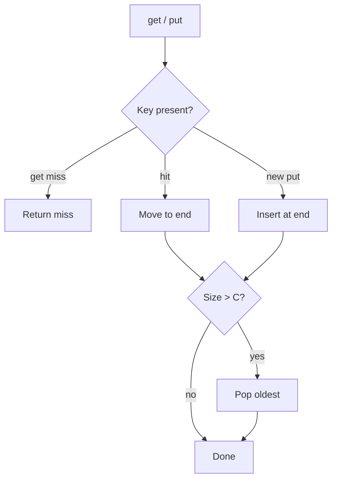

`collections.OrderedDict` is a `dict` subclass that treats **key order as a first-class operation**. Besides normal map semantics, it exposes `move_to_end` and a two-ended `popitem` so you can promote, demote, and evict keys without rebuilding the mapping. Since Python 3.7, plain `dict` also preserves insertion order; use `OrderedDict` when **reordering and order-sensitive equality** matter.

## Intuition

A plain `dict` is optimized for "look up `k`, set `k`, delete `k`." Order is remembered as a side effect of insertion. An `OrderedDict` is optimized for "make `k` the hottest key" and "drop the coldest key." That is the same doubly-linked recency list you would hand-code for an [LRU cache](glossary://lru-cache), packaged as a stdlib type.

Picture keys on a shelf from left (oldest / least recent) to right (newest / most recent):

```text
[ LRU / first  ........  MRU / last ]
   ^ popitem(last=False)   ^ move_to_end(key) lands here
```

| Need | OrderedDict call |
|------|------------------|
| Mark key most recent | `move_to_end(key)` (`last=True`, default) |
| Mark key least recent | `move_to_end(key, last=False)` |
| Evict most recent (LIFO) | `popitem(last=True)` |
| Evict least recent (FIFO / LRU) | `popitem(last=False)` |

Use a plain `dict` for ordinary maps and stable field order. Use `OrderedDict` when the policy is recency, last-write-wins order, or any code where "next victim" must be $O(1)$ from the ends.

## How it works

**Construction** matches `dict`: empty, from a mapping, from key-value pairs, or from kwargs (kwargs order is retained; see PEP 468 for keyword-arg order in general).

**Core order API** (from the [stdlib docs](https://docs.python.org/3/library/collections.html#ordereddict-objects)):

- `move_to_end(key, last=True)`: reposition an existing key to the right end (MRU) or, if `last=False`, to the left end (LRU). Missing key raises `KeyError`.
- `popitem(last=True)`: remove and return a `(key, value)` pair. `last=True` is LIFO (right end); `last=False` is FIFO (left end). Empty mapping raises `KeyError`.
- `reversed(od)` and reversed views of keys/items/values are supported.

**Equality.** Two `OrderedDict` instances compare equal only if they have the **same items in the same order** (roughly `list(od1.items()) == list(od2.items())`). Equality against a plain `dict` or other `Mapping` is **order-insensitive**, so an `OrderedDict` can still substitute for a regular mapping in APIs that only care about key/value content.

**vs plain `dict` (what still differs after 3.7):**

| Capability | `OrderedDict` | Plain `dict` |
|------------|---------------|--------------|
| Insertion order iteration | Yes | Yes (guaranteed since 3.7) |
| `move_to_end(k)` | Native, designed for reordering | Emulate end-only: `d[k] = d.pop(k)` |
| `move_to_end(k, last=False)` | Native | No efficient equivalent |
| `popitem(last=False)` | FIFO pop from left | Emulate: `(k := next(iter(d)), d.pop(k))` |
| Equality with same type | Order-sensitive | Order-insensitive |
| Design focus | Reordering | Mapping speed / density |

The docs state that `OrderedDict` handles **frequent reordering** better than `dict`; mapping throughput and space are secondary. That is why LRU recipes keep living on `OrderedDict` even though iteration order alone no longer requires it.

**Not a free lunch.** `OrderedDict` is still an in-process structure: no TTL, no cross-process sharing, and no lock around compound sequences like "lookup then `move_to_end` then maybe `popitem`." Concurrent writers need an external lock (or a process-local `functools.lru_cache` / a shared store such as Redis). Values and keys must still be whatever your program can store; only order ops are special.

## Diagram



Left end = next eviction victim under pure LRU. Right end = most recently used or inserted key after a successful refresh.

## Example

Minimal LRU with capacity $C$: every successful access or write moves the key to the right; overflow pops from the left.

```python title="ordered-dict-lru.py"
from collections import OrderedDict

class LRUCache:
    def __init__(self, capacity: int) -> None:
        if capacity < 1:
            raise ValueError("capacity must be >= 1")
        self.capacity = capacity
        self.items: OrderedDict[str, str] = OrderedDict()

    def get(self, key: str) -> str | None:
        if key not in self.items:
            return None
        self.items.move_to_end(key)  # promote to MRU
        return self.items[key]

    def put(self, key: str, value: str) -> None:
        if key in self.items:
            self.items.move_to_end(key)
        self.items[key] = value
        if len(self.items) > self.capacity:
            self.items.popitem(last=False)  # evict LRU
```

Trace with $C = 2$:

```python
c = LRUCache(2)
c.put("A", "1")           # order: A
c.put("B", "2")           # order: A, B
assert c.get("A") == "1"  # order: B, A  (A promoted)
c.put("C", "3")           # order: A, C  (B evicted)
assert c.get("B") is None
assert list(c.items.keys()) == ["A", "C"]
```

**Last-updated order.** The docs also show a one-line policy: every write moves the key to the end so iteration reflects last mutation time, not first insert:

```python
class LastUpdatedOrderedDict(OrderedDict):
    def __setitem__(self, key, value):
        super().__setitem__(key, value)
        self.move_to_end(key)
```

That pattern is useful for "recently touched config keys," small in-process tool-result maps, or teaching last-write-wins ordering without a separate timestamp field.

**When to prefer `functools.lru_cache`.** For pure functions with hashable args, `@functools.lru_cache(maxsize=...)` is usually better than a hand-rolled class: it keeps cache bookkeeping thread-safe, supplies `cache_info()` / `cache_clear()`, and needs no manual capacity math. Concurrent misses can still execute the wrapped function more than once. Cached return values need not be hashable. Reach for a custom `OrderedDict` LRU when inputs need an explicit derived key (tenant, model version, prompt hash), when entries are inserted independently of function calls, or when teaching the eviction policy.

## Worked numbers

Capacity $C = 3$, reference string $A, B, C, A, D$:

| $t$ | Op | Order after (LRU → MRU) | Hit? |
|-----|-----|-------------------------|------|
| 1 | put A | A | miss |
| 2 | put B | A B | miss |
| 3 | put C | A B C | miss |
| 4 | get A | B C A | hit (A moves to end) |
| 5 | put D | C A D | miss (evict B via `popitem(last=False)`) |

Hit rate: $1/5 = 0.20$. After step 4 the next victim is $B$ (left end). Forgetting to call `move_to_end` on get would leave order as $A\,B\,C$ and wrongly evict $A$ on the insert of $D$, turning "LRU" into something closer to FIFO on hits.

Cost of the hot path with `OrderedDict`: hash lookup $O(1)$ average, `move_to_end` and end-`popitem` designed to stay cheap under reordering. Emulating `move_to_end(..., last=False)` on a plain `dict` is not efficient; that is a concrete reason the type still exists.

## Trade-offs

| Choose | When |
|--------|------|
| Plain `dict` | Stable iteration order is enough; no promote/evict policy |
| `OrderedDict` | LRU / FIFO ends, order-sensitive equality, frequent reordering |
| `@lru_cache` | Memoize pure callables with hashable args |
| `deque(maxlen=...)` | Ordered **sequence** of events, not a key-value map |
| Redis / shared cache | Multi-process, multi-host, or large working sets |

**Production failure modes:**

- **Silent non-LRU.** `get` that only reads without `move_to_end` never refreshes recency; hot keys still die under insert pressure.
- **Unbounded growth.** Forgetting the `len > capacity` check turns the structure into a plain map that never evicts.
- **Wrong key.** Recency cannot fix a key that omits tenant, model id, or prompt version; that is a correctness bug, not a capacity bug.
- **Stale-but-hot entries.** Size-only LRU never expires a frequently hit wrong answer; pair with TTL or versioned keys when results can rot.
- **Order-sensitive `==`.** Two `OrderedDict`s with the same pairs in different order are not equal; tests and caches that assume dict-like equality can flake.
- **Concurrency.** Interleaved `move_to_end` / `popitem` without a lock can corrupt the intended recency policy under threads.

## Why it matters here

LLM services lean hard on small process-local caches: embedding fingerprints, prompt-prefix digests, tool results, judge scores, adapter slots. The eviction rule is often "keep what was used recently." `OrderedDict` makes that rule three lines of code with a visible invariant: promote on use, drop from the left when over capacity. The same recency idea scales up to [semantic caches](glossary://semantic-cache), Redis `allkeys-lru`, and free-block policies in [prefix](glossary://prefix-cache) / [KV](glossary://kv-cache) engines, but the first correct implementation engineers write is usually this type.

## Related terms

- [LRU cache](glossary://lru-cache)
- [Cache hit rate](glossary://cache-hit-rate)
- [collections.deque](glossary://collections-deque)
- [heapq](glossary://heapq)
- [Semantic cache](glossary://semantic-cache)
