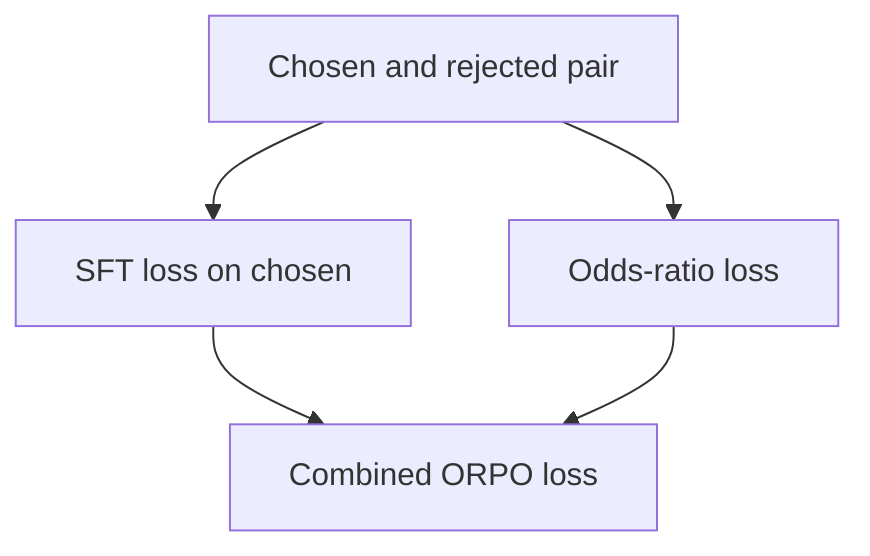

**Odds Ratio Preference Optimization (ORPO)** combines supervised imitation of preferred completion with preference objective that raises odds of chosen completion relative to rejected one. It doesn't require frozen reference model or separate alignment phase.

Conceptually:

$$
L_{ORPO}=L_{SFT}+\lambda L_{OR},
$$

where the odds-ratio term rewards the preferred sequence over the rejected sequence. For prompt $x$ and completion $y$, the original method uses a length-normalized likelihood score

$$
q_\theta(y\mid x)=\exp\left(\frac{1}{|y|}\sum_t\log p_\theta(y_t\mid x,y_{<t})\right),\qquad
o_\theta(y\mid x)=\frac{q_\theta(y\mid x)}{1-q_\theta(y\mid x)}.
$$

Then $L_{OR}=-\log\sigma(\log o_\theta(y_w\mid x)-\log o_\theta(y_l\mid x))$. The normalized score is a geometric mean of token probabilities, not a probability distribution over complete sequences. Pin completion masks and normalization: summing token log-probabilities instead changes the objective and its length effects.

## When it fits

- High-quality pairwise [preference data](glossary://preference-data) exists.
- One-stage training is operationally attractive.
- Avoiding reference-model memory matters.

## Failure modes

Large $\lambda$ can over-suppress rejected behavior, distort language modeling, or reduce capability. Pair quality and length effects still matter. No explicit reference anchor means SFT term and data quality carry more responsibility.

## Example

One batch contains prompt, preferred tool trajectory, and rejected malformed trajectory. ORPO teaches preferred completion and pairwise ordering in same update without loading frozen reference model.

## Why it matters here

ORPO is practical when memory and pipeline simplicity matter, but one-stage convenience doesn't remove evaluation, data-quality, or retention requirements.

## Related terms

- [Supervised fine-tuning](glossary://supervised-fine-tuning)
- [DPO](glossary://dpo)
- [Preference data](glossary://preference-data)
- [Loss function](glossary://loss-function)
