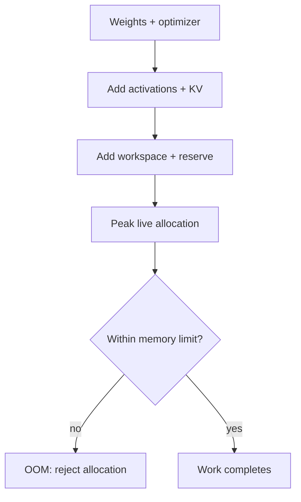

An **out-of-memory (OOM)** failure happens when a process, accelerator, or container requests more memory than its allocator can supply. The relevant ceiling might be GPU device memory, host RAM, a container limit, or a per-process quota. A checkpoint can fit on disk and load onto a GPU while a real training or inference request exceeds capacity because of activations, KV cache, temporary buffers, or concurrent requests. Test a representative request under the target configuration.

## Count every source of peak memory

Training can hold model weights, gradients, optimizer state, saved activations, communication buffers, and temporary workspaces at the same time. A caching allocator also reserves memory: reserved bytes already include its live allocations, so do not add the two counters. Unused cached blocks may be reclaimed, while other processes still consume device capacity. Serving adds a growing key-value cache and concurrent request state. Fragmentation can make one large allocation fail despite sufficient aggregate free bytes. Host or container exhaustion may instead kill a process under memory pressure, particularly with overcommit.

## Example

Suppose an accelerator has 24 GiB of usable device memory. A model consumes 15 GiB, optimizer state consumes 6 GiB, and existing buffers consume 1 GiB. Loading succeeds because the initial footprint is 22 GiB. A forward pass that needs another 3 GiB still fails because its 25 GiB peak exceeds the limit. Halving the microbatch may reduce saved activations enough to fit, while shortening the sequence can help when attention or cache growth drives the peak.

Inspect the failing allocation, device, process limit, and live-memory timeline before choosing a fix. Lower precision, activation checkpointing, gradient accumulation, sharding, or offload help different terms; none is a universal substitute for measuring peak demand.

## Why it matters here

Training, serving, quantization, batching, and long-context lessons all depend on a defensible memory budget. Correct diagnosis separates weight residency, transient activations, cache growth, and container limits before changing a system that already appears to fit.

## Related terms

- [VRAM](glossary://vram)
- [KV cache](glossary://kv-cache)
- [Activation checkpointing](glossary://activation-checkpointing)
- [Gradient accumulation](glossary://gradient-accumulation)
- [Model offload](glossary://model-offload)
