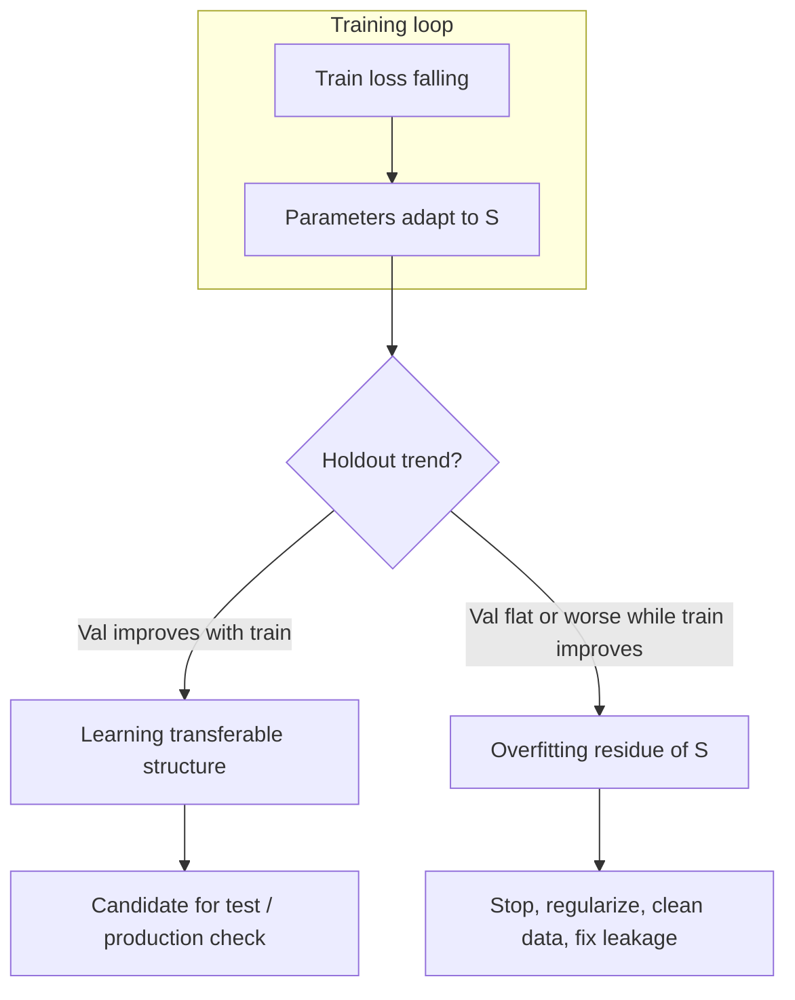

**Overfitting** is when a model fits the training sample so tightly that its error on new data from the same task is worse than the train fit suggests. The model has absorbed residual quirks of the train set (noise, shortcuts, annotation habits, duplicates, leakage) as if they were the true process. Training loss or accuracy looks strong; generalization does not.

Formally, you care about expected risk under the data-generating distribution $\mathcal{D}$, not empirical risk on a finite sample $S$. Overfitting is a large gap between those two (low $\hat{R}_S$, high $R$), not "high capacity" by itself. Underfitting is the opposite failure: the hypothesis class or optimization path never captures structure that *is* in the data, so both train and holdout stay bad.

## Intuition

A training set mixes two kinds of information: structure that will repeat, and residue that will not. Optimization only sees the finite sample $S$. Given enough capacity and enough steps, it can drive train loss toward zero by memorizing residue. The classic picture is a high-degree polynomial that snakes through every noisy point while a simpler curve tracks the real trend and misses some train points on purpose.

In LLM systems the same split shows up with different labels:

- **Classic supervised:** ticket classifiers, rankers, safety heads overfit sparse labels and template phrasing.
- **Fine-tunes / adapters:** LoRA or full SFT on a few hundred instruction rows can collapse train loss while instruction following, format flexibility, or nearby domains degrade.
- **Eval and corpus leakage:** the model (or retriever, or few-shot pack) has effectively seen the exam. That is [benchmark contamination](glossary://benchmark-contamination) and [feature leakage](glossary://feature-leakage); the *report* overfits even when the production distribution is fine.
- **Preference and reward models:** DPO/RLHF can overfit a reward model or a preference style so the policy chases judge artifacts, not user value.

Overfitting also appears in large models, often through eval formats, reward hacks, duplicated web text, prompt templates, and demo packs. The same pattern affects small tabular models. Modern overparameterized nets can also show *benign* interpolation and double descent (test error can fall again past the interpolation threshold), while a widening train-validation gap during fine-tuning remains an operational red flag for product ship decisions.

## Formula

Let $S = \{(x_i, y_i)\}_{i=1}^{n}$ be the training sample, $\ell$ a loss, and $f$ a predictor. Empirical risk and true risk are

$$
\hat{R}_S(f) = \frac{1}{n}\sum_{i=1}^{n} \ell\big(f(x_i), y_i\big),
\qquad
R(f) = \mathbb{E}_{(x,y)\sim\mathcal{D}}\big[\ell\big(f(x), y\big)\big].
$$

A practical overfitting gap on a held-out validation set $V$ is

$$
\Delta_{\text{gap}} = \hat{R}_V(f) - \hat{R}_S(f)
$$

(or the analogous accuracy/metric gap with signs flipped). Growing $\Delta_{\text{gap}}$ while $\hat{R}_S$ keeps falling is a classic warning. Compare the same loss and evaluation mode: dropout, augmentation, different label noise or distribution shift can create a gap without proving training-set memorization.

For squared error with $y = f(x) + \varepsilon$, assume $\mathbb{E}[\varepsilon\mid x]=0$, $\mathrm{Var}(\varepsilon\mid x)=\sigma^2$, and test noise independent of the training draw. The bias-variance decomposition at a fixed $x$ (expectation over training draws $D$ and test noise) is

$$
\mathbb{E}_{D,\varepsilon}\big[(y - \hat{f}(x;D))^2\big]
=
\big(\mathrm{Bias}_D[\hat{f}(x;D)]\big)^2
+ \mathrm{Var}_D[\hat{f}(x;D)]
+ \sigma^2,
$$

where

$$
\mathrm{Bias}_D[\hat{f}(x;D)]
= \mathbb{E}_D[\hat{f}(x;D)] - f(x),
\qquad
\mathrm{Var}_D[\hat{f}(x;D)]
= \mathbb{E}_D\big[\big(\hat{f}(x;D) - \mathbb{E}_D[\hat{f}(x;D)]\big)^2\big].
$$

High variance (sensitivity to which finite sample you drew) is the statistical face of classical overfitting; high bias is the face of underfitting. Regularization, early stopping, and more diverse data trade those terms against each other. Irreducible noise $\sigma^2$ cannot be removed by a better fit to $S$.

Explicit regularized training minimizes a penalized objective, for example

$$
\min_\theta\ \hat{R}_S(f_\theta) + \lambda\,\Omega(\theta),
$$

with $\Omega$ an $\ell_2$ or another explicit penalty on parameters. Decoupled AdamW weight decay is a separate update rule and is not generally equivalent to adding an $\ell_2$ term to Adam's loss. [Dropout](glossary://dropout) and early stopping provide other regularization mechanisms. Validate their strength against held-out risk; a smaller train-validation gap can coexist with worse validation risk.

## Diagram



## Example

In a hypothetical run, you fine-tune a 7B instruct model with LoRA on $n = 240$ internal support-rewrite pairs (tone + policy phrasing). Recipe: 8 epochs, learning rate $2 \times 10^{-4}$, batch size 8, no early stop. Metrics:

| Checkpoint | Train loss | Val loss (held-out tickets) | Format-OK rate (val) | Nearby-domain win rate |
| --- | --- | --- | --- | --- |
| Base (no adapter) | n/a | 1.42 | 0.91 | 0.50 (coin flip vs base) |
| Epoch 2 | 0.61 | 0.88 | 0.94 | 0.54 |
| Epoch 4 | 0.22 | 0.79 | 0.96 | 0.57 |
| Epoch 8 | 0.04 | 1.15 | 0.99 | 0.41 |

Train loss is near zero by epoch 8 and the model almost always emits the house template. Validation loss has already bottomed near epoch 4 and then risen. On a nearby-domain slice (sales chat, same brand voice but different intents) the adapter *loses* to the base model: it overfit support boilerplate and a few repeated policy lines that dominate the 240 rows.

A second failure mode hides in the eval design. If 30 of the 240 train pairs were copied (or lightly paraphrased) from the validation file, epoch 8 can look excellent on that contaminated val set while a fresh [golden dataset](glossary://golden-dataset) still shows the collapse. The training curve said "overfit"; the contaminated val set said "ship." Prefer a frozen gold set that never trains and never tunes hyperparameters.

Sketch of a minimal early-stop / gap check, placed inside the training loop (checkpoint saving and validation are omitted):

```python
# early-stop on val; gap is a diagnostic, not the stop criterion
gap = val_loss - train_loss
if val_loss < best_val - min_delta:
    best_val, best_step = val_loss, step
elif step - best_step > patience:
    restore_checkpoint(best_step)  # pick best val, not final train loss
    break
# rising gap while train_loss falls is a classic overfit signal
```

## How it works

1. **Capacity and steps.** Flexible models (deep nets, long fine-tunes, high-rank LoRA) can represent many functions consistent with $S$. Gradient descent walks toward low $\hat{R}_S$.
2. **Residue capture.** Label noise, template phrases, user ids, time stamps, duplicated rows, and [feature leakage](glossary://feature-leakage) become cheap ways to cut train loss.
3. **Distribution mismatch on holdout.** New tickets, new users, new phrasings, or post-cutoff docs do not carry those residues, so $\hat{R}_V$ and production metrics worsen.
4. **Selection overfitting.** Even without parameter updates on the test set, repeatedly choosing prompts, thresholds, or checkpoints using the same validation slice overfits the *selection procedure* to that slice. Treat validation as scarce; reserve a true test / gold set.

## Symptoms and controls

**Symptoms**

- Train loss keeps falling while validation loss, slice metrics, or online behavior stall or worsen.
- Near-perfect train accuracy with mediocre holdout accuracy.
- Brittle formatting: only the training template works; rephrases fail.
- Memorized eval answers or demos; public benchmark high, private rewrite low.
- Fine-tune that only helps examples near the train cluster; general instruction following drops.
- Reward-model gaming: policy maximizes a judge score users do not feel.

**Controls**

| Lever | What it does |
| --- | --- |
| Clean [train / val / test splits](glossary://train-validation-test-split) | Protects the final claim; split by user, account, time, or document when observations from those units share information |
| Dedup and decontamination | Removes near-duplicates and eval stems from train, indexes, and few-shot packs |
| Regularization | [Weight decay](glossary://weight-decay), [dropout](glossary://dropout), smaller LoRA rank, lower LR, fewer epochs |
| Early stopping / checkpoint select | Pick the step that minimizes val risk, not final train loss |
| More diverse data | New phrasings, hard negatives, real production tails beat endless epochs on the same 200 rows |
| Frozen golden set | Never trains, never tunes; used for ship/no-ship |
| Slice and shift tests | Check [data drift](glossary://data-drift) and rare expensive slices before trusting one aggregate |
| Leakage audit | Point-in-time features, no gold answers in RAG, no test prompts in demos |

Double descent and benign overfitting mean "train loss near zero" is not always fatal in large pretraining. For product fine-tunes on small proprietary sets, treat a rising val curve and failing gold slices as blocking until data or recipe changes.

## Why it matters here

Overfitting is why honest validation, contamination checks, golden datasets, and distribution-shift tests sit in front of every model, prompt, or retrieval ship decision. A notebook that beats the training file can still fail the next week of tickets, the next tenant, or the private rewrite of a public benchmark. Catching the gap offline is cheaper than learning it from production regressions.

## Related terms

- [Train, validation, and test split](glossary://train-validation-test-split)
- [Benchmark contamination](glossary://benchmark-contamination)
- [Golden dataset](glossary://golden-dataset)
- [Feature leakage](glossary://feature-leakage)
- [Weight decay](glossary://weight-decay)
