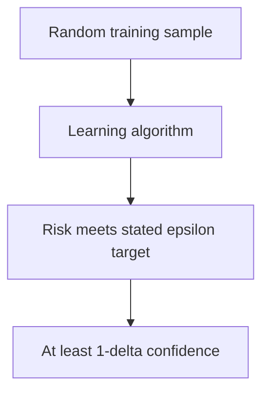

Probably approximately correct learning expresses a statistical goal with two separate tolerances. In the realizable setting, approximate correctness means population error at most $\varepsilon$; agnostic PAC learning instead bounds excess risk above the best predictor in the hypothesis class by $\varepsilon$. The procedure meets that target with probability at least $1-\delta$ over its random training sample and any learner randomness. The guarantee belongs to an explicit hypothesis class, data assumption, loss, and sample-size requirement, and standard PAC learnability requires it uniformly over the allowed data distributions.

## Keep error tolerance and failure probability distinct

An $(\varepsilon,\delta)$ statement with $\varepsilon=0.05$ and $\delta=0.01$ does not mean that a model is 95% accurate on every future batch. In the realizable setting, it means the procedure has at least 99% probability of returning a predictor whose true error is at most 5%, assuming the theorem's conditions hold. In the agnostic setting, the 5% tolerance instead applies above the best hypothesis-class risk. Realizable and agnostic settings have different sample-complexity expressions, so a bound must name which assumptions it uses.

## Example

A benchmark team wants a router with population failure below 0.05 and accepts a 0.01 chance that the training sample produces a worse learned rule. The values 0.05 and 0.01 answer different questions: allowed prediction error and tolerated failure of the learning guarantee. If evaluation examples are duplicates of one customer case or traffic later shifts to another population, the usual independent-sample interpretation no longer follows.

## Why it matters here

Research claims often confuse benchmark accuracy, confidence, sample size, and deployment guarantees. PAC terminology forces those quantities apart before drawing conclusions from finite evaluations or model searches.

## Related terms

- [Statistical learning theory](glossary://statistical-learning-theory)
- [Concentration inequality](glossary://concentration-inequality)
- [VC dimension](glossary://vc-dimension)
