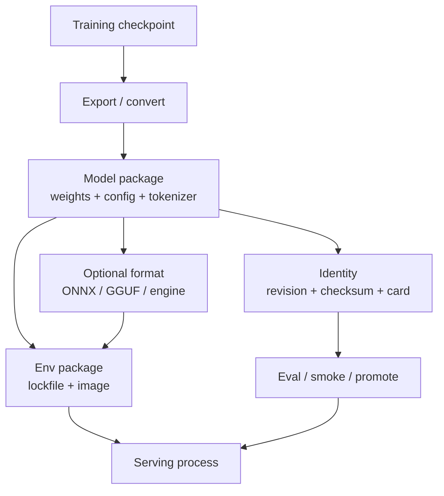

**Packaging** is the work of assembling everything a consumer needs to load, run, and identify a model (or a small ML service) as one portable unit. Weights alone are not a package. A usable package also carries architecture config, the [tokenizer artifact](glossary://tokenizer-artifact), chat or generation defaults when they matter, dependency pins, and enough identity metadata that another machine can reproduce the same inference path without the training notebook.

AI systems package artifacts and runtime at several connected layers:

| Layer | What you ship | Typical form |
| --- | --- | --- |
| **Model artifact** | Weights + config + tokenizer (+ chat template) | Hugging Face-style directory, SafeTensors shards |
| **Exchange / runtime format** | Graph or load unit for a target engine | [ONNX](glossary://onnx), [GGUF](glossary://gguf), TensorRT plan, quantized AWQ/GPTQ |
| **Lifecycle package** | Model + load API + declared deps | [MLflow](glossary://mlflow) Model (`MLmodel` + flavors + env files) |
| **Service package** | Process that serves the model | [Container image](glossary://container-image), lockfile, health and smoke hooks |

Packaging is the perimeter between "we trained something" and "another team can run it." Incomplete packages are a leading cause of [training-serving skew](glossary://training-serving-skew): the live path silently drops a preprocessor, swaps a tokenizer, or loads different library versions while the weight file still matches the dashboard.

## Intuition

Treat a release as a **load schema** that covers its files, dependencies, and runtime. The consumer must be able to answer:

1. Which tensors and architecture am I loading?
2. How do I turn raw input into model IDs or tensors?
3. Which software versions and native libraries am I allowed to use?
4. How do I prove I loaded the intended revision (digest, checksum, revision pin)?

If those answers live only in a teammate's shell history, the release is incomplete. A notebook, a Hub tag without a revision pin, or a copied `.safetensors` file cannot supply the full loading schema, even when the model math is correct.

## How it works

### 1. Model artifact package (Hub / `save_pretrained` shape)

A Transformers-style export is usually a directory, not one file:

```text
support-sft-v7/
├── config.json                 # architecture and hyperparams
├── model.safetensors           # or sharded *.safetensors + index
├── generation_config.json      # optional decoding defaults
├── tokenizer.json
├── tokenizer_config.json
├── special_tokens_map.json
├── chat_template.jinja         # or template field in tokenizer config
└── README.md                   # model card / system notes
```

Save both the model and tokenizer with their respective `save_pretrained` calls; the tokenizer is a separate artifact. Prefer SafeTensors (or another non-pickle weight format) for untrusted or shared distribution: tensor-only loads avoid pickle deserialization code execution. Custom model code and `trust_remote_code=True` still execute code and need separate review. Pin a Hub **revision** (commit) in production so deployments resolve a fixed artifact.

### 2. Exchange formats for a target runtime

When the serving stack is not the training stack, packaging often means **conversion**:

- **ONNX**: a typed computation graph (protobuf, sometimes with external weight files for large models) for ONNX Runtime, TensorRT, or edge backends. Profile the exported graph on your target GPU to confirm operator optimization.
- **GGUF**: a local-inference container used by `llama.cpp` and related tools: tensors, quant type, and load metadata in one (or sharded) file. GGUF is a packaging format; the quant type (`Q4_K_M`, …) is a separate quality choice inside it.
- **Engine-specific plans** (TensorRT, vendor NPU formats): often hardware-bound; re-package when GPU generation or driver ABI changes.

Each conversion is a new artifact identity. Record the parent checkpoint, converter version, quant/opset settings, and eval evidence for both the converted file and its FP16 source.

### 3. MLflow Model packaging

MLflow defines an **MLflow Model** as a directory with an `MLmodel` YAML that lists **flavors** (views of the same artifact). A typical layout includes:

```text
model/
├── MLmodel              # flavors, signature, run_id, mlflow_version
├── requirements.txt     # pip deps recorded at log time
├── conda.yaml
├── python_env.yaml
├── model.pkl / data/    # flavor-specific payload
└── input_example.json   # optional
```

The `python_function` (`pyfunc`) flavor is the universal interface: tools that only need `predict` can use it across sklearn, PyTorch, or custom wrappers. Flavors such as `pytorch`, `transformers`, or `onnx` preserve library-native load paths. Dependency files travel with the model so serving can rebuild the intended environment. This makes packaging a **lifecycle handoff** that includes the runtime environment as well as the weights.

### 4. Service and environment packaging

Production rarely runs "the directory on disk." It runs a process:

- **Language deps**: [dependency lockfile](glossary://dependency-lockfile) (`uv.lock`, `poetry.lock`, `pnpm-lock.yaml`, …)
- **OS and native stack**: [container image](glossary://container-image) with pinned base and CUDA/userland when GPUs matter
- **Weights placement**: baked into the image, mounted volume, or fetched at start with a recorded [checksum](glossary://checksum)
- **Operational hooks**: entrypoint, health check, metrics, smoke eval, [rollback](glossary://rollback) pointer

Docker (and OCI images generally) package the *runtime*. Model packaging packages the *learned artifact*. You usually need both.

## Diagram



## Example

You fine-tune a support bot from `Qwen/Qwen2.5-7B-Instruct` and need a local staging package that another engineer can load without your laptop state.

**Bad package:** only `adapter_model.safetensors` in Slack, base model name in a message, tokenizer assumed "whatever the base Hub repo has today."

**Adequate package:**

```text
support-bot-r17/
├── base_model: Qwen/Qwen2.5-7B-Instruct@a1b2c3d   # pinned revision
├── adapter/                                         # or merged full weights
│   ├── adapter_config.json
│   └── adapter_model.safetensors
├── tokenizer/                                       # copy that trained with the run
├── generation_config.json
├── chat_template.jinja
├── MANIFEST.json
└── eval/
    └── smoke_results.json
```

`MANIFEST.json` (illustrative historical dependency pins and abbreviated identity placeholders; use actual full revisions and hashes in a release):

```json
{
  "name": "support-bot",
  "version": "r17",
  "parent_checkpoint": "runs/support-sft/checkpoint-12000",
  "base_revision": "a1b2c3d",
  "weights_sha256": "9f3c…",
  "tokenizer_sha256": "71ab…",
  "merged": false,
  "quantization": null,
  "python": "3.12",
  "torch": "2.5.1",
  "transformers": "4.46.0",
  "eval_suite": "support-smoke-v4",
  "eval_task_f1": 0.81
}
```

Staging image then pins the lockfile and mounts or copies `support-bot-r17/` at a known path. Rollback is "previous package directory + previous image digest," not "retrain and hope."

For a **local GGUF** path after the same merge:

```bash
# Convert high-precision export, then quantize (tool names vary by llama.cpp revision)
python convert_hf_to_gguf.py ./support-bot-r17-merged \
  --outtype f16 --outfile support-bot-r17-f16.gguf
llama-quantize support-bot-r17-f16.gguf support-bot-r17-Q4_K_M.gguf Q4_K_M
```

The GGUF is a new package: record quant type, converter commit, and re-run the smoke suite on that file before calling it "r17 in production."

## What fails in production

| Failure | What it looks like | Fix in the package |
| --- | --- | --- |
| Weights without tokenizer / chat template | Garbled tools, wrong special tokens, "model got worse" after deploy | Ship tokenizer + template with weights; hash both |
| Floating Hub tag or image tag | Silent behavior change on re-pull | Pin revision / image digest |
| Quant or ONNX convert without re-eval | Server healthy, answers drift | Treat convert as a new version with smoke eval |
| Lockfile or CUDA mismatch | Import works, numerics or kernels differ | Pin deps and GPU base; log runtime versions on boot |
| LFS pointer in the image | Tiny "weight file," load crash | Resolve LFS before copy; assert size / magic bytes |
| Preprocess only in training code | Offline metrics good, online bad | Package shared feature / prompt code or document The schema |

A health endpoint that only checks "process up" does not validate packaging. Pair it with a fixed smoke prompt or test case row that asserts token IDs, output shape, and a few content checks.

## Trade-offs

**Single directory or file (Hub folder, GGUF).** Easy to copy and version; large models need sharding or external data; not enough alone for GPU driver and app code.

**Containerized service.** Best operational perimeter for CI and Cloud Run / Kubernetes; image size and cold start grow if weights are baked in; secrets and host drivers still stay outside.

**MLflow (or registry) package.** Strong lineage from run to version to alias; adds process and storage conventions; still needs a real serving image for many LLM stacks.

**Bake weights vs mount vs fetch.** Bake is simplest offline; mount/fetch keeps app images small and model updates independent, but requires explicit version pins so replicas do not drift.

Choose the thinnest package that makes the **load schema** explicit for your consumer: a research teammate, a local desktop runtime, or a multi-replica GPU service.

## Why it matters here

LeetLLM's deployment, quantization, and capstone lessons all end at packaging: Docker for local serving, GGUF as a local load unit, ONNX as an exchange graph, and "API packaging" as a typed service perimeter. Engineers who only ship weight files learn why production disagrees with the notebook. Engineers who package config, tokenizer, deps, identity, and a smoke path can version, compare, and roll back models like any other production artifact.

## Related terms

- [Model checkpoint](glossary://model-checkpoint)
- [Tokenizer artifact](glossary://tokenizer-artifact)
- [Container image](glossary://container-image)
- [GGUF](glossary://gguf)
- [Training-serving skew](glossary://training-serving-skew)
