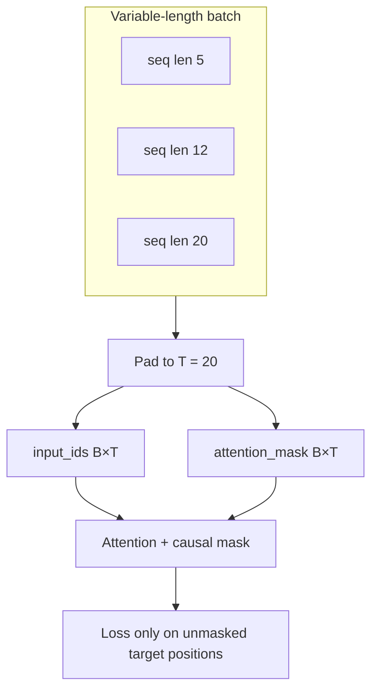

**Padding** inserts filler values so a tensor has the shape an operator or batch needs. In vision, that usually means extra border pixels around a feature map so a [convolution kernel](glossary://convolution-kernel) can cover edges and keep a predictable output size; those border values participate in convolution and encode a boundary assumption. In language models, pad token ids and matching mask bits let variable-length sequences share one rectangular batch tensor. Sequence padding is not content: masks, loss ignores, and generation code must treat its positions as empty.

## Intuition

Two different problems share one name.

1. **Boundary geometry (CNNs).** A $k \times k$ filter only fully covers interior pixels. Without padding, each layer shrinks the map and corner pixels are underused. Zero (or reflect / replicate) borders let the kernel sit on the edge and keep $H$ and $W$ stable when you want "same" size.
2. **Batch alignment (sequences).** GPUs and attention kernels want dense `[B, T, ...]` tensors. Real sequences have lengths $\ell_1, \ell_2, \ldots$. You pad each row to a common $T = \max_b \ell_b$ (or a fixed max length), then mark which positions are real with an attention mask and a loss mask. The pad id is only a placeholder; if the model attends to it or trains on it, behavior and gradients go wrong.

Padding is a shape contract. The interesting engineering is always the companion mask and which side of the sequence the pads sit on.

## Formula

**Convolution (one spatial axis, dilation $1$).** With input size $W$, kernel size $F$, padding $P$ on each side, and [stride](glossary://stride) $S$, the standard output length is

$$
W_{\mathrm{out}} = \left\lfloor \frac{W - F + 2P}{S} \right\rfloor + 1.
$$

(The same form applies independently to height. At dilation $D$, replace $F$ by the effective width $D(F-1)+1$.) For stride $1$ and total padding $p_{\mathrm{h}}$ rows (both sides combined), Dive into Deep Learning writes the equivalent

$$
n_{\mathrm{h}}^{\mathrm{out}} = n_{\mathrm{h}} - k_{\mathrm{h}} + p_{\mathrm{h}} + 1.
$$

**"Same" spatial size** (odd kernel, stride $1$) uses $P = (F - 1)/2$ on each side so $W_{\mathrm{out}} = W$. Example: $F=3$ needs $P=1$; $F=5$ needs $P=2$.

**Sequence batching.** For lengths $\ell_b$ and pad id $p$:

$$
x_{b,t} =
\begin{cases}
\text{token}_{b,t} & t < \ell_b \\
p & \ell_b \le t < T
\end{cases}
\qquad
m_{b,t} =
\begin{cases}
1 & t < \ell_b \\
0 & \text{otherwise}
\end{cases}
$$

with $T \ge \max_b \ell_b$. In scaled attention, pad keys get additive score $-\infty$ (or equivalent boolean mask) so [softmax](glossary://softmax) weight is $0$ on pads. Labels at pad positions use `ignore_index` (or an explicit loss mask) so [cross-entropy](glossary://cross-entropy) skips them.

## Diagram



Left vs right pad for a short sequence of length $3$ in a length-$5$ slot (`.` = pad):

```text
right pad:  tok tok tok . .
left pad:   . . tok tok tok
```

## Example

**Convolution.** Input $8 \times 8$, kernel $3 \times 3$, stride $1$, padding $1$ on each side:

$$
W_{\mathrm{out}} = \frac{8 - 3 + 2\cdot 1}{1} + 1 = 8.
$$

Without padding ($P=0$), $W_{\mathrm{out}} = 6$. Ten stacked unpadded $5 \times 5$ layers would erase a large border of a $240 \times 240$ image; same-style padding avoids that shrinkage.

**LLM batch (the production case).** Two prompts, pad id $0$, right-padded to $T=6$:

| row | `input_ids` | `attention_mask` |
|----:|-------------|------------------|
| 0 | `[101, 7592, 2088, 0, 0, 0]` | `[1, 1, 1, 0, 0, 0]` |
| 1 | `[101, 2023, 2003, 1037, 2742, 102]` | `[1, 1, 1, 1, 1, 1]` |

Pass **both** tensors into the model. If you omit `attention_mask`, many Transformer implementations build an all-ones mask and treat pads as real tokens: attention mixes pad embeddings into real positions, pooling averages in zeros or pad vectors, and metrics look slightly worse in a way that is easy to miss.

For **decoder-only batched generation**, Hugging Face documents left padding: set `tokenizer.padding_side = "left"` and ensure a defined `pad_token`. `generate` scores the **last** time step of each row. With right padding, that last step is often a pad, so the next-token logits are for a pad position and continuations look broken (for example repeating digits) even when an attention mask was passed. Left padding keeps the real final prompt token in the last column so every row's "next token" lines up.

```python
from transformers import AutoTokenizer

tok = AutoTokenizer.from_pretrained("gpt2")
tok.pad_token = tok.eos_token
tok.padding_side = "left"  # required for correct batched causal generate

batch = tok(["1, 2, 3", "A, B, C, D, E"], padding=True, return_tensors="pt")
# batch["input_ids"], batch["attention_mask"]  -> pass both to model.generate(**batch)
```

During causal LM **training**, right padding plus a [causal mask](glossary://causal-mask) and ignored labels on padded target positions is common (`-100` is the usual cross-entropy ignore index). A pad id is ignored only if the loss explicitly uses that id as `ignore_index`. When EOS doubles as pad, mask by position so genuine EOS targets remain trainable. Do not train the model to predict padding as a next token.

## How it works

1. **Choose pad value.** Vision: usually $0$ (or reflect/replicate borders). NLP: a dedicated `pad_token_id`. Reusing `eos` as pad is common when the tokenizer has no pad token; it works only if masks and loss ignore those positions consistently.
2. **Choose side and length.** Right pad for many encoder and training collators; left pad for batched decoder-only generation. $T$ is max length in the microbatch, a fixed max, or a bucketed max.
3. **Build masks.** Attention mask: $1$ = real, $0$ = pad (or boolean equivalents). Loss mask / `ignore_index`: no gradient from pad labels. Position ids: either absolute indices over the padded canvas or cumsum over the attention mask so pads do not consume "real" positions when that matches training.
4. **Combine with other masks.** Causal LM needs pad mask *and* look-ahead mask: block future tokens and pad keys. Encoder models often only need pad masking (bidirectional over real tokens).
5. **Optional efficiency path.** Heavy padding wastes FLOPs on empty slots. Alternatives: length bucketing, sequence packing (concatenate documents with block-diagonal attention so tokens do not attend across document boundaries), or [continuous batching](glossary://continuous-batching) / paged KV at serve time so you do not hold a static max-length pad for every request.

## Debug path

When batch quality or shapes look wrong, print for one short and one long example in the same batch:

- `input_ids` (and the pad id)
- `attention_mask` and whether pad columns are $0$
- labels / `ignore_index` coverage
- position ids under left vs right pad
- `padding_side` used at train vs generate
- tensor shape `[B, T, ...]` and true lengths

Classic failures: missing attention mask (pads attended), loss on pads (model learns "always pad"), right padding at generate time (logits taken from pad), and pooling over pads without mask (embedding quality drops).

## Why it matters here

Padding decides border evidence in vision towers, whether batches are legal tensors, and whether attention and loss see only real tokens. In LLM training and serving it shows up as wasted compute on pad slots, silent quality bugs when masks are omitted, and broken batched decoding when pad side is wrong. Treat padding plus masks as one unit of the data contract, not as cosmetic filler.

## Related terms

- [Causal mask](glossary://causal-mask)
- [Tensor shape](glossary://tensor-shape)
- [Continuous batching](glossary://continuous-batching)
- [Stride](glossary://stride)
- [Convolution kernel](glossary://convolution-kernel)
