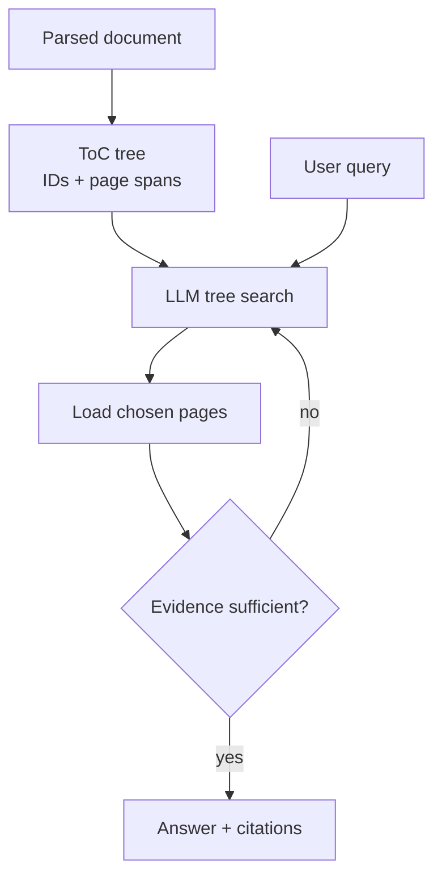

**PageIndex** is a **vectorless**, **reasoning-based** retrieval pattern for long documents: instead of embedding fixed [chunks](glossary://chunking) and ranking them by vector similarity, it builds a hierarchical **table-of-contents tree** (JSON nodes with titles, page ranges, summaries, and children), then lets an LLM **navigate that tree** like a human skimming a ToC and drilling into sections. Official docs and the open-source repo (`VectifyAI/PageIndex`) describe the two-step loop as (1) generate the tree index from the document and (2) run (agentic) reasoning-based retrieval via tree search. Retrieval returns **section or page spans** with explicit node IDs and page bounds, not opaque nearest-neighbor hits.

Embedding similarity captures one signal about topical overlap, while relevance also depends on query intent and document structure. Embedding [RAG](glossary://rag) is strong when the answer lives in a short passage whose wording matches the query. It weakens on professional PDFs (SEC filings, contracts, manuals) where many sections share vocabulary, answers sit behind cross-references ("see Appendix G"), or the query names *intent* ("what is the total deferred asset?") instead of the section's surface words. PageIndex trades ANN lookup for **structure plus multi-step LLM decisions** about *where to look next*.

## Intuition

A good analog is an analyst with a thick annual report:

1. Read the table of contents and section summaries.
2. Open the most promising chapter.
3. If a footnote points to Appendix G, jump there.
4. Stop when the evidence is enough to answer; otherwise pick another node.

PageIndex turns that habit into an **in-context index**: the tree (or a compressed view of it) sits in the model's working context so the model can reason over *structure* alongside embedding neighbors. Vector stores are unnecessary for this retrieval path. The cost moves to **index build** (LLM-assisted tree construction, OCR/layout for hard PDFs) and **query-time tokens** (multiple tree-search and section-read steps).

## Diagram



## How it works

### Offline: build the tree

A document becomes a recursive node list. Open-source examples use fields such as `node_id`, `title`, `start_index` / `end_index` (page range), `summary`, and nested children. Standard indexing offers page/token limits per node; the current SDK defaults to Flash indexing for text PDFs, extracting structure from layout and using the LLM for summaries/refinement. Markdown mode can follow `#` heading levels; hosted Cloud also handles OCR and image-rich documents.

Each leaf maps `node_id → raw section content` (text, tables, or page images in vision variants). That map is the retrieval target.

### Online: reason, then fetch

At query time the model does **not** embed the question for ANN search. It:

1. Inspects the tree (titles and summaries), optionally conditioned on chat history.
2. Chooses one or more nodes that should hold the answer.
3. Loads those sections' raw content.
4. Decides if more nodes are needed (sibling pages, child sections, referenced appendices).
5. Answers only after the gathered sections are sufficient.

Current products expose this through the SDK, Cloud APIs and **MCP tools**. The SDK supports local indexing, retrieval and chat with your own model key, so self-hosting no longer requires writing the entire agent loop. Cloud manages indexing and storage while retrieval/chat can use your chosen compatible model. Pin the SDK and backend: local text-PDF support and Cloud OCR capabilities differ.

### Contrast with vector RAG

| Concern | Typical vector RAG | PageIndex-style tree RAG |
|---|---|---|
| Index object | Chunk embeddings in a vector DB | Hierarchical ToC JSON + page/section store |
| Match signal | Embedding similarity / hybrid sparse+dense | LLM reasoning over titles, summaries, structure |
| Unit of evidence | Fixed or recursive chunks | Natural sections / page spans |
| Cross-refs ("Appendix G") | Often missed unless graph/link prep | Model can follow via the tree |
| Multi-turn | Query rewrite + re-embed | History can steer the next tree step |
| Failure mode | Wrong nearest neighbors; cut mid-section | Wrong tree branch; expensive multi-hop reads; weak tree from bad parse |

PageIndex is closer in spirit to [GraphRAG](glossary://graphrag) than to plain [dense retrieval](glossary://dense-retrieval): both invest in a **structured index** so retrieval can follow relationships. GraphRAG prioritizes entities and communities across a corpus; PageIndex prioritizes **document hierarchy and pages** for long single documents (and, in later "file system" designs, trees over many files).

## Example

A 120-page annual report is indexed into a tree. A branch can look like this (a node's page span can describe its own introductory text rather than every descendant's pages):

```json
{
  "title": "Financial Stability",
  "node_id": "0006",
  "start_index": 21,
  "end_index": 22,
  "summary": "Overview of financial stability monitoring.",
  "nodes": [
    {
      "title": "Monitoring Financial Vulnerabilities",
      "node_id": "0007",
      "start_index": 22,
      "end_index": 28,
      "summary": "Vulnerability metrics and risk watch items."
    }
  ]
}
```

Query: *"What is the total value of deferred assets?"*

1. The model reads top-level titles and opens the assets / financial statements branch (suppose pages 75–82 in this illustrative filing).
2. That section only states the *increase*, and the text says detailed numbers are in **Appendix G, Statistical Tables**.
3. Tree search jumps to Appendix G, loads the table node, and returns the total with a page citation.

A pure top-$k$ embedding search often ranks nearby "deferred assets" prose or the *change* sentence, never following the appendix pointer, because the appendix table does not look similar to the question in embedding space.

Minimal standard-indexing shape from a repository checkout (the current Flash mode rejects these standard-only flags):

```bash
python3 run_pageindex.py --mode standard --pdf_path ./2023-annual-report.pdf \
  --max-pages-per-node 10 \
  --if-add-node-summary yes
# then agent: reason over tree JSON → fetch node content by node_id → answer
```

## Trade-offs

**Strengths.** Strong fit for long, hierarchical professional PDFs where section structure and cross-references matter; citations map to real pages; no vector DB ops; multi-turn context can redirect the search; vision variants can reason over page images without trusting OCR alone.

**Costs and risks.** Every navigation step spends LLM tokens and latency, so p95 can be higher than a single ANN query. Index quality depends on [document parsing](glossary://document-parser) and OCR: a flattened PDF with bad reading order yields a misleading ToC. Flat chat logs, tiny FAQs, or high-QPS FAQ search usually want [hybrid search](glossary://hybrid-search) or BM25+dense instead. Scaling from one filing to millions of docs needs a corpus layer such as a catalog or file-tree index above per-document trees. Reported headline scores (for example PageIndex's **98.7%** on FinanceBench) are **vendor-reported full-system** results on **per-filing / single-document** financial QA; they do not isolate PageIndex's accuracy or report a multi-doc corpus result. Re-validate on *your* gold set and latency budget.

## Why it matters here

LeetLLM trains you to diagnose RAG as a pipeline (parse → index unit → retrieve → pack → generate). PageIndex is the clean counterexample to "always chunk and embed": for long structured documents, the **index unit** can be a **reasoning-friendly tree of pages and sections**, and the retriever can be an agent that walks that tree. Knowing when structure-first retrieval beats similarity search (and when it is too slow or too fragile) is part of production RAG judgment.

## Related terms

- [RAG](glossary://rag)
- [Chunking](glossary://chunking)
- [Dense retrieval](glossary://dense-retrieval)
- [GraphRAG](glossary://graphrag)
- [Document parser](glossary://document-parser)
