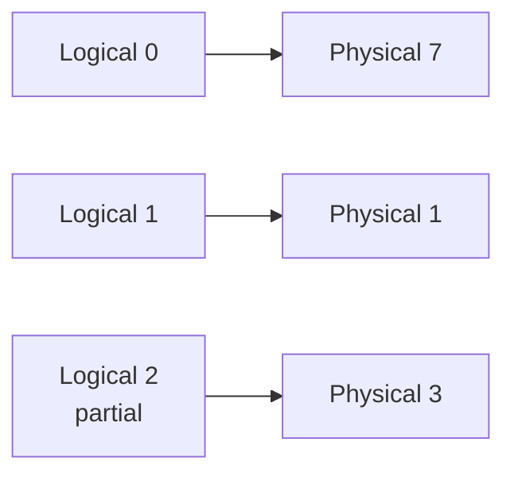

**PagedAttention** is an attention algorithm that stores a sequence's [KV cache](glossary://kv-cache) in fixed-size **blocks** that may live in non-contiguous GPU memory, with a per-sequence **block table** mapping logical token order to physical block IDs. Kwon, Li, Zhuang, Sheng, Zheng, Yu, Gonzalez, Zhang, and Stoica (SOSP 2023; arXiv:2309.06180) introduced it as the core of [vLLM](glossary://vllm). The attention math is unchanged; what changes is how past $K$ and $V$ are laid out, allocated, shared, and freed under variable-length serving.

## Intuition

Autoregressive serving is memory-bound by the KV cache. That cache is large, grows one token at a time in the [decode phase](glossary://decode-phase), and has a lifetime and final length that are not known when a request starts. Classical deep-learning runtimes expect contiguous tensors, so older serving stacks pre-allocated one contiguous KV slab per request sized to the model's max sequence length (or a generous overestimate of the output). That design wastes GPU [HBM](glossary://hbm) in three ways:

| Waste | Cause |
| --- | --- |
| **Reservation** | Space held for future tokens that may never arrive |
| **Internal fragmentation** | Allocated length $\gg$ tokens actually used |
| **External fragmentation** | Holes between differently sized contiguous slabs that no new request can fill |

The vLLM paper's profiling of prior systems found only about **20–38%** of KV-cache memory holding live token state; the rest was waste. The public vLLM blog summarized the same pathology as roughly **60–80%** wasted memory under fragmentation and over-reservation.

PagedAttention imports the OS virtual-memory fix. Think of:

| OS concept | PagedAttention |
| --- | --- |
| Process | Sequence / request |
| Virtual page | Logical KV block |
| Physical frame | Physical KV block in a GPU pool |
| Page table | Per-sequence **block table** |
| Byte | Token slot inside a block |

Contiguous **logical** blocks need not be contiguous in physical memory. The serving engine allocates a free block only when the last block of a sequence is full, so almost all waste is limited to the **partially filled last block**.

## How it works

1. **Pool of equal-sized physical blocks.** At worker startup, a large GPU region is carved into fixed blocks. Every block holds KV for $B$ tokens (default $B = 16$ in the paper and common vLLM configs) for a given layout of layers/heads.

2. **Logical blocks fill left to right.** Prefill writes the prompt's $K$/$V$ into as many blocks as needed. Decode appends one new token's $K$/$V$ into the next free slot in the last logical block. When that block fills, the engine maps a new physical block into the table.

3. **Block table lookup at attention time.** For a new query $q_t$, the kernel walks the sequence's block table, loads each physical block's keys and values, and computes attention **block-wise**. Tokens stay in causal order via the table; the GPU addresses need not be sequential.

4. **Free on completion.** Finished sequences return their blocks to the free pool for other work. That free-list discipline pairs naturally with [continuous batching](glossary://continuous-batching): as sequences leave each iteration, their blocks become admission capacity for waiting requests.

5. **Sharing with reference counts and copy-on-write.** Parallel sampling and beam search share prompt (and sometimes mid-beam) blocks by pointing multiple logical entries at the same physical block and bumping a reference count. A write into a shared block **copies** that block first (copy-on-write), so siblings keep a consistent shared prefix without duplicating the whole history up front.

6. **Pressure handling.** If free blocks run out, the scheduler can **preempt**. The original system discussed CPU swapping or dropping blocks and **recomputing** on resume, with an all-or-nothing policy per sequence. Current vLLM V1 defaults to recomputation; offload support and policy depend on engine version and configuration. Do not assume the paper's CPU swapping path is the current default.

```text
# Conceptual block-table lifecycle (not a real API)
pool = PhysicalBlockPool(num_blocks, block_size=B)
table[seq] = []  # logical -> (physical_id, filled_slots)

on_prefill(seq, n_prompt):
    need = ceil(n_prompt / B)
    for i in 0..need-1:
        table[seq].append(pool.alloc())
    write_kv_into_blocks(seq, 0..n_prompt-1)

on_decode_token(seq):
    if last_block_full(table[seq]):
        table[seq].append(pool.alloc())
    append_kv(seq, new_token)

on_finish(seq):
    for blk in unique_physical(table[seq]):
        if refcount(blk) drops to 0: pool.free(blk)
```

## Diagram

The block table maps model order to scattered physical storage. Allocation and reference counting are separate from this mapping.



## Formula

Standard single-query attention over the growing cache is still exact (paper Eq. 3):

$$
a_{tj}
=
\frac{\exp\!\bigl(q_t^{\top} k_j / \sqrt{d}\bigr)}
{\sum_{u=1}^{t}\exp\!\bigl(q_t^{\top} k_u / \sqrt{d}\bigr)},
\quad
o_t
=
\sum_{j=1}^{t} a_{tj}\, v_j
$$

PagedAttention only rewrites the **layout** of $K$ and $V$. With block size $B$, pack up to $B$ tokens into block $b$ as $K^{(b)}, V^{(b)} \in \mathbb{R}^{d \times B_b}$ (columns are per-token vectors; the last block may be partial, $B_b \le B$). The paper's block-wise form (Eq. 4) is:

$$
A_t^{(b)}
=
\frac{\exp\!\bigl(q_t^{\top} K^{(b)} / \sqrt{d}\bigr)}
{\sum_{b'=1}^{\lceil t/B\rceil}
\sum_{j=1}^{B_{b'}}
\exp\!\bigl(q_t^{\top} k_j^{(b')} / \sqrt{d}\bigr)},
\quad
o_t
=
\sum_{b=1}^{\lceil t/B\rceil}
V^{(b)}\, A_t^{(b)\top}
$$

$A_t^{(b)}$ is the length-$B_b$ row of attention weights on block $b$; $\exp$ in the numerator is elementwise, and the denominator sums over every token in every block. The kernel scores block-wise, reduces max/sum across blocks, then weights values. That is ordinary attention with a gather over non-contiguous physical blocks instead of one dense $K_{1:t}$ tensor.

**Internal fragmentation (upper bound per sequence):** only the last block can be partly empty, so unused slots are at most $B-1$ tokens of KV:

$$
\text{wasted tokens} \le B - 1
\quad\text{(per sequence, once all full blocks are filled)}
$$

With $B=16$, that is at most 15 idle token slots, tiny next to multi-thousand-token contexts. External fragmentation is gone because every free slot is a same-sized block any sequence can take.

## Worked numbers

**Per-token KV size (paper example, OPT-13B, FP16).** One token needs keys and values across all layers:

$$
2 \times 5120 \times 40 \times 2\ \mathrm{bytes} = 819{,}200\ \mathrm{bytes/token} = 800\ \mathrm{KiB/token}
$$

(the $2$ factors are $K$+$V$ and 2 bytes per FP16 element; $5120$ is the model width; $40$ is the layer count). At a 2048-token max length, a **contiguous max-length reservation** costs $800\ \mathrm{KiB} \times 2048 \approx 1.68\ \mathrm{GB}$ ($1.5625\ \mathrm{GiB}$) **per sequence**, whether the reply is 20 tokens or 2000.

**Blocks for a realistic chat turn.** Prompt 800 tokens, output so far 120 tokens, $B=16$:

$$
n_{\mathrm{blocks}}
=
\left\lceil \frac{800+120}{16} \right\rceil
=
\left\lceil 57.5 \right\rceil
=
58
$$

Physical memory is $58 \times 16 \times 800\ \mathrm{KiB}\approx0.760\ \mathrm{GB}$ of KV capacity, of which only the last block has idle room (8 empty slots $\times 800\ \mathrm{KiB}$). A max-length contiguous design would still hold ~1.68 GB for the same sequence while it is only ~920 tokens long.

**Concurrency.** In a hypothetical OPT-13B worker, suppose ~12 GB is available for KV. Contiguous 2048-token slots admit $\lfloor12/1.68\rfloor=7$ full reservations. With paged blocks sized to **actual** lengths near 1k tokens (~0.83 GB allocated each), the same pool can hold about fourteen active sequences, and more when many are shorter. That extra concurrency can raise batch size and tokens/s under continuous batching.

Paper-reported end-to-end gains for vLLM (PagedAttention plus its scheduler) vs FasterTransformer and Orca-style baselines are about **2–4×** throughput at similar latency on OPT-scale models, larger under long sequences and multi-output decoding. The launch blog reported up to about **24×** vs Hugging Face Transformers and **3.5×** vs TGI on LLaMA 7B/13B ShareGPT-style loads. Treat those as workload- and baseline-specific, not universal constants.

## Example

A chat worker's admission timeline with $B = 16$ looks like:

| Sequence | Tokens live | Logical blocks | Notes |
| --- | ---: | ---: | --- |
| A | 48 | 3 before release | Short reply finishes and releases its blocks |
| B | 900 | 57 | Long system prompt + long answer |
| C | 32 | 2 | Just admitted after A freed blocks |

Without paging, admitting C might require a free contiguous slab of size `max_model_len`, even though C only needs two blocks today. With PagedAttention, C takes two free physical blocks from the pool (possibly non-adjacent, possibly formerly owned by A). B's 901st token fits in its existing 57th block; its 913th token requires block 58. Earlier blocks stay in place.

If the user asked for **two parallel samples** from the same prompt, both samples share the prompt's physical blocks (refcount 2). When sample 1 writes the first divergent token into a still-shared last block, copy-on-write allocates a private block for that write so sample 2 keeps the shared prefix intact. Beam search uses the same mechanism as beams diverge and rejoin the top-$k$ set.

## Trade-offs

| Upside | Cost / limit |
| --- | --- |
| Near-zero external fragmentation; waste mostly last partial block | Attention kernel must gather via the block table (paper measured ~20–26% higher **attention kernel** latency vs a highly tuned contiguous FasterTransformer kernel; end-to-end still wins) |
| Higher effective batch size under length variance | Block size is a trade-off: too small underuses GPU parallelism; too large raises internal fragmentation and weakens sharing |
| Cheap prefix / beam / multi-sample sharing | Copy-on-write and refcounting add bookkeeping; wrong free timing leaks blocks |
| Enables preemption without compacting giant tensors | Swap-to-CPU and recompute both hurt tail latency when the free pool is empty |
| Orthogonal to FlashAttention-style IO tiling | Paging organizes KV memory; FlashAttention-style tiling reduces memory traffic |

**What fails in production.** Symptoms of block pressure point to scheduler or memory behavior: rising preemption/swap rate, falling concurrent sequences, queue time up while GPU SM utilization is uneven, OOM on admission of long prompts, or “KV cache full” style rejects. Debug with free-block count, block utilization, preemption rate, sequence-length histogram, and batch size over time, alongside average tokens/s. PagedAttention changes KV layout and allocation. The per-token $K$/$V$ size stays the same, and the attention computation remains the same. Use GQA/MQA, quantization, or shorter contexts to reduce cache size.

## Why it matters here

LLM serving capacity is often limited by how many live KV states fit in HBM, not by raw FLOPs. PagedAttention is the standard mental model for why modern engines can batch many variable-length chats without pre-reserving max-length slabs, and it is the bridge between the KV cache abstraction and production knobs in vLLM-class systems (block size, max num sequences, preemption, prefix/block sharing).

## Related terms

- [KV cache](glossary://kv-cache)
- [vLLM](glossary://vllm)
- [Continuous batching](glossary://continuous-batching)
- [Decode phase](glossary://decode-phase)
- [Prefix cache](glossary://prefix-cache)
