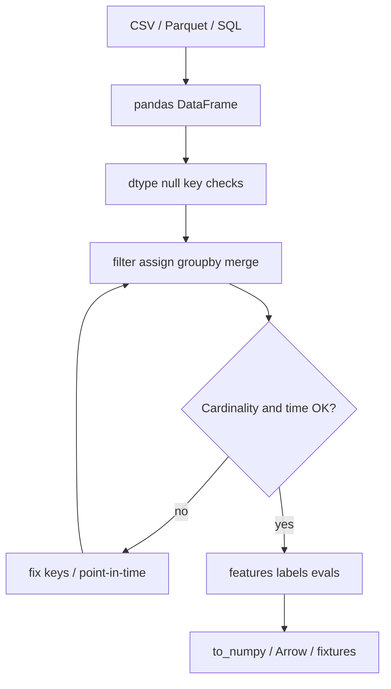

**pandas** is the standard Python library for labeled tabular data: load, clean, join, group, reshape, and report on tables before they become features, labels, eval fixtures, or plots. Wes McKinney introduced it for practical statistical computing (SciPy 2010); the name comes from *panel data*, multi-dimensional observations common in econometrics. Official docs still put the same idea first: data structures for relational or labeled data, built to sit next to [NumPy](glossary://numpy-array) in a scientific stack.

The two core types cover almost every day-to-day job. A **Series** is a 1D labeled array (values plus an **Index**). A **[DataFrame](glossary://dataframe)** is a 2D table with a row Index and named columns, each column typically a Series of one dtype. Labels govern alignment in arithmetic, assignment, and many reductions. Two objects can look same-shaped and still insert `NaN`s, drop rows, or multiply cardinality when their indexes or join keys disagree.

## Intuition

Treat pandas as the workbench between warehouses/logs/CSVs and tensors or reports:

1. **Ingest** rows with a known grain (`request_id`, `(user_id, ts)`, `eval_case_id`).
2. **Validate** dtypes, nulls, key uniqueness, time ranges, and slice membership.
3. **Transform** with filters, derived columns, group aggregates, and joins.
4. **Export** numeric blocks (`to_numpy()`), Arrow, Parquet, or fixtures for training and offline eval.

NumPy gives dense homogeneous arrays and broadcasting. pandas adds column names, mixed types, missingness, SQL-like joins, and split-apply-combine. You stay in pandas while the table is still "about entities and times." You leave for arrays or tensors when the schema is fixed and every row is a model input.

## How it works

| Piece | Role |
| --- | --- |
| `Series` | 1D values + Index; one dtype (NumPy or pandas ExtensionDtype) |
| `DataFrame` | Dict-like container of aligned Series; size-mutable columns |
| `Index` / MultiIndex | Row (and column) labels used for alignment and selection |
| Label alignment | Ops match on shared labels; missing labels become `NaN`; result index is often the **union** |
| `loc` / `iloc` | Label-based vs position-based selection; prefer explicit axes over chained `[]` |
| `groupby` | Split-apply-combine: split by keys, apply agg/transform/filter, combine results |
| `merge` / `join` / `concat` | Relational combine (`merge` is SQL-style; `concat` stacks axes) |
| IO | `read_csv`, `read_parquet`, SQL readers, writers; schema lives in dtypes and column names |
| Copy-on-Write (pandas 3+) | Derived objects behave as copies; use a single `.loc` or `.iloc` assignment to update the source frame |

**Alignment (Series).** For two Series $s$ and $t$, arithmetic matches on index labels. The result index is the **union** of the inputs, so labels from either side remain in the result. A label present in only one side yields missing data at that label. Comparison operators can instead require identical labels, so check each operation's alignment rule. Positional access (`iloc`, `.to_numpy()`) discards the label mapping.

**Alignment (DataFrame).** Frame-vs-frame ops align on **both** row index and columns. Frame-vs-Series (default) aligns the Series index to the DataFrame **columns** and broadcasts down the rows (NumPy-style row broadcast after label match).

**GroupBy (split-apply-combine).** Calling `df.groupby(keys)` builds groups. Then you either:

- **aggregate** (many rows → one row per group: `mean`, `sum`, custom),
- **transform** (same shape as input, group-aware values),
- **filter** (keep or drop whole groups).

That is the same mental model as SQL `GROUP BY`, expressed in method chains on in-memory tables.

**Merge cardinality.** `pd.merge(left, right, on=key, how=...)` is relational. One-to-many and many-to-many keys expand row counts without error. Unlike typical SQL joins, pandas matches null keys to null keys. Reject missing entity IDs before joining. After every merge, compare `len(df)` and unique entity counts to what the grain promises.

## Diagram



## Example

Offline LLM eval report: join model scores to frozen case metadata, assert grain, then slice metrics. This is the pattern LeetLLM labs and production harnesses reuse constantly.

```python
import pandas as pd

# Frozen eval cases (one row per case_id)
cases = pd.DataFrame({
    "case_id": ["c1", "c2", "c3", "c4"],
    "slice": ["easy", "hard", "hard", "easy"],
    "gold": ["pass", "escalate", "pass", "block"],
})

# One scored run (must stay 1:1 with cases)
scores = pd.DataFrame({
    "case_id": ["c1", "c2", "c3", "c4"],
    "pred": ["pass", "block", "pass", "block"],
    "latency_ms": [120, 340, 210, 95],
})

assert cases["case_id"].notna().all() and scores["case_id"].notna().all()
assert set(cases["case_id"]) == set(scores["case_id"]), "missing or unexpected case IDs"
assert scores[["pred", "latency_ms"]].notna().all().all()
assert pd.api.types.is_numeric_dtype(scores["latency_ms"])
assert (scores["latency_ms"] >= 0).all()
before = len(cases)
report = cases.merge(scores, on="case_id", how="left", validate="one_to_one")
assert len(report) == before
assert report["pred"].notna().all(), "missing scores for some cases"

report["correct"] = report["pred"] == report["gold"]
overall = report["correct"].mean()  # 0.75

by_slice = (
    report.groupby("slice", as_index=False)
    .agg(n=("case_id", "size"), accuracy=("correct", "mean"), p95_ms=("latency_ms", lambda s: s.quantile(0.95)))
)
# easy: accuracy 1.0; hard: accuracy 0.5  -> overall hides the hard-slice failure
# Two rows per slice demonstrate quantile syntax; estimate tail latency from a representative sample.

# Label alignment pitfall (same positions, different indexes)
a = pd.Series([1.0, 2.0], index=["c1", "c2"])
b = pd.Series([10.0, 20.0], index=["c2", "c1"])
aligned_sum = a + b          # c1: 21.0, c2: 12.0  (matched by label)
positional = a.to_numpy() + b.to_numpy()  # [11.0, 22.0]  (matched by position)
```

What this teaches:

- **`validate="one_to_one"`** fails loud if either side duplicates `case_id` (preferred over silent row blow-ups).
- **Slice metrics** after a join catch regressions that overall accuracy buries.
- **Label vs position** on Series: `+` follows Index labels; NumPy arrays follow memory order. Mixing the two without an explicit `.reset_index(drop=True)` or `.to_numpy()` is a classic silent bug when reordering tables.

Prefer single-indexer writes under modern pandas (Copy-on-Write is default in 3.x):

```python
report.loc[report["slice"] == "hard", "flag"] = "review"
# not: report["flag"][report["slice"] == "hard"] = "review"  # chained assignment
```

## Debug path

When a table "looks right" but metrics or training go wrong:

1. **Grain.** `df.shape`, `df["id"].nunique()`, `df.duplicated(subset=[...]).sum()`. After `merge`, re-check length and uniques.
2. **Schema.** `df.dtypes`, `df.isna().mean()`, unexpected `object` columns (mixed strings/numbers, failed parses).
3. **Time.** Min/max timestamps per side of a join; reject features with `available_at > prediction_at` ([point-in-time join](glossary://point-in-time-join) discipline).
4. **Alignment.** After `reindex`, `align`, or arithmetic between differently indexed frames, count new `NaN`s. Choose `join=` explicitly on `align` and `how=` on `merge` when union behavior would hide missing keys.
5. **Export.** `to_numpy(dtype=..., copy=True)` (or Arrow) only after column order and dtypes are fixed; do not train on an accidental Index column.
6. **Memory.** Wide string/`object` columns and many-to-many joins dominate RAM. Profile `df.memory_usage(deep=True)` before scaling a notebook script to full logs.

## Trade-offs

pandas is the default for interactive analysis, mid-size feature tables, and eval reporting in Python. It is eager and mostly single-process: multi-gigabyte joins and huge groupbys often want Polars, DuckDB, Spark, or SQL pushdown instead. The Index model is more powerful than a pure "SQL result set" mental model, and more error-prone if you treat frames like positional matrices. For LLM systems, use pandas where inspectability matters (slice tables, error analysis, [golden dataset](glossary://golden-dataset) diffs); use the warehouse or a lazy engine when the working set no longer fits a careful in-memory pipeline.

## Why it matters here

LeetLLM's core stack lists pandas for tabular cleanup, joins, grouping, feature inspection, and evaluation reports. Almost every production AI path still has a table stage: request logs, label exports, retrieval hit lists, judge scores, latency traces. Fluent pandas that *checks cardinality and time* is how you catch [feature leakage](glossary://feature-leakage), bad splits, and slice regressions before they become "the model got worse" stories. Agent-generated analysis code also tends to emit pandas; you need to read it critically under a [sandbox](glossary://sandbox), not trust a green cell.

## Related terms

- [DataFrame](glossary://dataframe)
- [NumPy array](glossary://numpy-array)
- [Feature leakage](glossary://feature-leakage)
- [Point-in-time join](glossary://point-in-time-join)
- [Evaluation slice](glossary://evaluation-slice)
