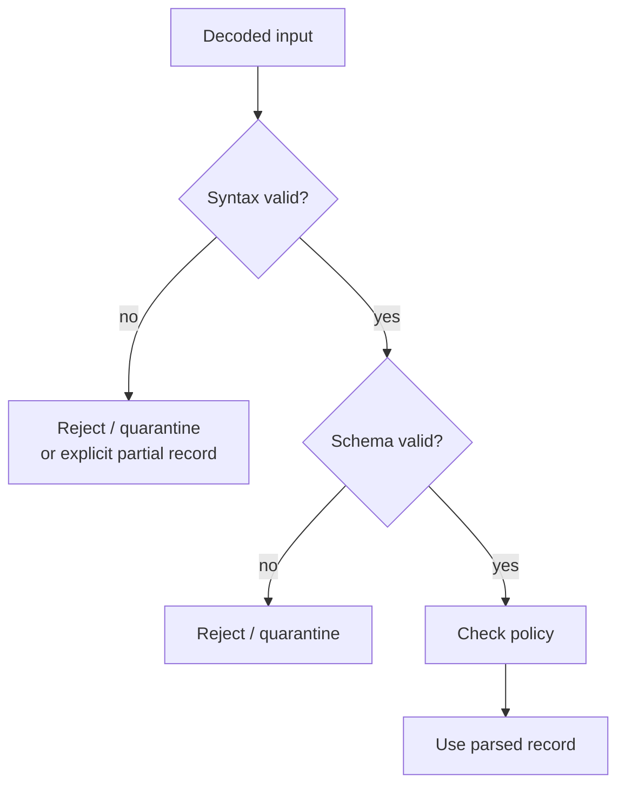

**Parsing** turns raw text or bytes into structured values under explicit rules for character encoding, record partitions, fields, nesting, escaping, normalization, types, and error recovery. A parser is a total function over *allowed* inputs and a partial one over *everything else*: legal strings become typed records; illegal strings become errors (or a documented recovery path). Downstream code must not invent structure the parser refused to certify.

In compiler terms (Aho, Lam, Sethi, Ullman), **lexical analysis** groups characters into tokens, and **syntax analysis** (parsing proper) checks that the token stream matches a grammar and builds a tree or other intermediate form. In LLM systems the same idea appears everywhere: log lines become records, PDFs become text elements, model completions become JSON objects, and tool-call argument strings become typed arguments. Syntax validates form; semantic checks establish meaning and authorization. A release ID can parse as a string and still name an unapproved artifact.

## Intuition

Parsing is the moment raw bytes stop being "text" and become something the system is willing to treat as data. Until that perimeter, you have a string. After it, you have fields other code will index, embed, rank, execute, bill, or evaluate.

Three layers often get collapsed into one call:

| Layer | Question | Typical failure |
|---|---|---|
| **Decode** | Which character encoding and line endings? | UTF-8 vs Latin-1 mojibake; stray BOM |
| **Syntax** | Does the string match the grammar? | Truncated JSON, unescaped control chars, merged records |
| **Schema / types** | Are required fields present and correctly typed? | `"false"` still a string; missing `release_id` |

[JSON Schema](glossary://json-schema) and [Pydantic](glossary://pydantic) sit on the third layer. [Structured output](glossary://structured-output) and constrained decoding try to make layer two (and often three) succeed at generation time. You still parse and re-validate in your process: providers can truncate, refuse, wrap fences, or return schema-valid garbage.

RFC 8259 states The schema for one common case: a JSON parser transforms a JSON text into another representation; it **must** accept all texts that conform to the grammar and **may** accept non-JSON extensions. Prefer strict accept/reject for untrusted model output. Silent "repair" turns model typos into production side effects.

## How it works

A production parse path usually has these stages:

1. **Ingest bytes.** Pin encoding (UTF-8 for networked JSON per RFC 8259). Strip or reject BOM only under a documented policy.
2. **Normalize surface form where the format permits it.** Line endings, [Unicode normalization](glossary://unicode-normalization) form, and optional whitespace policy. Normalization changes equality, cache keys, and sometimes token counts; treat it as a data schemas. For JSON, parse the original text first and normalize selected string fields afterward; rewriting raw text can change string values or collapse distinct keys.
3. **Find records / spans.** Split logs, extract a fenced code block, locate the first balanced `{...}`, or walk a byte range for a file format. Wrong partitions merge or drop events before fields exist.
4. **Lex and parse syntax.** For JSON: structural characters, strings, numbers, `true`/`false`/`null`, nested objects and arrays. For custom formats: an explicit [state machine](glossary://state-machine) or generated parser beats ad hoc [regex](glossary://regex) once nesting, escapes, or multiline recovery appear.
5. **Validate shape and types.** Map to a schema: required keys, enums, numeric bounds, `additionalProperties`, nested arrays. Convert strings to domain types only under rules you control (`Decimal("12.50")`, ISO-8601 timestamps with timezone).
6. **Emit lineage.** Source id, parser name and version, raw span or checksum, error codes for partial failure. Consumers need to know *which* parser produced the record when a library upgrade rewrites history.

Document formats (PDF, HTML, DOCX) use the same pipeline at a larger scale: detect type, extract, structure reading order, gate quality. That specialized path is a [document parser](glossary://document-parser).

## Diagram



## Example

### Multiline log records

A naive `splitlines()` treats each physical line as an event. Real logs wrap stack traces. Group continuation lines with the previous timestamped header:

```python
def parse_log_records(text: str) -> list[list[str]]:
    records: list[list[str]] = []
    current: list[str] = []
    for line in text.splitlines():
        if line.startswith("START "):
            if current:
                records.append(current)
            current = [line]
        elif current:
            current.append(line)
        # else: orphan continuation before any header; drop or quarantine
    if current:
        records.append(current)
    return records
```

If two `START` lines are glued without a newline, or a stack frame starts with `START ` by coincidence, partitions break and every later metric, embedding, or alert on "that incident" is wrong.

### Tool-call arguments: syntax then schema

An agent returns tool arguments as a string. Treat parsing as two gates:

```python
import json
from decimal import Decimal
from typing import Literal
from pydantic import BaseModel, ConfigDict, Field, ValidationError

class DeployArgs(BaseModel):
    model_config = ConfigDict(extra="forbid")
    status: Literal["approved"]
    release_id: str = Field(min_length=1, max_length=64)
    canary_percent: Decimal = Field(gt=0, le=10, decimal_places=2)

raw = '{"status": "approved", "release_id": "r17", "canary_percent": "5.00"}'

def reject_constant(value):
    raise ValueError(f"non-JSON number: {value}")

def unique_object(pairs):
    result = {}
    for key, value in pairs:
        if key in result:
            raise ValueError(f"duplicate key: {key}")
        result[key] = value
    return result

try:
    tree = json.loads(raw, parse_constant=reject_constant, object_pairs_hook=unique_object)
except ValueError as e:
    raise ValueError(f"syntax: {e}") from e

try:
    args = DeployArgs.model_validate(tree)  # types + constraints
except ValidationError as e:
    raise ValueError(f"schema: {e}") from e

# only now may a deployment policy check run
assert args.canary_percent == Decimal("5.00")
```

Python's default `json.loads` accepts `NaN` and infinities and keeps the last duplicate object key. The hooks above reject both. Duplicate names are discouraged by RFC 8259 rather than forbidden by its grammar; rejecting them makes the application's interpretation unambiguous. The enum and extra-field rule constrain structure, but `"approved"` provided by a model is still not authorization to deploy.

Failure modes this catches:

| Input | Stage that fails | Risk if skipped |
|---|---|---|
| `{"amount": 12.50` (truncated) | syntax | crash or partial dict |
| `{"status": "approved", "canary_percent": "5.00"}` missing `release_id` | schema | deployment with no immutable artifact |
| `{"status": "approved", "release_id": "r17", "canary_percent": "5.00"}` with the percentage left as `str` | type coercion policy | lexical comparison instead of numeric bounds |
| prose around a JSON object | syntax unless you extract a span first | parse error on every call |

Extracting a span (fenced block, first balanced braces) is still parsing. It needs tests for nested braces inside strings, multiple objects, and truncated streams.

## Recovery behavior

Decide explicitly what malformed input becomes:

| Policy | When it fits | Danger |
|---|---|---|
| **Reject** | Tool args, auth, money, safety | Correct default when side effects exist |
| **Retry with model** | Flaky free-form JSON before tools | Needs a hard retry budget and same schema |
| **Partial + error field** | Batch log ingest | Downstream must honor the error field |
| **Quarantine source** | Corpus ingest | Keeps index clean; needs operator path |
| **Silent repair** | Almost never for actions | Hallucinates structure; evals treat it as truth |

RFC 8259 allows parsers to accept extensions; that is not a license to invent missing keys. If you repair, re-run the full syntax + schema path on the repaired text and log both raw and repaired forms.

## What fails in production

| Failure | Symptom | Check |
|---|---|---|
| perimeter bugs | Two events merged; stack frames as new events | Multiline test cases; golden record counts |
| Escaping | Quotes, newlines, or control chars break JSON | Unescaped U+0000–U+001F in model strings |
| Encoding | Mojibake in retrieval snippets | Encoding pin; BOM policy |
| Type fuzziness | Numbers as strings; timestamps without TZ | Schema with real types, not "stringly" JSON |
| Over-permissive schema | Extra keys or open enums pass | `additionalProperties: false`; closed enums |
| Version drift | Same file, new text after library bump | Parser id + content [checksum](glossary://checksum) in lineage |
| Misattributed bugs | "Model hallucinated policy" when OCR/parser mangled digits | Trace source bytes → parse → chunk → cite |

## Why it matters here

LLM products stand on parsers at both ends of the model:

- **Ingest:** parsing decides which evidence exists for retrieval, citation, and training. A bad perimeter or OCR digit error becomes a confident wrong answer that looks like reasoning failure.
- **Egress:** parsing decides whether free-form generation becomes a tool call, eval row, or API payload. Schema-valid is the minimum; policy and auth still run after.

Name parse, validate, and recover as separate stages, and give each stage test cases. If a system "sometimes works," instrument the parse stage first: syntax error rate, schema error rate, quarantine rate, and parser version on every trusted record.

## Related terms

- [Document parser](glossary://document-parser)
- [JSON Schema](glossary://json-schema)
- [Structured output](glossary://structured-output)
- [State machine](glossary://state-machine)
- [Unicode normalization](glossary://unicode-normalization)
