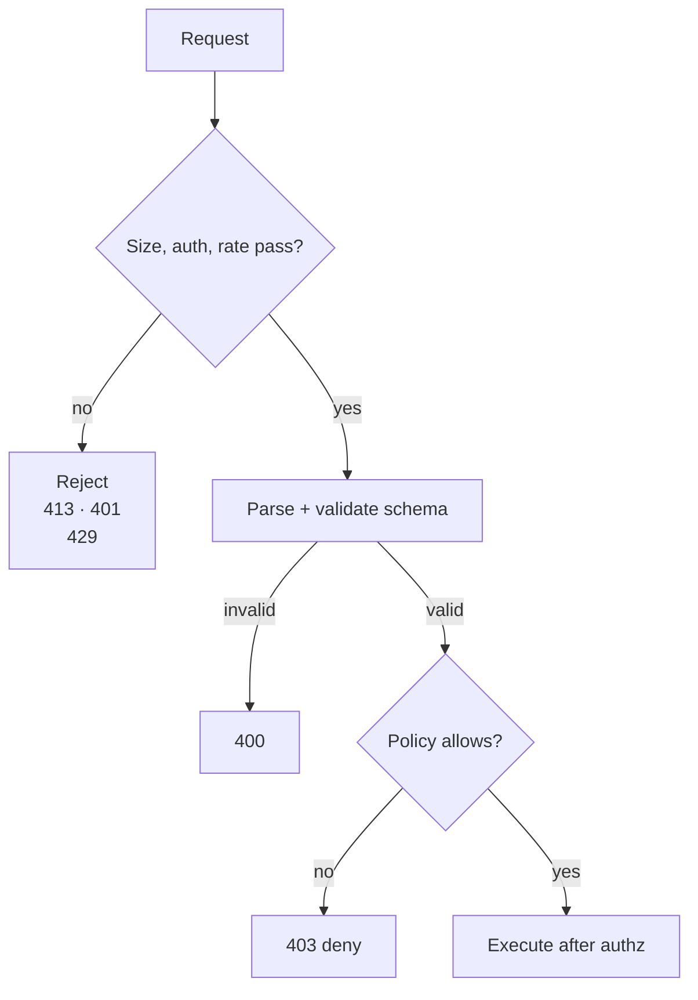

A **payload** is the application data a message, record, or transfer carries, as distinct from the framing and control metadata that move it. In HTTP, that usually means the request or response body: the JSON for a chat completion call, the bytes of an uploaded PDF, or the event body a [webhook](glossary://webhook) POSTs. Headers, status codes, and routing decide *how* the trip works; the payload is *what* the other side is supposed to process.

Engineers reuse the same word at other partitions with the same data-vs-control distinction:

| perimeter | Payload means | Wrapper / control plane |
|---|---|---|
| HTTP API | Request or response body (JSON, SSE `data:`, multipart file) | Method, path, headers, status code |
| Tool / agent | Structured arguments and tool results | Tool name, call id, allowlist, auth |
| Queue / job | Work item fields the worker will act on | Priority, enqueue time, retry count |
| Vector store | Structured metadata next to an embedding (Qdrant’s term) | Point id, vector, collection config |
| Tensor / cache math | Raw bytes of weights, activations, or K/V values | Layout, dtype, block tables, indexes |

HTTP standards evolved the wording. Older specs talked about a **payload body**. [RFC 9110](https://www.rfc-editor.org/rfc/rfc9110) prefers **content** for the same idea, and renames status **413** from “Payload Too Large” to “Content Too Large.” Production code, gateways, and AI APIs still say “payload” every day, so treat the terms as synonyms for engineering work.

## Intuition

For an HTTP model request, the route, authorization header, and content type control how the server handles the message. Prompt text, model parameters, and tool definitions are the payload. The server can reject an oversized body before parsing it, reject malformed JSON after parsing starts, or deny a well-shaped tool call after authorization. Those are separate partitions with separate failure signals.

Never confuse “we received a payload” with “we can trust it.” Untrusted clients, models that emit tool args, and retrieved documents all produce payloads that must be treated as data until a trusted path validates them.

## How it works

A production path that accepts a payload usually runs these steps in order:

1. **Frame and size.** Use the HTTP stack's framing and enforce a limit on bytes actually received, including when a streaming body has no advance `Content-Length`. Cap body size at the [API gateway](glossary://api-gateway) so one multi-megabyte dump cannot pin worker memory. Oversize → **413** (still often logged as `payload_too_large`).
2. **Parse.** Decode JSON, protobuf, multipart, or SSE `data` lines. A malformed client request commonly receives **400**; malformed upstream or model output needs separate error handling.
3. **Validate shape.** Check required fields, types, enums, and max string lengths with [JSON Schema](glossary://json-schema), [Pydantic](glossary://pydantic), or an equivalent. These checks establish the payload's structure; business truth and authorization require their own checks.
4. **Authorize.** Use the *authenticated* principal to decide whether this payload may run: tenant match, tool allowlist, ACL on cited docs. Client and model fields can request an identity, but the trusted principal supplies it.
5. **Act or store.** Enqueue a job, call a tool, upsert a vector-store point, or pass a cleaned subset into the model. Hash or redact prompts and PII before logging, and retain only the data needed for operations and audit.

For [tool calling](glossary://tool-calling), the model proposes a payload; application code owns steps 3-5. "The model asked for it" is never authorization.

## Example

A release assistant accepts one engineering request and may propose a tool call. Three related payloads appear on one request path.

**1. Client → API (HTTP body)**

```http
POST /v1/chat HTTP/1.1
Host: api.example.com
Authorization: Bearer sk_live_…
Content-Type: application/json
Content-Length: 100

{
  "thread_id": "thr_9f2",
  "message": "Run the safety suite for release r17",
  "stream": true
}
```

The body shown uses LF line endings and includes a final newline, totaling 100 UTF-8 bytes. A real HTTP client computes the length from the serialized bytes. Gateway rules for this route: body ≤ 256 KiB, `message` ≤ 8k characters, `thread_id` required. A 2 MiB dump of chat history stuffed into `message` is rejected with **413** before any retrieval or model call.

**2. Model → app (tool-call payload)**

```json
{
  "name": "run_eval",
  "arguments": {
    "release_id": "r17",
    "suite_id": "safety-private-v3",
    "max_cases": 500
  }
}
```

The app validates against the tool schema, checks that the authenticated engineer may access release `r17` and the private suite, enforces the case budget, then executes. A missing `release_id` fails schema checks; a valid shape naming another tenant's suite fails authorization.

**3. Vector store point (Qdrant-style payload)**

When a deployment runbook chunk was indexed, the embedding traveled with structured metadata that Qdrant calls a **payload**:

```json
{
  "id": 10482,
  "vector": [0.02, -0.11, 0.44],
  "payload": {
    "tenant_id": "acme",
    "doc_id": "runbook-deploy-v3",
    "security_label": "engineering",
    "is_deleted": false
  }
}
```

Search can filter on that payload (`tenant_id = acme AND is_deleted = false`). The application must derive the tenant constraint from authenticated identity and apply it consistently to retrieval and document reads. Treat the client-provided filter as a query hint and enforce authorization independently. Here “payload” is metadata stored beside the vector; the HTTP query body is a separate payload. [Qdrant payload documentation](https://qdrant.tech/documentation/manage-data/payload/) describes these stored fields and their use in filtering.

## Diagram



Cheap rejects happen early in the path. Expensive work (GPU, tools, durable writes) only runs after size, parse, schema, and authz pass.

## Production failure modes

- **Oversized bodies.** Gateways, reverse proxies, and app servers each have their own limit. A client may pass nginx yet fail at the app, or the reverse. Align caps and return a stable **413** with a machine-readable code such as `payload_too_large`.
- **Shape drift.** Field renamed, new required key, or enum extended on one side only. Old consumers break even when every response is still valid JSON. Version The schema and put the version *in* the payload or route.
- **Trusting model text as control.** Tool arguments, HITL approval digests, and interrupt payloads must be validated and re-checked against authoritative state. Explanations next to a tool call do not constrain the args.
- **Sensitive logging.** Full prompts, retrieved chunks, and tool results are payloads that often contain PII or secrets. Prefer hashes, redaction, short retention, and access-controlled raw stores over writing every body into hot metrics labels.
- **Idempotency key reuse.** Define what happens when the same key arrives with a different payload. One API policy is to reject with **409** after comparing a payload hash; the status and comparison rules belong in that API's schema.

## Why it matters here

LeetLLM's lessons on structured model output, tool calling, retrieval, and APIs repeatedly cross payload partitions. Clear payload formats (size, schema, trust, logging) help turn generated output into software other services can call safely. Separating these partitions also helps diagnose whether a failure arose in generation, parsing, authorization, or another step on the [request path](glossary://request-path).

## Related terms

- [API schemas](glossary://api-contract)
- [JSON Schema](glossary://json-schema)
- [Tool calling](glossary://tool-calling)
- [Metadata filter](glossary://metadata-filter)
- [Webhook](glossary://webhook)
