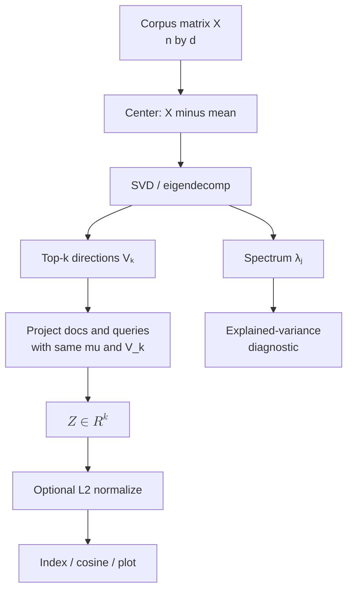

**Principal component analysis (PCA)** is a linear method that finds an ordered set of orthogonal directions (principal components) along which a dataset has the largest variance, then projects the data onto a subset of those directions. Pearson (1901) and Hotelling (1933) introduced the idea; modern implementations almost always compute it via the [SVD](glossary://svd) of a centered data [matrix](glossary://matrix). The result is a shorter coordinate system that keeps as much total squared deviation from the mean as a linear map of that rank can keep.

In LLM systems you meet PCA as (1) a **compressor** for high-dimensional [embeddings](glossary://embedding), (2) a **diagnostic** of spectrum and [anisotropy](glossary://anisotropy), and (3) an optional **post-process** (center, whiten, or drop top components). PCA finds directions with high variance; measure retrieval recall to see whether a projection preserves relevant neighbors.

## Intuition

Picture a cloud of points elongated along a diagonal in 2D. The first principal component is the unit direction of that stretch; projecting onto it collapses the short axis and keeps most of the scatter. The second component is orthogonal to the first and captures the leftover spread. In $d$ dimensions the same idea iterates: each new direction is the max-variance axis among those orthogonal to the ones already chosen.

For embedding matrices, variation in length or template language can dominate a centered component while retrieval-relevant variation lives in smaller components. Centering removes the mean offset, so the centered spectrum diagnoses uneven variance. To assess whether original vectors cluster in a cone around a shared mean direction, inspect their angular distribution separately.

## Formula

Let $X \in \mathbb{R}^{n \times d}$ contain $n>1$ samples with $d$ features (for embeddings, $n$ chunks and $d$ dimensions). Center columns:

$$
\tilde{X} = X - \mathbf{1}\mu^\top, \qquad
\mu = \frac{1}{n}\sum_{i=1}^{n} x_i
$$

**Covariance form.** With sample covariance $C = \frac{1}{n-1}\tilde{X}^\top \tilde{X}$ (some texts use $\frac{1}{n}$), principal directions are eigenvectors

$$
C v_j = \lambda_j v_j, \qquad
\lambda_1 \ge \lambda_2 \ge \cdots \ge \lambda_d \ge 0
$$

with orthonormal $v_j$. Eigenvalue $\lambda_j$ is the variance along $v_j$. The **explained-variance ratio** of component $j$ is

$$
r_j = \frac{\lambda_j}{\sum_{k=1}^{d} \lambda_k}
$$

This ratio requires nonzero total variance; identical samples have no variance to explain.

**SVD form (what libraries use).** Factor the centered matrix

$$
\tilde{X} = U \Sigma V^\top
$$

with singular values $\sigma_1 \ge \sigma_2 \ge \cdots \ge 0$. Right singular vectors (columns of $V$) are the principal directions. For the $\frac{1}{n-1}$ covariance convention, $\lambda_j = \sigma_j^2 / (n-1)$. Truncating to the first $k$ columns $V_k$ gives the reduced codes

$$
Z = \tilde{X} V_k \in \mathbb{R}^{n \times k}
$$

and the reconstruction $\hat{X} = Z V_k^\top = \tilde{X} V_k V_k^\top$. By the Eckart–Young theorem, $\hat{X}$ is a minimum-Frobenius-error approximation of $\tilde{X}$ among all matrices of rank at most $k$.

**Whitening** (optional). For positive eigenvalues, scaling projected coordinates by $1/\sqrt{\lambda_j}$ makes their sample covariance the identity. Tiny eigenvalues amplify noise; zero eigenvalues cannot be whitened into unit-variance coordinates. Drop degenerate directions or regularize the scale explicitly. Current scikit-learn's transform implementation floors the square-root scale at machine epsilon to avoid non-finite output, which does not restore variance to a constant coordinate. See the [PCA API](https://scikit-learn.org/stable/modules/generated/sklearn.decomposition.PCA.html) and [transform implementation](https://github.com/scikit-learn/scikit-learn/blob/main/sklearn/decomposition/_base.py).

## How it works

1. **Choose a fit set.** For production embedding indexes, fit on a representative sample of **document** vectors (or the full corpus if it fits memory). Do not fit a separate PCA on queries.
2. **Center.** Subtract the training mean $\mu$. scikit-learn `PCA` centers automatically; raw `np.linalg.svd` on uncentered $X$ retains the mean offset, which the first component can encode instead of the spread.
3. **Decompose.** Full SVD or randomized SVD (for large $n,d$ and small $k$) yields $V_k$ and the spectrum $\lambda_j$ or $\sigma_j$.
4. **Project.** Documents and queries both use the **same** $\mu$ and $V_k$. For a sample row $x$, $z = (x - \mu) V_k$, matching $Z = \tilde{X} V_k$ above.
5. **Re-normalize if your metric needs it.** Projection changes vector lengths. For [cosine similarity](glossary://cosine-similarity) or maximum inner product search on unit vectors, L2-normalize $z$ after the transform (and again at query time).
6. **Persist the transform.** Store $\mu$, $V_k$, $k$, and whether whitening is on. If you refit or change the encoder, rebuild document codes and apply the matching transform to queries. Corpus drift can reduce quality, but a fixed shared basis remains aligned until one side changes transform.

scikit-learn notes: `PCA` centers but does **not** standardize feature scales. On heterogeneous tabular features, standardize first; on already comparable embedding dimensions, centering alone is the usual default. `IncrementalPCA` supports out-of-core fit; `svd_solver="randomized"` targets the top-$k$ only.

## Diagram



## Example

Compress a retrieval index and keep documents and queries in one coordinate system:

```python
import numpy as np
from sklearn.decomposition import PCA

# docs: n by d embeddings already computed by your encoder
docs = np.load("doc_embeddings.npy")  # e.g. shape (200_000, 768)
queries = np.load("query_embeddings.npy")

pca = PCA(n_components=256, svd_solver="randomized", random_state=0)
docs_z = pca.fit_transform(docs)          # fit on documents only
queries_z = pca.transform(queries)        # same mu and V_k

def l2_normalize(a: np.ndarray) -> np.ndarray:
    n = np.linalg.norm(a, axis=1, keepdims=True)
    return a / np.clip(n, 1e-12, None)

docs_z = l2_normalize(docs_z)
queries_z = l2_normalize(queries_z)

kept = float(pca.explained_variance_ratio_.sum())
print(f"Kept variance fraction: {kept:.3f}")
# Rank with inner product after normalization (cosine)
scores = queries_z @ docs_z.T
```

Production checklist for this path:

- Measure **Recall@k** (or nDCG) on a labeled set at several $k$, alongside `explained_variance_ratio_`.
- Prefer native short vectors ([Matryoshka representation learning](glossary://matryoshka-representation-learning) / model `dimensions` APIs) when the encoder was trained for truncation; PCA is the post-hoc fallback.
- If you only need RAM savings and can keep full-precision search offline, [product quantization](glossary://product-quantization) or scalar quantization in the vector DB may beat application-side PCA.

## Worked numbers

Three centered points in $\mathbb{R}^2$:

$$
\tilde{X} =
\begin{bmatrix}
1 & 1 \\
2 & 2 \\
-3 & -3
\end{bmatrix}
$$

All mass lies on the line $x_2 = x_1$. The first principal direction is $v_1 = \frac{1}{\sqrt{2}}[1, 1]^\top$ with all of the variance ($\lambda_1 = 14$ under the $\frac{1}{n-1}$ convention); $v_2 = \frac{1}{\sqrt{2}}[1, -1]^\top$ has $\lambda_2 = 0$. Projecting to $k=1$ recovers the 1D coordinate along the diagonal and reconstructs $\tilde{X}$ exactly. Projecting to the short axis alone would destroy all signal: variance is not "any axis of size $k$," it is the **ordered** top-$k$.

On real embedding matrices the same story appears as a spectrum plot: if the first few $r_j$ sum to $0.9$, the cloud is nearly low-rank (or heavily anisotropic). If the curve is flat, many directions share energy and aggressive $k$ hurts more.

## Trade-offs

| Strength | Limit |
| --- | --- |
| Closed form via eigendecomposition or SVD; seeded randomized solvers are reproducible | Linear only; tied eigenvalues permit multiple valid bases |
| Optimal rank-$k$ reconstruction in Frobenius norm on centered data | Optimal reconstruction $\neq$ optimal retrieval or classification |
| Spectrum is a clear diagnostic | Dominant PCs may be bulk / template noise |
| Same API for compress, whiten, plot | Fit/transform mismatch breaks cosine ranks |
| Works without labels | Labels might want directions PCA throws away |

**What fails in production**

- **Separate PCA on queries and documents.** Different bases; scores are garbage.
- **Skipping re-normalization** after projection when the index assumes unit vectors.
- **Shipping PC-removal or whitening without a retrieval A/B.** "All-but-the-top" style removal of mean plus leading components helped many *static word* vectors (Mu and Viswanath, 2018); on modern sentence embeddings it can help or hurt. Always re-evaluate.
- **Trusting explained variance as a ship gate.** A rare but discriminative direction can sit in a small eigenvalue.
- **Refitting online on drifting traffic** without versioning $\mu$ and $V_k$, so half the index uses an old basis.

## Why it matters here

PCA is the linear-algebra default for "make this embedding matrix smaller or inspect its geometry." Curriculum work on dimensionality reduction, dense retrieval cost, and representation diagnostics all assume you can fit one shared basis, read the spectrum, and judge compressors by recall alongside variance kept. It is also the computational twin of SVD: once you see $Z = \tilde{X} V_k$, every later talk of low-rank structure in embeddings is the same object under a different name.

## Related terms

- [SVD](glossary://svd)
- [Embedding](glossary://embedding)
- [Anisotropy](glossary://anisotropy)
- [Cosine similarity](glossary://cosine-similarity)
- [Matryoshka representation learning](glossary://matryoshka-representation-learning)
