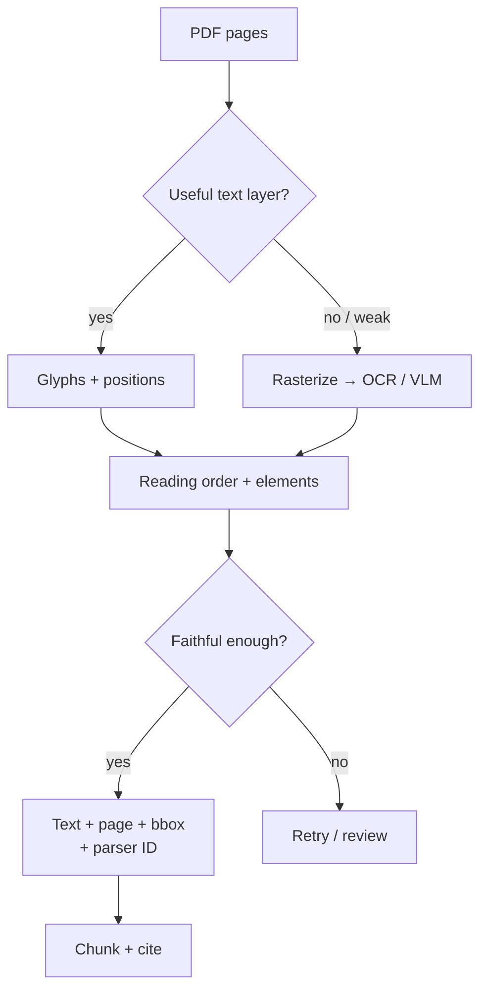

A **PDF parser** reads Portable Document Format objects; an extraction pipeline uses it to recover text and structure that downstream systems can index, embed, cite, or score. It is a specialized [document parser](glossary://document-parser) for PDF. The hard part is not "open the file." PDF content streams describe **drawing instructions**: glyphs and images placed with coordinates and operators. [Tagged PDFs](https://pdfa.org/resource/tagged-pdf-best-practice-guide-syntax/) can also contain logical structure and reading order, but many files lack usable tags. An extractor must use available structure or reconstruct candidates, choose a route when the text layer is missing or unreliable, and emit locators (page, bounding box, parser id) so answers stay auditable.

Three PDF surfaces look similar on screen and fail differently:

| Surface | What the file actually stores | What the parser must do |
|---|---|---|
| Digitally born | Content-stream text operators, fonts, positions | Decode glyphs; group into words/lines; invent reading order |
| Image-only scan | Page images, little or no text | Render, run [OCR](glossary://ocr) (or a document VLM), treat output as derived |
| OCR-backed scan | Image plus a background text layer | Prefer careful OCR of the image when the layer is noisy; never treat OCR text as ground truth |

Native extraction in pypdf, pdfminer.six, PyMuPDF (MuPDF), and pdfplumber reads the text layer. [pypdf does not perform OCR](https://pypdf.readthedocs.io/en/stable/user/extract-text.html); image-only pages need a separate recognition path. [PyMuPDF provides optional Tesseract-backed OCR](https://pymupdf.readthedocs.io/en/latest/recipes-ocr.html), which requires the OCR dependency and an explicit OCR call. Layout-aware and model-based paths such as Unstructured `hi_res` and page-to-markup converters add geometry or vision when operators alone are not enough.

## Intuition

Think of a PDF as a print program, not a word processor document. A content stream can paint characters out of human reading order, split "test" across several operators with spacing adjustments, or draw a table as free-floating strings with no row or column objects. Your parser's job is to recover a **linearization** and optional **element types** that are good enough for retrieval. That recovery is always a hypothesis. Indexing it without quality gates means BM25, dense search, and the LLM all treat a reconstruction error as source truth.

## How it works

A production PDF path usually runs these stages:

1. **Open and page iterate.** Parse the PDF object graph (catalog, page tree, content streams, fonts, XObjects). Encrypted files require authorized decryption credentials before parsing or rendering. Enforce page, memory, and execution-time limits because small files can expand into expensive content streams.
2. **Probe the text layer.** Count useful characters per page, detect replacement characters (`U+FFFD`), measure whether text is almost empty while the page is large. Empty or gibberish pages go to OCR or review, not straight into the index.
3. **Extract glyphs with positions.** Operators such as `Tj` / `TJ` (show text) place runs under a text matrix and current transformation matrix. Parsers map font encodings to Unicode, then cluster characters into words and lines using distance thresholds (pdfminer.six's `LAParams`: character, word, and line margins).
4. **Reconstruct reading order and structure.** Sort lines top-to-bottom / left-to-right for simple pages, or run a layout model for multi-column, forms, and tables. Optional element labels: title, paragraph, list, table, caption, header/footer.
5. **Route scans.** Rasterize at a fixed DPI and run OCR or a page-level document model when native text fails gates.
6. **Emit records.** Text, page number, optional bbox, element type, strategy id, quality flags, content [checksum](glossary://checksum), engine version. That handoff feeds structure-aware [chunking](glossary://chunking).

Common library and strategy choices:

| Tool / strategy | Typical use | Weakness |
|---|---|---|
| pypdf `extract_text` / `extraction_mode="layout"` | Fast native text; layout mode preserves horizontal placement | No OCR; tables and multi-column still heuristic |
| pdfminer.six + `LAParams` | Character-level layout tree (`LTTextBox`, …) | Margin knobs are brittle across document classes |
| PyMuPDF `get_text` / blocks / dict | Fast, rich geometry; good for many born-digital PDFs | Sorting is still not true semantic structure |
| pdfplumber | Tables and word boxes on top of pdfminer | Complex merged cells and multi-page tables break |
| Unstructured `fast` | pdfminer-style text, cheap bulk ingest | Weak on scans and hard layouts |
| Unstructured `ocr_only` | Tesseract (or similar) when no extractable text | Digit errors; layout order can still fail |
| Unstructured `hi_res` | Layout model for element labels and tables; pin the configured model | Slower; still not perfect multi-column order |
| Unstructured `auto` | Choose `fast` vs `ocr_only` (and `hi_res` when table inference needs it) by document traits | Wrong auto route on hybrid pages |
| Nougat-style converters | Academic PDFs to markup (math, tables) from page images | Domain-tuned; cost and hallucination risk on non-science docs |

These [Unstructured strategy names and fallbacks](https://docs.unstructured.io/open-source/core-functionality/partitioning) depend on options and installed dependencies. Pin the exact engine, layout model, and version in [provenance](glossary://provenance). A library upgrade can change extracted chunks even when the source bytes are unchanged.

## Diagram



## Example

Consider a hypothetical incident runbook PDF with these pages and extraction outcomes. The strategy identifiers describe example configurations; measure quality and speed on target PDFs before comparing extractors:

| Page | Surface | Native extract | Parser route | Indexed excerpt |
|---:|---|---|---|---|
| 7 | Born-digital, single column | Clean | `pypdf-layout@6.0` | `Rollback failure: page on-call within 15 minutes with deploy ID.` |
| 8 | Scan of the same policy | Empty | `ocr@tesseract5` | `Rollback failure: page on-call within 1S minutes with deploy ID.` |
| 9 | Two-column layout | Interleaved columns | `layout-hi_res@1.4` | Left policy column, then right notes (correct order) |

A naive stream-order extract on page 9 might yield:

```text
Rollback failure: Routine deploy notes: page on-call within archive within 15 minutes 14 days
```

The words `15 minutes` still appear, so sparse and dense retrieval can rank the page as relevant while the policy sentence is wrong. Page 8's OCR `1S` is worse: the index stores a number that never existed. Both are **parser/OCR failures**, not model reasoning bugs, until you inspect page, route, and checksum.

Minimal native adapter (candidate only; still gate before index):

```python
from importlib.metadata import version
from pypdf import PdfReader


def extract_pages(path: str) -> list[dict]:
    reader = PdfReader(path)
    out = []
    for i, page in enumerate(reader.pages, start=1):
        text = page.extract_text(extraction_mode="layout") or ""
        compact = " ".join(text.split())
        if len(compact) < 40:
            route, quality = "ocr_required", "hold"
        elif "\ufffd" in compact:
            route, quality = "native", "review_encoding"
        else:
            route, quality = "native-layout", "candidate"
        out.append(
            {
                "source_type": "pdf",
                "locator": f"page={i}",
                "text": text,
                "parser": f"pypdf-layout@{version('pypdf')}",
                "route": route,
                "quality": quality,
            }
        )
    return out
```

The character-count rule is a toy routing heuristic: a short page can be correct and a long page can have scrambled columns. Passing it produces a candidate, not a validated page. A record after separate quality review might look like:

```python
record = {
    "source_id": "incident-runbook-v3.pdf",
    "source_type": "pdf",
    "locator": "page=7",
    "bbox": [72, 640, 540, 700],
    "element_type": "NarrativeText",
    "text": "Rollback failure: page on-call within 15 minutes with deploy ID.",
    "parser": "pypdf-layout@6.0",
    "quality": "ready",
    "checksum": "sha256:6b6379...",
}
```

## What fails in production

| Failure | Symptom | Mitigation |
|---|---|---|
| Wrong reading order | Columns or captions interleaved; policy glued to notes | Layout strategy; column-aware order; sample multi-column gold pages |
| Table collapse | Numbers leave their headers; flat line soup | Table extractor / HTML table export; do not chunk tables as plain prose |
| Missing or fake text layer | Empty pages, or OCR background with wrong digits | Char-count and encoding gates; re-OCR scans; mark `derived=ocr` |
| Header/footer pollution | Same line on every page dominates BM25 | Drop near-duplicate lines across pages; strip page-number patterns |
| Ligatures / spacing | `ff` vs `ff`; glued or split words | Unicode normalize; evaluate word boundaries on real fonts |
| Hybrid pages | Half digital, half image | Per-page route, not one strategy for the whole file |
| Version drift | Same PDF, different text after upgrade | Pin parser id; content checksum; [backfill](glossary://backfill) with dual-write index |
| Over-trusting extract | Index accepts any non-empty string | Gold span checks; critical-field validators; hold bad quality |

Parser output is a **candidate**. Quality gates (minimum useful characters, encoding checks, anchor phrases, table shape) decide whether text is ready to index, needs another strategy, or must stay out of retrieval.

## Why it matters here

PDF-heavy RAG corpora can include policies, runbooks, papers, contracts, and exported decks. In LeetLLM's ingestion and retrieval lessons, parsing determines evidence quality before embeddings enter the picture. If extracted text is wrong, later chunks, vectors, and citations inherit that error. Separating native extraction from OCR, pinning parser versions, and keeping page locators helps identify a fixable ingest bug.

## Related terms

- [Document parser](glossary://document-parser)
- [OCR](glossary://ocr)
- [Chunking](glossary://chunking)
- [Provenance](glossary://provenance)
- [Checksum](glossary://checksum)
