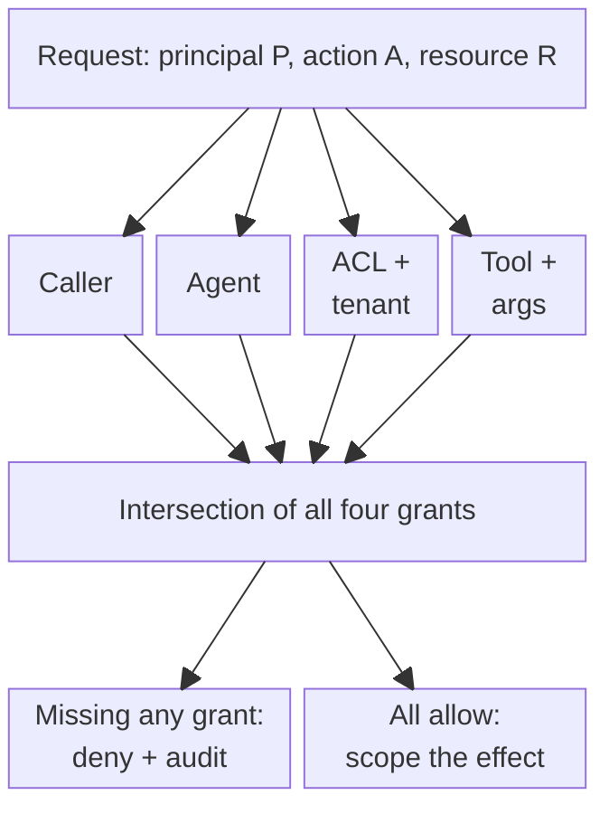

A **permission boundary** is the hard ceiling on what a principal may do: data it can see, tools it can call, actions it can take, environments it can touch, and outputs it can emit. Anything outside that ceiling is denied even if some other policy, prompt, or broad role would otherwise allow it.

The term is formalized in cloud IAM. In AWS, a *permissions boundary* is a managed policy that caps what identity-based policies can grant to a user or role, and grants nothing by itself. That policy path uses the **intersection** of grants and the boundary. Resource policies have additional evaluation paths: same-account grants directly to an IAM user ARN or role-session ARN can escape an *implicit* boundary deny; explicit denies still apply. See [AWS's evaluation rules](https://docs.aws.amazon.com/IAM/latest/UserGuide/access_policies_boundaries.html).

For an AI application, a useful delegated-access design checks several ceilings together: caller rights, the agent's role and tool catalog, tenant and resource ACLs, spend and environment scopes, and session or approval caps. This application contract must be enforced explicitly rather than inferred from the name of a cloud policy.

Enforce a boundary in application code, IAM, retrieval filters, credential minting, and tool gates. A refusal in the final answer cannot undo unauthorized text entering the context window or a tool running with over-broad credentials.

## Intuition

Evaluate every request against its stacked ceilings: caller rights, agent role, resource ACLs, spend, environment, and approval state.

| Ceiling | Question it answers |
| --- | --- |
| Caller rights | What may this human (or service) do right now? |
| Agent / workload role | What was this bot or worker provisioned to do? |
| Resource ACL / tenant | May this principal touch *this* document, repository, or workspace? |
| Action catalog | Is this tool name even executable here? |
| Argument / spend / env scope | Is *this* path, amount, recipient, or environment in bounds? |
| Session / approval / time | Is the grant still valid, one-shot, and approved if required? |

Effective permission is the overlap. Granting the agent the caller's full admin token fails the second ceiling. Giving the agent a god-mode service account fails the first and third. "The model will be careful" fails all of them.

AWS-style language is useful shorthand: identity policies (and role grants) *open* doors; the boundary *closes* doors that must stay closed no matter how wide other policies open. In agent stacks you usually need **both** directions of cap at once: never more than the user, and never more than the agent's own provisioned scope (the delegated-access intersection rule).

## How it works

Name the inventory, then place enforcement *before* side effects and *before* private text reaches the model.

1. **Principal.** Authenticated user, service account, agent session, or delegated workload. Bind identity in trusted middleware; never take "who I am" from free-form model text.
2. **Resource and action.** Document chunk, repository, tool name, export job, deploy target. Decide $(P, A, R)$: may principal $P$ perform action $A$ on resource $R$?
3. **Tenant and classification.** Workspace, customer, sensitivity label. Shared indexes still filter every query.
4. **Credentials.** Use short-lived, narrowly scoped credentials where the downstream service supports them. Enforce argument and approval binding in a trusted gateway when the credential format cannot express it. Ambient admin keys in the agent env are a missing boundary.
5. **Enforcement points.** At least: retrieval filter before prompt pack; tool gate before API/shell/payment; cache key isolation; log/trace redaction or ACL; export and background-job paths.
6. **Denial behavior.** Prefer fail closed: omit the chunk, deny the tool, return a structured reason, write an audit event. Do not "probably allow" on timeout or missing metadata.
7. **Override path.** Rare elevation (production deploy, break-glass admin) is a new, time-bounded grant with approval binding, not a permanent hole in the boundary.

The model may draft tool calls and answers either way. Trusted code decides which capabilities exist.

## Formula

For a fixed request with principal $P$, action $A$, and resource $R$, treat each policy surface as a set of allowed $(A, R)$ pairs (or a predicate $\mathrm{allow}_i$). Effective authority is the intersection:

$$
\mathrm{Eff}(P) \;=\; \mathrm{Grant}(P) \;\cap\; \mathrm{Boundary}(P) \;\cap\; \mathrm{Session}(P) \;\cap\; \mathrm{OrgCeiling}
$$

A request is allowed only if every active surface permits it:

$$
\mathrm{allow}(P, A, R) \iff
(A, R) \in \mathrm{Eff}(P)
\;\land\;
\mathrm{ACL}(R)\ \text{admits}\ P\ \text{for}\ A
$$

In agent form (caller plus workload role):

$$
\mathrm{Eff}_{\mathrm{agent}} \;=\; \mathrm{Perms}(\mathrm{user}) \;\cap\; \mathrm{Perms}(\mathrm{agent\_role}) \;\cap\; \mathrm{ToolAllowlist} \;\cap\; \mathrm{ArgPolicy}
$$

These equations specify an application policy requiring every active ceiling to permit the request, with explicit deny overriding allows. They describe the identity-policy/boundary intersection, but not all AWS resource-policy evaluation paths. A tool allowlist is lifted to allowed action/resource pairs so the set intersection is well-defined.

## Diagram



## Example

Multi-tenant developer assistant. Caller is engineer `u_9` in tenant `acme`. Agent role is `repo_assistant`.

| Layer | Allows |
| --- | --- |
| Caller | Read assigned repositories; deploy to staging; no production deploy |
| Agent role | `search_repo`, `read_ci`, `run_test`, `draft_patch`; no `deploy_prod`, no unrestricted shell |
| ACL / tenant | Repositories and runbooks with `tenant_id=acme` and project membership for `u_9` |
| Credentials | Read/test token scoped to repository `api` for $60\,\mathrm{s}$ |

Retrieval for "Why did release r17 fail its gate?" returns top-$k$ chunks. Before packing:

| Chunk | Score | Boundary check | In prompt? |
| --- | --- | --- | --- |
| `api/r17/eval-report` | $0.92$ | tenant + project match | Yes |
| `payments/r55/incident` | $0.88$ | wrong project | No |
| `hr-comp-plan.md` | $0.81$ | ACL deny for repo_assistant | No |
| `public-deploy-runbook` | $0.70$ | public grant | Yes |

Only allowed chunks enter the model. Later the model proposes:

```json
{"name": "deploy_prod", "args": {"service": "api", "release_id": "r17", "traffic_percent": 100}}
```

The tool gate denies: action isn't on the agent allowlist, production is outside caller scope, and no approval is bound to `r17`. In this example's policy, a separately authorized deployment workload may open a canary at $\le 10\%$ traffic after approval. Its gateway checks service, release digest, environment, traffic cap, and expiry, then atomically consumes the approval to enforce one use. A TTL alone does not make a credential one-shot. The model never holds a production-admin key.

The following pseudocode illustrates only caller/action/tenant checks; a complete gate must also enforce agent resource scope, arguments, expiry, and required approval before minting credentials.

```python
def effective_allow(user_perms, agent_perms, action: str, resource) -> bool:
    # Intersection: every ceiling must allow.
    if action not in user_perms.actions:
        return False
    if action not in agent_perms.actions:
        return False
    if resource.tenant_id != user_perms.tenant_id:
        return False
    if not acl_allows(user_perms.principal, action, resource):
        return False
    return True

def authorize_tool(user, agent_role, name: str, args: dict):
    resource = load_resource(args)  # repository, document, release, etc.
    if not effective_allow(user.perms, agent_role.perms, name, resource):
        audit("deny", user, name, args, reason="outside_permission_boundary")
        raise PermissionError("outside permission boundary")
    # Mint narrow creds only after all ceilings pass
    return mint_scoped_token(user, name, resource, ttl_s=60)
```

What fails in production when the boundary is soft or incomplete:

- **Service account RAG.** One index reader sees every tenant; similarity search becomes a cross-tenant leak into the prompt. Output filters cannot un-see private context.
- **Run-as-user with full token.** The agent inherits admin delete rights; a vague "clean up old resources" or an injected doc becomes a confused-deputy incident.
- **Cache and logs.** Answer cache keyed only by query text serves user A's private answer to user B. Traces that dump full prompts leak the same data the chat UI tried to hide.
- **Background jobs and exports.** Async summarizers and CSV exports reusing a broad key bypass the interactive tool gate.
- **Stale grants.** ACL checked only at ingest; revoked readers still retrieve until you re-check at query time (OWASP RAG guidance: enforce at retrieval, store ACL metadata on every chunk).

## Why it matters here

LLM products turn natural language into retrieval, tool calls, and side effects at machine speed. Put security controls in credentials, indexes, and tool catalogs because a buggy plan or prompt injection can request any available capability. A permission boundary makes these controls testable: intersect grants, enforce before context packing and side effects, deny on missing checks, and audit allows and denials. For AI/ML engineers it shows up as IAM ceilings on training and serving roles, permission-aware vector filters, user $\cap$ agent tool scope, scoped short-lived tokens, and the same filters on caches, logs, workers, and exports. Design the ceiling for the job you intend; assume the model will eventually ask for everything else.

## Related terms

- [Policy gate](glossary://policy-gate)
- [Least privilege](glossary://least-privilege)
- [RBAC](glossary://rbac)
- [Fail closed](glossary://fail-closed)
- [Action allowlist](glossary://action-allowlist)
