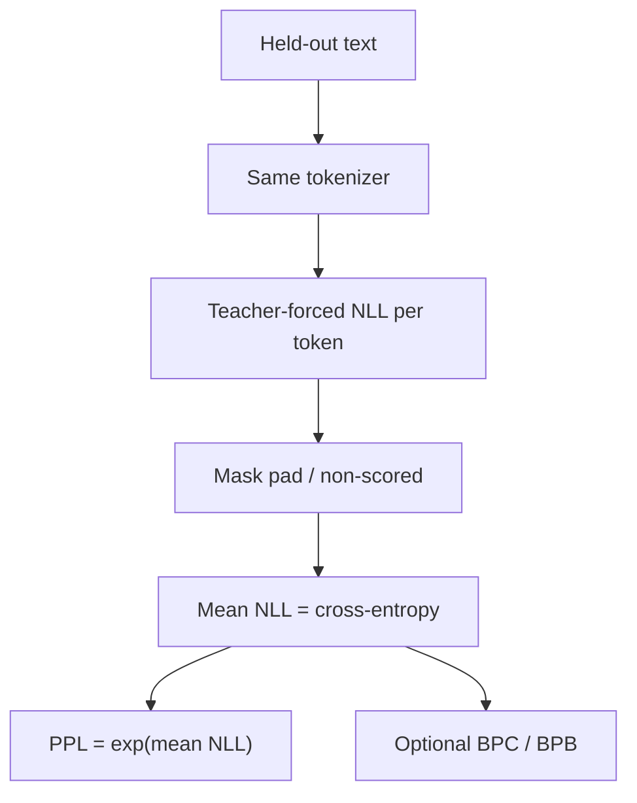

**Perplexity (PPL)** is the standard *intrinsic* metric for autoregressive language models: the exponentiated average per-token negative log-likelihood on held-out text. If the geometric mean of the model's gold-token probabilities under teacher forcing is $p$, then perplexity is $1/p$. A PPL of $10$ means the model is, on average, as uncertain as if it chose uniformly among $10$ options at each step (the "effective branching factor").

It is the same quantity as average [cross-entropy](glossary://cross-entropy) under a different packaging: training graphs usually plot loss in nats; papers often report $\exp(\text{loss})$ so the number is a branching factor instead of a log-score. Lower is better under a fixed tokenizer, dataset, masking, and context protocol. Perplexity directly scores causal next-token models; bidirectional masked LMs need a scoring procedure defined for their objective. Measure instruction following, factuality, and tool use with task-specific evaluations.

## Intuition

Language modeling factorizes a sequence as a product of next-token probabilities. Products of small numbers are hard to read; the geometric mean of those probabilities is not:

$$
\mathrm{PPL}(X) = \Bigg(\prod_{i=1}^{t} p_\theta(x_i \mid x_{<i})\Bigg)^{-1/t}
$$

That product form is the inverse geometric mean of the per-token probabilities, which is exactly $\exp$ of mean negative log-likelihood. If every gold token had probability $0.25$, PPL would be $4$ no matter the sequence length. A uniform model over vocabulary size $V$ has PPL $V$; a perfect model that always puts mass $1$ on the gold token has PPL $1$ (unattainable on open text).

Think of PPL as "how many equally likely next tokens the model is effectively juggling." Compression people see the same number as a code length: bits per token is average $H$ in base $2$, and $\mathrm{PPL} = 2^{H_{\mathrm{bits}}}$.

## Formula

For a tokenized sequence $X = (x_1,\ldots,x_t)$ and model $p_\theta$:

$$
\mathrm{PPL}(X) = \exp\left\{-\frac{1}{t}\sum_{i=1}^{t}\log p_\theta(x_i \mid x_{<i})\right\}
$$

with natural log (PyTorch / most training stacks). Equivalently, if $H$ is mean cross-entropy in nats, $\mathrm{PPL} = e^{H}$. If $H_2$ is mean cross-entropy in bits, $\mathrm{PPL} = 2^{H_2}$. Same number either way.

**Corpus average.** Sum negative log-likelihood over all scored tokens in the corpus, divide by token count, then exponentiate once. An unweighted average of document perplexities gives short documents the same weight as long ones and is a different statistic, even before accounting for the nonlinear exponential.

**Masking.** Only tokens that contribute to loss enter $t$: pad tokens, prompt-only spans in SFT, or context-only tokens in a sliding window must use `ignore_index` / $-100$ (or equivalent) so they do not dilute or inflate the mean.

**Bits-per-character / bits-per-byte.** Token-level PPL is tokenizer-dependent. For cross-tokenizer comparison, normalize total NLL by characters or UTF-8 bytes:

$$
\mathrm{BPC} = \frac{1}{\ln 2}\cdot\frac{1}{C}\sum_{i=1}^{t}-\ln p_\theta(x_i \mid x_{<i})
= \frac{t}{C}\cdot\frac{\ln(\mathrm{PPL})}{\ln 2}
$$

where $C$ is character (or byte) count of the raw text. BPC/BPB normalize code length to the string rather than a particular subword inventory. Compare the same raw text and account consistently for normalization, special tokens, and scored spans; byte normalization cannot repair different evaluation data.

## Worked numbers

Natural log. Three gold tokens with probabilities $0.5$, $0.25$, $0.5$:

| $i$ | $p_i$ | $-\ln p_i$ |
|----:|------:|-----------:|
| 1 | $0.5$ | $\approx 0.693$ |
| 2 | $0.25$ | $\approx 1.386$ |
| 3 | $0.5$ | $\approx 0.693$ |

Mean NLL $\approx 0.924$ nats. $\mathrm{PPL} = e^{0.924} \approx 2.52$. Geometric-mean check: $(0.5 \cdot 0.25 \cdot 0.5)^{1/3} \approx 0.397$, and $1/0.397 \approx 2.52$.

Bits: $H_2 = 0.924 / \ln 2 \approx 1.33$ bits/token, and $2^{1.33} \approx 2.52$.

```python
import math

ps = [0.5, 0.25, 0.5]
mean_nll = -sum(math.log(p) for p in ps) / len(ps)
print(round(math.exp(mean_nll), 3))  # 2.52
```

Uniform over $V=50257$ (GPT-2-sized vocab, no structure): $\mathrm{PPL}=V$. A strong domain LM on clean prose can sit in the low tens or below on that domain's held-out set; the absolute number is meaningless without matching eval protocol.

## Example

**Domain adaptation check.** Consider hypothetical results after continued pretraining on internal legal PDFs. On a frozen held-out legal slice (same tokenizer, same max length, same stride, loss only on non-pad tokens):

| checkpoint | mean NLL (nats) | PPL |
|------------|----------------:|----:|
| base | $2.89$ | $\approx 18.0$ |
| +1 epoch domain CPT | $2.48$ | $\approx 12.0$ |

The adapted model assigns higher average log-probability to this corpus's gold tokens, measuring held-out likelihood under this setup. Assess data quality and overfitting with data audits and generalization checks. Evaluate citation quality, instruction following, and safety with task-specific regression tests before release.

**Fixed context length (strided window).** For models with max length $k$ shorter than the corpus, non-overlapping chunks reduce early tokens' context and typically raise PPL. [Hugging Face's documented compromise](https://huggingface.co/docs/transformers/perplexity) uses a sliding window with stride $s < k$: each forward pass scores only the *new* tokens while conditioning on up to $k-1$ predecessors. The Hugging Face documentation reports roughly PPL $19.4$ with no overlap versus $16.4$ with stride $512$ on WikiText-2 using GPT-2 large. Always document stride and max length next to the number.

## How it works (eval path)

1. Tokenize the held-out corpus with the **same** tokenizer artifact as training.
2. Score gold tokens under causal teacher forcing (labels shifted by one; no free-running sample).
3. Mask pads / non-scored positions so they never enter the mean.
4. For long documents, use a strided sliding window so most tokens see rich left context.
5. Accumulate total NLL and total token count; $\mathrm{PPL}=\exp(\mathrm{NLL}/\mathrm{count})$.
6. Optionally report BPC/BPB alongside token PPL when tokenizers differ across candidates.

```python
# Sketch: mean NLL then exp (batch already shifted/masked)
# loss = F.cross_entropy(logits, labels, ignore_index=-100, reduction="sum")
# ppl = exp(loss / n_valid_tokens)
```

## Diagram



## What fails in production

**Incomparable setups.** Different BPE vocabularies, whitespace rules, special tokens, max length, stride, or loss masks change PPL without changing user-visible quality. Cross-model leaderboards that mix tokenizers without BPC/BPB are noise.

**Wrong product claim.** Falling PPL on web text indicates improved token likelihood on that distribution. Evaluate RAG answers, tool calling, and preference alignment with dedicated task tests. After SFT/RLHF, base-style PPL on pretraining data can rise while chat quality improves because the objective changed.

**Contamination and leakage.** Eval text that appeared in training (or near-duplicates) can yield optimistically low PPL. Perplexity cannot be below $1$ for valid normalized token probabilities. An unexpectedly low value near $1$ merits checking leakage, repetitive data, masking, and aggregation rather than assuming exceptional generalization.

**Slice blindness.** A single corpus mean hides regressions on rare languages, code, or safety-critical strings. Track PPL (or mean NLL) by [evaluation slice](glossary://evaluation-slice) when the product cares about those slices.

**Generation vs scoring.** Perplexity scores the *gold* continuation under teacher forcing. Evaluate free-running, temperature-sampled, or beam-search outputs with generation metrics, or score those sample strings under a defined likelihood protocol.

## Why it matters here

Perplexity is the readable form of the next-token training objective: the same NLL you minimize in [pretraining](glossary://pretraining) and often still track in continued pretraining and domain adaptation. Curriculum topics on [cross-entropy](glossary://cross-entropy), [logprob](glossary://logprob), [tokenization](glossary://tokenization), and teacher-forced eval all meet here. Use it as a fast, cheap smoke signal for "does this checkpoint still model this distribution?" then insist on task metrics before claiming product progress.

## Related terms

- [Cross-entropy](glossary://cross-entropy)
- [Logprob](glossary://logprob)
- [Tokenization](glossary://tokenization)
- [Teacher forcing](glossary://teacher-forcing)
- [Pretraining](glossary://pretraining)
