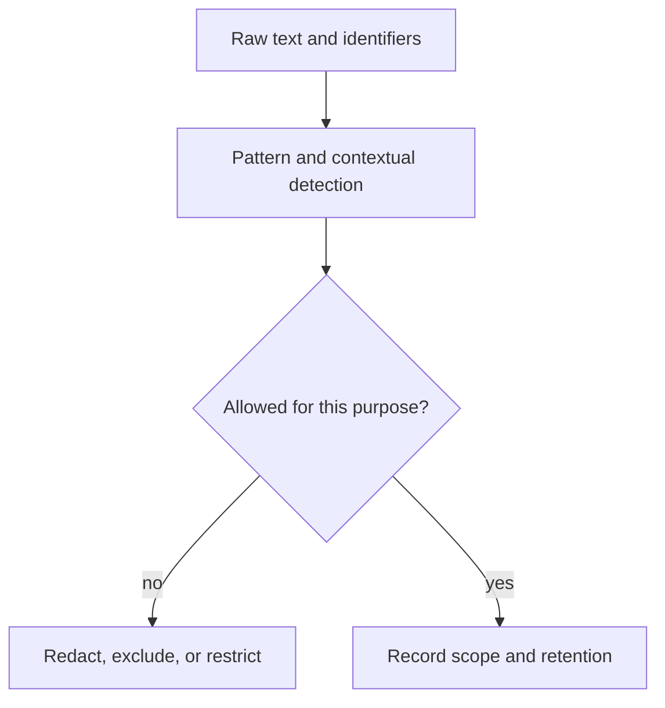

**Personally identifiable information (PII)** is information that identifies a specific person directly, or helps identify them when combined with other available data. Names, email addresses, phone numbers, account identifiers, government-issued identifiers, and precise location data can qualify depending on context. Whether a field is protected, and which handling obligations apply, depends on the relevant jurisdiction, product policy, and surrounding dataset.

The category can also include information *about* an identifiable person, such as linked medical, financial, or employment records. [NIST's definitions](https://csrc.nist.gov/glossary/term/personally_identifiable_information) include linked or linkable information. The EU GDPR uses the related legal term **personal data**, with its own definition and scope; its [Article 4 and Recital 26](https://eur-lex.europa.eu/eli/reg/2016/679/oj/eng) distinguish pseudonymized personal data from anonymous information. These legal categories have different scopes across frameworks.

## Identification depends on context

A support transcript containing a rare job title, an exact incident timestamp, and a small office location may identify its author even without an email address. Hashed identifiers can remain linkable if the input space is small or the same hash appears across systems. Pseudonymization reduces direct exposure; assess linkability before treating the data as anonymous.

## Example

A training-data pipeline ingests an incident report containing `casey@example.com`, an internal employee identifier, and a customer conversation. A regular expression can replace the email with a placeholder, but it won't reliably recognize every identifying phrase inside the conversation. Add context-aware review, source-specific exclusion rules, access controls, and sample audits. Record which detector version processed the document and which authorized purpose permits retention.

Treat downstream copies as part of the same inventory. The original document, normalized dataset, embedding index, debug logs, evaluation fixtures, and cached agent transcript can each preserve sensitive material after the source text was edited.

## Why it matters here

Pretraining, retrieval, agent memory, observability, and evaluation all move human-generated text across system boundaries. Readers need to distinguish identifier detection, policy enforcement, lineage, retention, and formal privacy guarantees before declaring a dataset or model output safe.

## Related terms

- [Data governance](glossary://data-governance)
- [Differential privacy](glossary://differential-privacy)
- [Privacy budget](glossary://privacy-budget)
- [Secrets management](glossary://secrets-management)
- [Audit trail](glossary://audit-trail)
