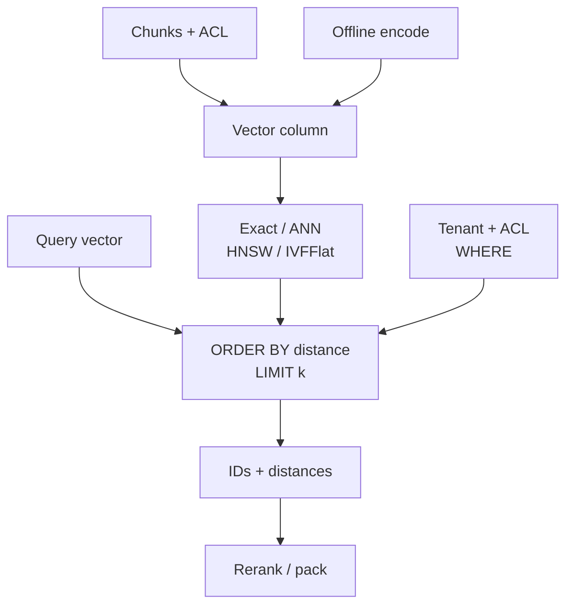

**pgvector** is an open-source [PostgreSQL](glossary://postgresql) extension that adds typed vector columns, distance operators, and [ANN](glossary://ann-search) indexes so embeddings live beside ordinary relational data. Enable it once per database with `CREATE EXTENSION vector;`, then store float vectors as `vector(d)`, rank neighbors with operators such as `<->` (L2) or `<=>` (cosine distance), and optionally build `hnsw` or `ivfflat` indexes when exact scan is too slow.

pgvector runs inside Postgres, so WAL, transactions, JOINs, backups, replicas, and SQL permissions still apply. That is the product pitch and the operational constraint. You keep [dense retrieval](glossary://dense-retrieval) inside the same ACID boundary as documents, tenants, and ACLs, at the cost of sharing CPU, memory, and I/O with the rest of the database.

The extension supports exact nearest neighbor search by default (perfect geometric recall) and approximate indexes when you trade some recall for latency. Types include single-precision `vector`, half-precision `halfvec`, binary `bit`, and `sparsevec`. Distance families include L2, (negative) inner product, cosine, L1, and for binary vectors Hamming and Jaccard.

## Intuition

Treat pgvector as "embeddings are another column type." A chunk row can hold `text`, `tenant_id`, `document_id`, and `embedding vector(1536)` in one place. A query becomes: embed the question, then `ORDER BY embedding <=> $q LIMIT k` with a `WHERE` that already encodes tenant and permission filters.

Compared with a library like [FAISS](glossary://faiss), whose high-performance index toolbox leaves persistence coordination, multi-writer rules, and ACL enforcement to your application, pgvector offers SQL and the Postgres operational stack with less index-engineering freedom. Co-locating vectors with product state can simplify access decisions. Suitable capacity depends on dimensions, filters, query concurrency, hardware, and the latency target.

## How it works

### Store and rank

1. **Enable and declare.** `CREATE EXTENSION vector;` then `embedding vector(d)` (or `halfvec(d)`, `bit(d)`, `sparsevec(d)`).
2. **Insert.** Write embeddings from your encoder as float arrays; bulk load with `COPY` when backfilling.
3. **Exact search.** Without an ANN index, Postgres scans and sorts by a distance operator. Recall is exact under that metric.
4. **Approximate search.** Create `hnsw` or `ivfflat` with an operator class that matches the metric you will use at query time (`vector_cosine_ops`, `vector_l2_ops`, `vector_ip_ops`, …).
5. **Filter and join.** Combine vector order with SQL `WHERE`, JOINs to permission tables, and full-text search for hybrid retrieval.

### Distance operators (float vectors)

| Operator | Meaning | Notes |
| --- | --- | --- |
| `<->` | L2 (Euclidean) distance | Standard geometric distance |
| `<#>` | **Negative** inner product | Postgres index scans need ASC order, so smaller is "better" |
| `<=>` | Cosine **distance** | Similarity in SQL: `1 - (embedding <=> q)` |
| `<+>` | L1 (taxicab) distance | Absolute difference sum |

Binary vectors use `<~>` (Hamming) and `<%>` (Jaccard). Indexes require an `ORDER BY` on a distance operator in ascending order plus a `LIMIT`; expressions like `ORDER BY 1 - (embedding <=> q) DESC` will not use the index.

### Index families

| Index | Idea | Build | Query knobs | When it fits |
| --- | --- | --- | --- | --- |
| **None (exact)** | Scan all rows (or filter-first then rank) | n/a | parallel workers | Small $N$, or high-selectivity filters that shrink the set |
| **HNSW** | Multi-layer proximity graph ([HNSW](glossary://hnsw)) | Slower, more RAM; no training step; build knobs `m`, `ef_construction` | `hnsw.ef_search` | Candidate for interactive recall/latency |
| **IVFFlat** | Coarse lists ([IVF](glossary://ivf)); probe nearest lists | Faster, less memory; train after data exists; build knob `lists` | `ivfflat.probes` | Build-cost or memory constrained corpora |

The [official pgvector README](https://github.com/pgvector/pgvector) documents HNSW's stronger speed-recall tradeoff and IVFFlat's cheaper builds. Create IVFFlat *after* the table has data; suggested starting points are `lists ≈ rows/1000` up to about 1M rows and $\sqrt{\text{rows}}$ above that, with `probes` near $\sqrt{\text{lists}}$. HNSW defaults are `m = 16`, `ef_construction = 64`, `ef_search = 40`. Tune these initial settings against the workload's recall and latency.

### Filtering and ANN

With approximate indexes, SQL filtering occurs **after** candidates are scanned. Partial indexes and partition pruning can restrict the indexed population. From 0.8.0, **iterative scans** scan more candidates after filtering, until enough matches or a configured scan limit is reached. Authorization remains a separate query/application check, and approximate scans can still miss eligible neighbors. For intuition, a uniform 40-candidate shortlist with a predicate matching 10% of rows would retain about four results. Actual tenant/ACL selectivity can correlate with geometry. Tune `ef_search` / `probes`, iterative scans, partial indexes, or partitions against the filtered workload.

## Formula

For query embedding $q$ and stored vectors $\{x_i\}$ in $\mathbb{R}^d$:

**L2 distance** (`<->`):

$$
\mathrm{d}_{\mathrm{L2}}(q, x) = \|q - x\|_2 = \sqrt{\sum_{j=1}^{d}(q_j - x_j)^2}
$$

**Cosine distance** (`<=>`) for nonzero vectors, with cosine similarity as the complement used in apps:

$$
\mathrm{d}_{\cos}(q, x) = 1 - \frac{\langle q, x \rangle}{\|q\|_2\,\|x\|_2}, \qquad
\mathrm{sim}_{\cos}(q, x) = 1 - \mathrm{d}_{\cos}(q, x)
$$

**Inner product** for ranking: the operator `<#>` returns $-\langle q, x \rangle$ so ascending order matches maximum inner product search (MIPS). Recover the true IP with a sign flip in SQL: `(embedding <#> q) * -1`.

If embeddings are L2-normalized (common for dual encoders and many commercial embedding APIs), MIPS and cosine agree:

$$
\|q\|_2 = \|x\|_2 = 1 \;\Rightarrow\; \langle q, x \rangle = \cos(q, x).
$$

pgvector notes that for unit-normalized vectors, inner product ranking is the faster path. Storage for one `vector` value is $4d + 8$ bytes (float32 elements plus header). Indexable dimensions for `vector` HNSW/IVFFlat are capped at 2,000; half-precision and binary paths raise those ceilings for larger models or compressed indexes.

ANN fidelity (same as other vector systems): for approximate top-$k$ set $A_k$ and exact geometric top-$k$ set $E_k$,

$$
\mathrm{ANN\text{-}recall@}k = \frac{|A_k \cap E_k|}{k}.
$$

Measure with `SET LOCAL enable_indexscan = off` (or disable the ANN path) on a query sample and compare id sets to assess index fidelity. Evaluate task recall separately on human-labeled queries.

## Diagram



## Example

Support RAG on Postgres: $N = 500{,}000$ chunks, $d = 1536$ float32 embeddings from a cosine-trained bi-encoder, multi-tenant with per-document ACLs.

**Schema (sketch):**

```sql
CREATE EXTENSION IF NOT EXISTS vector;

CREATE TABLE chunks (
  id            uuid PRIMARY KEY,
  tenant_id     text NOT NULL,
  document_id   uuid NOT NULL,
  chunk_text    text NOT NULL,
  embedding     vector(1536) NOT NULL
);

CREATE INDEX chunks_tenant_doc_idx ON chunks (tenant_id, document_id);

-- Cosine ANN; build after bulk load for best performance
CREATE INDEX chunks_embedding_hnsw
  ON chunks USING hnsw (embedding vector_cosine_ops)
  WITH (m = 16, ef_construction = 64);
```

**Raw vector storage (order of magnitude):**

$$
500{,}000 \times (4 \times 1536 + 8) \approx 500{,}000 \times 6{,}152 \approx 3.1\,\mathrm{GB}
$$

plus HNSW graph, TOAST, and metadata. Plan `shared_buffers` / instance RAM so hot indexes stay cached.

**Query path** (caller may read only documents in a join table `document_acl`):

```sql
BEGIN;
SET LOCAL hnsw.ef_search = 100;

SELECT c.id, c.document_id, c.chunk_text,
       1 - (c.embedding <=> $1::vector) AS cosine_sim
FROM chunks c
JOIN document_acl a
  ON a.document_id = c.document_id
 AND a.principal_id = $2
 AND a.can_read
WHERE c.tenant_id = $3
ORDER BY c.embedding <=> $1::vector
LIMIT 20;
COMMIT;
```

Here `$1` is the query embedding; trusted server code supplies `$2` from the authenticated principal and `$3` from its authorized tenant. Assume `document_acl` has at most one matching read grant per document/principal, or use `EXISTS` to avoid duplicate hits. Permissions and ranking share a database snapshot. Configure row-level security separately when the database must enforce access across all query paths. If filters are selective and you get fewer than 20 rows, raise `ef_search`, enable iterative scans, or filter first and rank the eligible set exactly.

**IVFFlat alternative** after data is loaded:

```sql
CREATE INDEX chunks_embedding_ivf
  ON chunks USING ivfflat (embedding vector_cosine_ops)
  WITH (lists = 500);  -- ~N/1000 for N=500k

SET ivfflat.probes = 22;  -- ~sqrt(lists)
```

## Trade-offs

| Dimension | Win | Cost |
| --- | --- | --- |
| Architecture | One store for docs, vectors, ACL, backups | Vector load shares OLTP capacity |
| Consistency | ACL revoke and delete land with WAL/replicas | Heavy re-embed jobs can lock or bloat like any big write |
| Indexes | HNSW/IVFFlat inside SQL; hybrid with FTS | Filter-after-ANN starvation; operator-class must match metric |
| Scale | Can combine partitions, replicas, and compressed representations | Capacity needs workload measurement; dimension and concurrency matter alongside row count |
| Ops | Same Postgres monitoring, PITR, extensions | HNSW build/vacuum can be long; set `maintenance_work_mem` carefully |

Compared with FAISS or a managed vector DB: pick pgvector when SQL JOINs, permissions, and operational simplicity dominate; pick a specialized index stack when pure ANN QPS, billion-scale compression, or GPU search dominate.

## Debug path

When retrieval "regresses" on pgvector:

1. **`EXPLAIN (ANALYZE, BUFFERS)`** the query. Confirm the HNSW/IVFFlat scan (or intentional sequential path). Missing `ORDER BY distance LIMIT` means no ANN index path.
2. **Metric / opclass match.** Cosine queries need `vector_cosine_ops` and `<=>`. L2 indexes will not accelerate cosine orderings.
3. **ANN vs exact.** Compare ids with indexscan off. If ANN-recall@k is low, raise `hnsw.ef_search` or `ivfflat.probes`; if IVF was built on tiny data, drop and rebuild after load.
4. **Filter starvation.** Log candidate counts before and after ACL. Enable iterative scans or partial indexes when post-filter kills top-$k$.
5. **Stale geometry.** New embedding model or chunker requires re-embed and reindex; mixing model versions in one column scrambles neighborhoods.
6. **Resource pressure.** Ingestion, vacuum, and ANN queries competing on one primary show up as p95 spikes; split read traffic to a replica or isolate vector work if OLTP SLOs slip.

## Why it matters here

Curriculum RAG systems need a realistic embedding store that respects tenants, deletes, and backups. pgvector is that bridge from experiments to a product that already runs on Postgres (including hosted stacks such as Supabase). Lessons on dense retrieval, HNSW/IVF, ACLs, and hybrid search all land here. Learning the operators, operator classes, and filter-after-ANN failure mode prevents the classic bug where the LLM looks broken because the gold chunk never left the database.

## Related terms

- [PostgreSQL](glossary://postgresql)
- [ANN search](glossary://ann-search)
- [HNSW](glossary://hnsw)
- [Dense retrieval](glossary://dense-retrieval)
- [Embedding](glossary://embedding)
