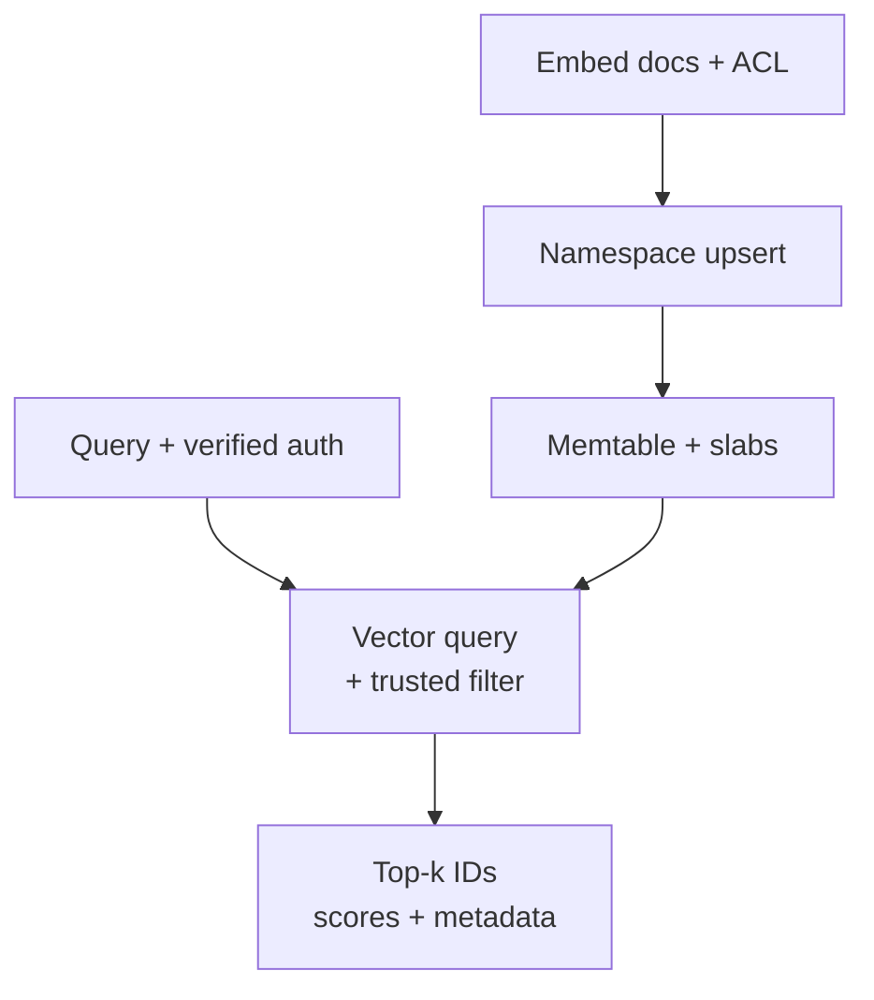

**Pinecone** is a managed vector database for storing [embeddings](glossary://embedding), running approximate nearest-neighbor ([ANN](glossary://ann-search)) search, and applying [metadata filters](glossary://metadata-filter) at query time. You create an **index** with a fixed dense dimension and similarity metric (or a sparse / hybrid configuration), **upsert** records of the form `(id, vector[, sparse_values], metadata)`, and **query** with a vector plus an optional filter and `top_k`. Pinecone runs the index as a cloud service (AWS, GCP, Azure serverless regions). You do not operate the underlying search/storage infrastructure yourself; legacy pod-based indexes still expose pod-capacity configuration. You own the retrieval contract around it: embedding model, chunking, ACL metadata, freshness, and evals.

That workflow describes the **Vectors API**. As of September 23, 2026, Pinecone also supports a **Documents API** with schema-declared text, dense-vector, and sparse-vector fields. Its [data model](https://docs.pinecone.io/guides/index-data/data-modeling) supports full-text search as well as semantic retrieval; the two index models use different request shapes. This entry's code uses vector records.

Pinecone provides indexing and query infrastructure for [dense retrieval](glossary://dense-retrieval) and [RAG](glossary://rag). Applications still choose chunking, filtering, and grounding policies; a correct nearest-neighbor score with the wrong tenant filter, stale version, or mismatched embedding model can ship a bad answer.

## Intuition

Think of three layers you always separate in production RAG:

1. **Geometry.** An embedding model maps text (or images, etc.) into $\mathbb{R}^d$. Similar meaning means nearby vectors under a chosen metric.
2. **Index serving.** Pinecone stores those vectors, keeps an ANN structure fresh under upserts/deletes, and returns top-$k$ ids and scores quickly.
3. **Product constraints.** Metadata and **namespaces** restrict which vectors are eligible: tenant, document type, region, visibility, version.

FAISS-style libraries solve (2) as an in-process index. Self-hosted stores such as [Qdrant](glossary://qdrant) or [Weaviate](glossary://weaviate) solve (2)+(3) with more operational ownership. Pinecone's product pitch is: (2) as an API, with (3) as first-class filters and partitions, so your app code focuses on (1) and on trustworthy metadata.

## How it works

### Resource model

| Object | Role |
| --- | --- |
| **Organization / project** | Billing, API keys, index inventory |
| **Index** | Named collection with a vector configuration or a document schema |
| **Namespace** | Logical partition inside one index; every upsert and query targets exactly one namespace |
| **Record / document** | Vector record with `id` and vector fields, or schema-based document with `_id`, ranking fields, and metadata |

Serverless is the default deployment path for new indexes. Writes and reads scale on separate paths. Durable state lives in object storage as immutable **slabs** per namespace; recent writes sit in an in-memory **memtable** so queries can see data that has not yet been flushed. Query routers fan work across slab executors, apply metadata filters while scoring, merge with memtable hits, and return the global top-$k$. Cold namespaces pay a first-touch cost when slabs are fetched from object storage into cache; warm namespaces stay in memory or local SSD.

Older **pod-based** indexes still exist for eligible customers, who configure pod type and capacity. [New Standard/Enterprise signups on or after 2025-08-18 cannot create pods](https://docs.pinecone.io/guides/indexes/pods/create-a-pod-based-index) and use serverless instead, with dedicated read nodes available for some workloads. Prefer current serverless docs when designing new systems.

### Write path

1. **Create the index** with `dimension` and `metric` matching your embedding model (`cosine`, `euclidean`, or `dotproduct` for dense; sparse indexes use `dotproduct`).
2. **Embed offline** (your model or a Pinecone-hosted model with integrated embedding).
3. **Upsert** batches of records into a namespace. Same `id` overwrites the previous vector and metadata (idempotent replace).
4. **Delete** by id or by metadata filter when sources leave the corpus or lose ACL grants.

Large bulk loads can import from object storage (Parquet) instead of streaming millions of upsert RPCs. Upsert is for ongoing freshness.

### Read path

1. Embed the live query with the **same** model, metric convention, and normalization as the corpus.
2. Build a **metadata filter** in trusted server code from auth context (never from free-form model text alone).
3. Call `query` with `vector`, `top_k`, `namespace`, optional `filter`, and whether to return metadata/values.
4. Optionally fuse with sparse signals ([hybrid search](glossary://hybrid-search)), then [rerank](glossary://reranker) and pack context for the generator.

### Metadata

Vector-record metadata is a flat JSON object (no nesting): strings, numbers, booleans, or lists of strings. Keys must not start with `$`. The [documented limit](https://docs.pinecone.io/guides/index-data/data-modeling#include-metadata) is **40 KB** per record or document. Full-text string fields in a document schema have separate limits. Filters use a Mongo-like language: `$eq`, `$ne`, `$gt`/`$gte`/`$lt`/`$lte`, `$in`/`$nin`, `$exists`, and top-level `$and` / `$or`. On the read path, executors exclude non-matching records from ranking; unfiltered vector queries search the targeted namespace.

### Namespaces vs metadata for multitenancy

Pinecone's recommended multitenant pattern on serverless is **one namespace per tenant** when you need strong isolation and per-tenant scale: each namespace is stored separately, and queries never scan another tenant's vectors. Use **metadata filters** inside a namespace for document type, language, version, or ACL labels that cut across many small facets. Mixing millions of tiny tenants into one giant namespace and relying only on `tenant_id` filters is usually the wrong default when the product needs hard isolation.

## Formula

**Dense nearest neighbor** under a metric $d$ (what the index approximates, optionally restricted by filter $f$):

$$
j^\star = \arg\min_{i:\, f(x_i)=\mathrm{true}} d(q, x_i)
$$

For maximum inner product search (common with unit-normalized dual-encoder embeddings, or with `metric="dotproduct"`):

$$
j^\star = \arg\max_{i:\, f(x_i)=\mathrm{true}} \langle q, x_i \rangle
$$

After L2-normalizing both sides, $\langle q, x \rangle = \cos(q, x)$, so cosine and normalized dot product agree. Match the index metric to the embedding training objective; mismatch is a silent quality bug.

**Hybrid (single dense+sparse index).** Pinecone scores sparse and dense coordinates with `dotproduct` on one record. Sparse BM25-style weights are not on the same scale as dense cosine/dotproduct scores, so raw fusion lets sparse dominate. At query time, apply a convex combination via query-side scaling with weight $\alpha \in [0,1]$:

$$
q'_{\mathrm{dense}} = \alpha \, q_{\mathrm{dense}}, \qquad
q'_{\mathrm{sparse}} = (1-\alpha) \, q_{\mathrm{sparse}}
$$

Then the index score is $\alpha \cdot s_{\mathrm{dense}} + (1-\alpha) \cdot s_{\mathrm{sparse}}$. $\alpha = 1$ removes the sparse contribution; $\alpha = 0$ removes the dense contribution. Tune the balance on labeled queries; $0.75$ below is an example, not a universal default. [Current hybrid-search guidance](https://docs.pinecone.io/guides/search/hybrid-search) also covers Documents API text filtering and client-side reciprocal rank fusion.

## Diagram



## Example

Multi-tenant policy assistant. Index: serverless dense, `dimension=1024`, `metric="cosine"`. Namespace per customer. Each chunk is one record.

```python
from pinecone import Pinecone, ServerlessSpec

pc = Pinecone(api_key="...")
name = "policy-chunks"
if not pc.has_index(name):
    pc.create_index(
        name=name,
        vector_type="dense",
        dimension=1024,
        metric="cosine",
        spec=ServerlessSpec(cloud="aws", region="us-east-1"),
    )
index = pc.Index(host="...")  # index host from describe_index

# Ingest one chunk for tenant acme (embedding produced offline)
index.upsert(
    namespace="tenant_acme",
    vectors=[{
        "id": "doc_return_policy_v3#chunk_12",
        "values": embedding_1024,  # list[float], same model as query
        "metadata": {
            "document_id": "doc_return_policy_v3",
            "document_type": "policy",
            "region": "us",
            "version": 3,
            "security_label": "support",
            "is_current": True,
        },
    }],
)

# Query: only current support-visible US policies
query_vec = embed_query("Which checks block production for release r17?")
result = index.query(
    namespace="tenant_acme",
    vector=query_vec,
    top_k=40,
    include_metadata=True,
    filter={
        "$and": [
            {"document_type": {"$eq": "policy"}},
            {"region": {"$eq": "us"}},
            {"security_label": {"$in": ["public", "support"]}},
            {"is_current": {"$eq": True}},
        ]
    },
)
# result.matches: id, score, metadata for packing into the RAG prompt
```

A common miss is operational: the filter uses `version: 2` after v3 was published, `is_current` stays true on old vectors, or the query embedding comes from a different model than the index. The nearest wrong chunk still looks confident.

Hybrid sketch (dense+sparse record index requires `metric="dotproduct"`):

```python
def hybrid_score_norm(dense, sparse, alpha: float):
    """alpha * dense + (1 - alpha) * sparse on the query side."""
    if not 0.0 <= alpha <= 1.0:
        raise ValueError("alpha must be in [0, 1]")
    hdense = [v * alpha for v in dense]
    hsparse = {
        "indices": sparse["indices"],
        "values": [v * (1.0 - alpha) for v in sparse["values"]],
    }
    return hdense, hsparse

hdense, hsparse = hybrid_score_norm(dense_q, sparse_q, alpha=0.75)
hybrid_index.query(namespace="tenant_acme", top_k=40, vector=hdense, sparse_vector=hsparse)
```

## What fails in production

| Failure | What you see | Fix direction |
| --- | --- | --- |
| **Wrong embedding contract** | High geometric self-similarity on eval, low task recall | Lock model id, dimension, metric, and normalize/query prefix; rebuild the index after any change |
| **Filter / ACL bugs** | Leaks or empty top-$k$ | Build filters only from authz; fail closed on missing labels; measure filtered recall@k |
| **Stale vectors** | Answers cite withdrawn policies | Version metadata + delete/upsert pipeline; verify delete visibility latency |
| **Namespace mistakes** | Cross-tenant empty results or wrong corpus | Always pass the tenant namespace; never default to a shared bag for multitenant data |
| **Hybrid without $\alpha$** | Keyword scores swamp semantics (or the reverse) | Scale query vectors; tune $\alpha$ on labeled traffic |
| **Cold / huge metadata** | p95 spikes, slow builds | Keep filter fields small; index only filterable keys if the API allows; warm critical namespaces |
| **Assuming managed = solved** | Pretty latency, wrong answers | Own chunking, eval sets, freshness SLOs, and cost of re-embed |

The hybrid sketch assumes a separately configured `hybrid_index` with `dotproduct` and records containing both signals; the earlier cosine-only `index` is not suitable for that request.

Pinecone's [architecture](https://docs.pinecone.io/guides/core-concepts/architecture) separates durable write acknowledgement from background indexing. The service is [eventually consistent](https://docs.pinecone.io/guides/index-data/check-data-freshness), so queries can lag a successful write while background indexing runs. After a source change, check when the old id is gone, when the new vector is queryable, and whether mixed versions can both match. Security-critical revocation also needs an authoritative authorization check alongside index updates.

## Trade-offs

| Choice | Strength | Cost |
| --- | --- | --- |
| **Pinecone (managed)** | Fast path to filtered ANN, multitenant namespaces, hybrid APIs, no cluster ops | Vendor lock-in, usage pricing, less control of index internals |
| **Self-hosted Qdrant / Weaviate** | Full control, local/VPC, payload flexibility | You run capacity, upgrades, backups, incidents |
| **pgvector** | Same DB as rows, transactions, SQL ACLs | ANN + OLTP contention; you still operate Postgres |
| **FAISS (library)** | Best for offline experiments and custom codecs | No durable multi-writer DB, no ACL service |

Compare systems on **filtered recall**, update/delete visibility, namespace strategy, cold-start latency, cost at your QPS and storage, backup/restore, and observability alongside happy-path top-$k$ latency.

## Why it matters here

Pinecone is a standard reference architecture for "embeddings as a product dependency." Curriculum work on RAG, dense retrieval, metadata filters, hybrid search, and multitenancy all land on the same boundary: the vector database serves geometry and filters; the application still owns embedding quality, authorization metadata, and evaluation.

## Related terms

- [Dense retrieval](glossary://dense-retrieval)
- [Metadata filter](glossary://metadata-filter)
- [Hybrid search](glossary://hybrid-search)
- [ANN search](glossary://ann-search)
- [RAG](glossary://rag)
