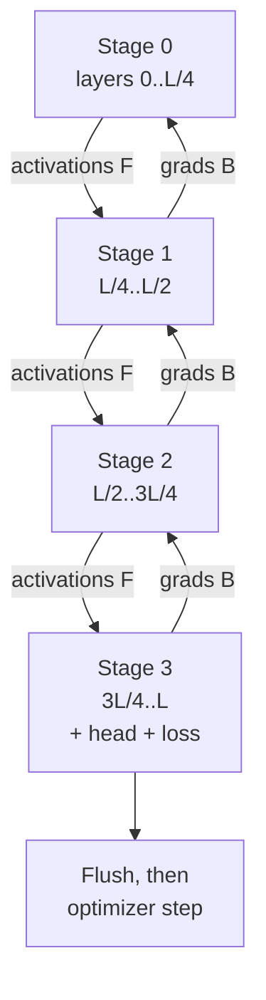

Pipeline parallelism (PP) splits a model **by depth**: consecutive layer ranges become stages on different workers, and a mini-batch is cut into **microbatches** that stream through those stages like an assembly line. Stage $i$ runs its layers on microbatch $k$, then passes activations (forward) or gradients (backward) to the neighboring stage. Only boundary tensors move between devices, not the full weight set.

[Data parallelism](glossary://data-parallelism) processes different batch slices across model replicas (or sharded-state replicas). [Tensor parallelism](glossary://tensor-parallelism) slices *inside* a layer. Pipeline parallelism cuts the *stack*. In Megatron-style LLM training you often compose all three (3D parallelism): tensor parallel within a node, pipeline parallel across nodes, data parallel across model replicas.

## Intuition

A single GPU that cannot hold every layer can still hold a **slice** of the depth. Without microbatches, stage 1 sits idle until stage 0 finishes the whole batch, so utilization collapses. Split the batch into $m$ microbatches and keep several in flight: while stage 0 works on microbatch $k+1$, stage 1 works on $k$. Fill and drain still leave some idle **pipeline bubble**; more microbatches shrink that bubble as a fraction of step time, at the cost of more live activations and either a larger global batch or a smaller $B_{\mathrm{micro}}$ for the same global batch.

Synchronous schedules **flush** the pipeline before the optimizer step so every stage sees the same weight version for a given mini-batch (GPipe, PipeDream-Flush / 1F1B). Async PipeDream-style schedules can hide more bubble but risk stale or inconsistent weights unless carefully controlled.

## How it works

1. **Partition layers into stages.** Assign contiguous blocks (often equal transformer-layer counts) to pipeline ranks. Embeddings and the LM head may land on the first and last stages and skew load.
2. **Split the mini-batch.** Global batch becomes $m$ microbatches of size $B_{\mathrm{micro}}$. Each microbatch is a full forward and backward through the pipeline.
3. **Schedule forwards and backwards.** Classic options:
   - **GPipe (F-then-B):** all microbatch forwards, then all backwards. Simple; peak activation memory scales with $m$.
   - **1F1B (PipeDream-Flush):** warm-up forwards, then steady-state one-forward-one-backward, then cool-down. Same bubble size as GPipe for equal stage times, but in-flight microbatches are bounded by pipeline depth $p$, so activation memory is lower.
   - **Interleaved 1F1B (Megatron):** each device owns $v$ non-contiguous model chunks. Under the balanced, negligible-communication model, bubble shrinks by about $v$ and boundary messages increase. The original schedule required $m$ to be a multiple of $p$; current frameworks may support other grouping constraints, so check the configured implementation.
4. **Flush, then step.** After the last backward, all ranks apply the optimizer (optionally with a data-parallel all-reduce or sharded optimizer on each stage's parameters).
5. **Optional recomputation.** [Activation checkpointing](glossary://activation-checkpointing) discards most intermediates inside a stage and recomputes them in backward so you can afford more microbatches or deeper stages.

Communication is mostly **point-to-point** send/recv of activation and gradient tensors between adjacent stages (often via [NCCL](glossary://nccl)), not a full-model all-reduce every layer. That is why PP is a natural **cross-node** dimension when tensor-parallel collectives want to stay on fast NVLink inside a node.

## Diagram



## Formula

Assume $p$ stages, $m$ microbatches per pipeline flush, roughly equal per-microbatch forward time $t_f$ and backward time $t_b$ on every stage, and negligible communication/optimizer overhead. These are the schedule approximations from [Narayanan et al.'s Megatron-LM analysis](https://arxiv.org/html/2104.04473v5), not exact timing predictions for every 1F1B variant. [Current Megatron schedule APIs](https://docs.nvidia.com/megatron-core/developer-guide/latest/apidocs/core/core.pipeline_parallel.schedules.html) expose implementation-specific choices.

**Bubble wall time** (fill plus drain for standard GPipe / non-interleaved 1F1B):

$$
t_{\mathrm{pb}} = (p - 1)\,(t_f + t_b)
$$

**Ideal useful work** if every stage were always busy on the $m$ microbatches:

$$
t_{\mathrm{id}} = m\,(t_f + t_b)
$$

**Bubble fraction relative to ideal work** (Megatron-LM / Narayanan et al. form; the rule of thumb $m \gg p$):

$$
\frac{t_{\mathrm{pb}}}{t_{\mathrm{id}}} = \frac{p - 1}{m}
$$

**Bubble as a share of total step time** (same schedule, equal stage costs):

$$
\frac{t_{\mathrm{pb}}}{t_{\mathrm{pb}} + t_{\mathrm{id}}} = \frac{p - 1}{m + p - 1}
$$

**Interleaved schedule.** With $v$ model chunks per device, stage time per chunk is about $t_f/v$ and $t_b/v$, so

$$
t_{\mathrm{pb}}^{\mathrm{(int)}} \approx \frac{(p - 1)\,(t_f + t_b)}{v}
$$

at the cost of roughly $v\times$ more pipeline boundary messages.

**Activation memory (order of magnitude, no checkpointing).** Peak live microbatches are about $m$ for GPipe and about $p$ for 1F1B steady state, so

$$
M_{\mathrm{act}} \propto (\text{\# microbatches in flight}) \times B_{\mathrm{micro}} \times (\text{activations per stage})
$$

Checkpointing at stage boundaries (as in GPipe) trades ~one extra forward of recompute for much lower peak activation storage.

**3D world size.** With pipeline degree $p$, tensor degree $t$, and data-parallel degree $d$:

$$
N_{\mathrm{GPU}} = p \times t \times d
$$

Global batch still multiplies microbatch size by microbatch count and by $d$ (and any extra accumulation outside the pipeline flush).

## Worked numbers

Take $p = 8$ stages and $m = 32$ microbatches, balanced stages.

| Metric | Value |
| --- | --- |
| Bubble / ideal work $(p-1)/m$ | $7/32 \approx 22\%$ |
| Bubble / wall step $(p-1)/(m+p-1)$ | $7/39 \approx 18\%$ |
| Same $p$, $m = 64$ | $7/64 \approx 11\%$ of ideal; $7/71 \approx 10\%$ of wall |

If stage 0 is 1.4× slower than the others (heavy embedding or long first-block sequence ops), the whole pipeline clocks to that bottleneck: theoretical bubble math underestimates idle time on every faster stage. Profile per-stage $t_f$, $t_b$, and P2P wait; rebalance layer counts or move non-transformer ops before trusting $(p-1)/m$.

Interleaving with $v = 2$ on the $m = 32$, $p = 8$ case cuts ideal bubble roughly in half ($\approx 11\%$) if communication stays hidden; if IB links are saturated, the extra messages can erase the win.

## Example

Consider a hypothetical 70B decoder-only training configuration on 64 GPUs. Full training state does not fit on one 80 GB GPU; whether multi-GPU [FSDP](glossary://fsdp) alone suffices depends on sharding, wrapping, activations, and sequence length. One possible 3D topology is:

- Tensor parallel $t = 8$ (one DGX/HGX node)
- Pipeline parallel $p = 4$ (four nodes in a pipeline)
- Data parallel $d = 2$ (two replicas)

$$
N = 4 \times 8 \times 2 = 64
$$

Each pipeline stage holds one quarter of the blocks (plus embeddings on stage 0 and LM head on stage 3). Global batch is 256 sequences; with $d = 2$ each pipeline group sees 128 sequences per step, split into $m = 32$ microbatches of size 4. Bubble vs ideal work is $(4-1)/32 \approx 9\%$. Frameworks such as [NVIDIA Megatron](glossary://nvidia-megatron)-LM or DeepSpeed Pipeline implement the 1F1B (or interleaved) schedule: rank programs are static per step, send/recv activations between stages, and only after the flush do you step AdamW (often with a distributed optimizer on each stage's parameter shard).

```python
# Conceptual shape (frameworks own the real schedule)
# world: p pipeline ranks × t tensor ranks × d data ranks
for step, batch in enumerate(loader):
    microbatches = split(batch, m)          # m microbatches
    losses = pipeline_forward_backward(     # GPipe or 1F1B schedule
        model_stage, microbatches, schedule="1f1b"
    )
    # optional: DP all-reduce / reduce-scatter on this stage's grads
    optimizer.step()
    optimizer.zero_grad(set_to_none=True)
```

## Trade-offs

| Dimension | Pressure when you raise it |
| --- | --- |
| Pipeline depth $p$ | Fits deeper models; larger bubble unless $m$ grows; more stages to balance |
| Microbatches $m$ | Smaller bubble fraction; more activation memory (GPipe) or larger global batch |
| Interleaving $v$ | Smaller bubble; more P2P traffic and scheduling complexity |
| Stage balance | Uneven $t_f$/$t_b$ multiplies bubble beyond the equal-stage formulas |
| PP vs TP vs DP | PP: cheap P2P, depth split, bubble risk. TP: heavy collectives, width split. DP: throughput and batch, replicate or shard state |

Prefer PP when depth (or multi-node) is the wall and you can keep $m$ several times $p$. Prefer more TP only while collectives stay on fast intra-node links. Prefer more DP (or FSDP/ZeRO) when the model already fits per stage and you need tokens/sec.

## Debug path

- **Bubble too large:** log $m$, $p$, and measured idle vs compute; raise $m$ or lower $p$; try interleaved 1F1B if interconnect allows.
- **OOM after raising $m$:** switch GPipe → 1F1B, enable activation checkpointing, shrink $B_{\mathrm{micro}}$, or reduce live microbatches.
- **Throughput below theory:** stage imbalance (profile per-stage time), slow P2P (cross-node vs NVLink), or tensor-parallel groups accidentally spanning slow links.
- **Loss / numerics diverge vs a reference:** confirm flush-before-step (synchronous semantics), correct global loss scaling, and intentional RNG/dropout handling across stages and activation recomputation. Changing microbatch layout can change random-number consumption; bitwise agreement with a single-GPU run is not automatic.
- **Hangs:** mismatched send/recv order between ranks, different $m$ on different ranks, or NCCL timeouts on stragglers.

## Why it matters here

Pipeline parallelism is how LLM training crosses the "model deeper than one GPU or one node" barrier without putting every collective on the slow path. Curriculum topics on Megatron, DeepSpeed, and 3D parallelism assume you can reason about stages, microbatches, bubble fraction, and the memory difference between GPipe and 1F1B. In production pretraining and large SFT, PP is usually the **depth and multi-node** knob next to tensor parallel (width) and data parallel / FSDP (replicas and state sharding).

## Related terms

- [Tensor parallelism](glossary://tensor-parallelism)
- [Data parallelism](glossary://data-parallelism)
- [Activation checkpointing](glossary://activation-checkpointing)
- [NVIDIA Megatron](glossary://nvidia-megatron)
- [FSDP](glossary://fsdp)
