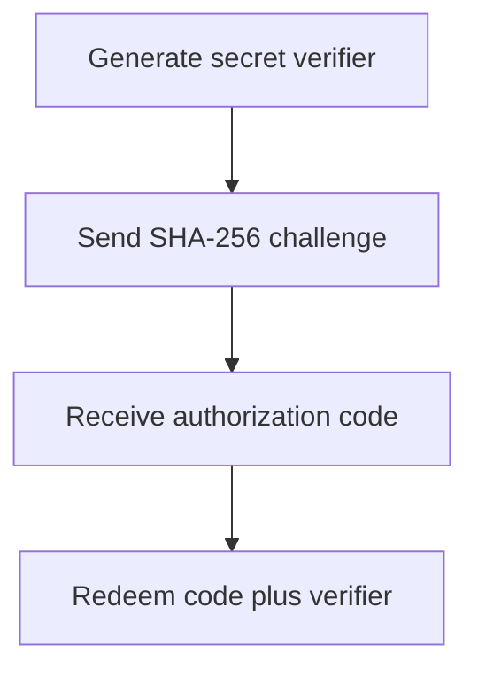

**Proof Key for Code Exchange (PKCE)** binds an OAuth authorization-code request to the client that started it. The client creates a high-entropy secret verifier, sends a derived challenge during authorization, and later proves possession of the original verifier when redeeming the authorization code.

PKCE proves possession of the per-request secret. Confidential clients still authenticate where required. [RFC 7636](https://www.rfc-editor.org/rfc/rfc7636.html) defines the mechanism; [OAuth's security best current practice](https://www.rfc-editor.org/rfc/rfc9700.html) requires PKCE for public clients and recommends it for confidential clients.

## How PKCE blocks code interception

For `S256`, the challenge is the unpadded Base64url encoding of the SHA-256 digest of the ASCII verifier. A verifier is 43–128 characters from the specified unreserved-character set; Base64url-encoding 32 cryptographically random bytes is a standard way to generate one. The authorization server associates the challenge and method with the issued code. At the token endpoint, it derives the challenge from the presented verifier and checks the stored value. Use `S256` rather than `plain`, which exposes the verifier in the authorization request.

An attacker who steals the authorization code cannot redeem it without the verifier. Pair PKCE with exact redirect-URI checks, HTTPS, issuer validation, resource binding, scope restrictions, and secure token storage. Reusing one verifier across authorization attempts weakens the protection the mechanism is supposed to provide.

## Example

A desktop agent connects to a protected document tool. It generates a fresh random verifier, derives an `S256` challenge, and opens the authorization flow. After approval, its redirect handler receives an authorization code.

The client sends that code and the original verifier to the authorization server. If another application intercepted the code but doesn't possess the verifier, the server rejects the token request. The resource server must still independently validate the resulting access token and restrict requested tool actions.

## Why it matters here

Agent clients, native applications, and MCP integrations frequently initiate delegated authorization without a reliably confidential client secret. PKCE protects their authorization-code exchange while preserving the separate partitions for token audience, user consent, scopes, and execution-time policy.

## Related terms

- [OAuth](glossary://oauth)
- [MCP](glossary://mcp)
- [permission scope](glossary://permission-boundary)
- [Secrets management](glossary://secrets-management)
