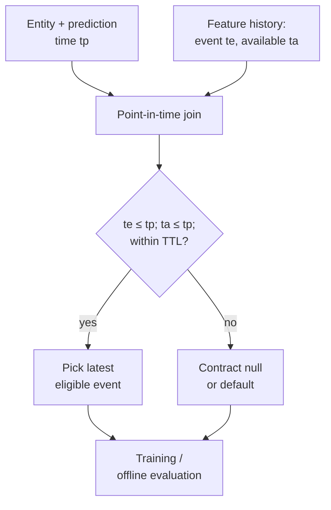

A **point-in-time join** (also called an **as-of join** or **ASOF join**) builds each training or offline-eval row so that every feature value is the latest eligible state of the feature tables *as of that row's* [prediction timestamp](glossary://prediction-timestamp). For entity key $k$ and prediction time $t_p$, attach the latest feature record the live scorer could have read at $t_p$.

The basic SQL pattern is a backward **ASOF LEFT JOIN** from observations (entity keys, $t_p$, optional labels) onto feature history. For each left row, select the latest matching feature timestamp at or before its prediction time, leaving null if none qualifies. Event time alone can include records that arrived later; replaying what serving actually knew also requires ingestion or availability time. Feature-store APIs offer historical retrieval, but their timestamp semantics and supported availability checks differ.

## Intuition

A warehouse is a cleaned present tense. A live model only knows a messy past. Training rows built with plain equi-joins (`entity_id = entity_id`) or "take the latest feature forever" quietly give the model tomorrow's corrections, late heartbeats, and post-outcome aggregates. Offline AUC rises; production collapses.

A point-in-time join asks a stricter question per row: **what would serving have known at $t_p$?** That is the difference between replaying history and rewriting it.

Compare common time-based queries:

| Query | What it returns | Typical use | Leakage risk for training |
| --- | --- | --- | --- |
| Latest feature per entity | Current offline/online value | Batch score *now* | High if used as historical training |
| Time travel at one global $T$ | Entire snapshot as of $T$ | Audit, experiment replay | High: every row gets the same clock |
| Point-in-time join | Per-row as-of $t_p$ | Honest training / offline eval | Low if availability is enforced |

## Formula

Let a candidate feature record for entity $k$ have event time $t_e$, availability (ingestion / effective) time $t_a$, and optional TTL $\tau$. It is eligible for a prediction at $t_p$ only if:

$$
t_e \le t_p
\quad\text{and}\quad
t_a \le t_p
\quad\text{and}\quad
t_p - t_e \le \tau
\quad\text{(if a TTL applies).}
$$

Among eligible records for the same keys, take the one that maximizes $(t_e, t_{\mathrm{write}})$ (or the platform's documented tie-break: write time, API invocation time, or effective timestamp). A fact that *describes* the past but *lands* after $t_p$ still leaks, so availability time must also be checked.

[Feast's current historical retrieval](https://docs.feast.dev/getting-started/concepts/point-in-time-joins) bounds feature event time by each entity timestamp and measures TTL backward from that row. By default, a created timestamp deduplicates equal event times while later corrections can remain eligible. Where supported, `filter_by_created_timestamp=True` adds the availability bound; the configured non-null created timestamp must actually represent availability. Otherwise, enforce it in a custom join.

[Tecton's documented effective-time model](https://docs.tecton.ai/docs/0.9/reading-feature-data/reading-feature-data-for-training/constructing-training-data) incorporates schedule and `data_delay` for batch features. Match that configured estimate to the operational availability contract; the ingestion timestamp may differ from the time serving could read the value.

## How it works

1. **Build the entity (events) dataframe.** One row per label or decision: join keys (`user_id`, `ticket_id`, …), prediction timestamp $t_p$, and usually the label. Set $t_p$ to the decision clock (impression time, charge time, SLA score time).
2. **Load versioned feature history** from offline stores (Parquet, warehouse tables, feature groups) keyed by entity and $t_e$ (plus ingestion / write metadata when available).
3. **Join per row with ASOF semantics.** For each entity row, filter feature history to eligible records under the formula above; pick the latest remaining; leave nulls if nothing is in range (TTL miss or history starts too late).
4. **Repeat across feature views** with different cadences (hourly aggregates, daily attributes, stream counters). Each view is joined independently with its own TTL and schedule.
5. **Materialize a training dataset.** The result is what offline training and offline eval should see. Online serving later reads the *current* online store for the same definitions; parity tests compare the two paths at a fixed as-of time.

```python
# Feast sketch: configured driver view and availability-aware offline store
entity_df = events[["driver_id", "event_timestamp", "label"]]
training_df = store.get_historical_features(
    entity_df=entity_df,
    features=[
        "driver_hourly_stats:trips_today",
        "driver_hourly_stats:earnings_today",
    ],
    filter_by_created_timestamp=True,
).to_df()
```

## Example

SLA-risk model scores open tickets at prediction time. Entity grain is `assignee_id`; feature is `queue_backlog` (open tickets in the assignee queue).

Entity rows:

| ticket | assignee | $t_p$ | label (missed SLA?) |
| --- | --- | --- | --- |
| T9 | A3 | 12:00 | 1 |
| T12 | A3 | 15:00 | 0 |

Feature history for `A3` (after warehouse cleanup and a late backfill):

| $t_e$ | value | available at ($t_a$) | notes |
| --- | ---: | ---: | --- |
| 11:00 | 12 | 11:05 | online on time |
| 11:55 | 18 | 12:40 | describes 11:55 but landed after 12:00 |
| 12:05 | 19 | 12:06 | after T9's $t_p$ |
| 14:50 | 9 | 14:52 | fine for T12 |

Point-in-time join:

```text
T9  (A3, tp=12:00):
  12:05 -> reject (te > tp)
  11:55 -> reject (ta=12:40 > tp)   # late arrival / backfill
  11:00 -> accept  value=12

T12 (A3, tp=15:00):
  14:50 -> accept  value=9
```

A naive "latest known backlog for A3" join would give **both** rows value $9$ or the post-backfill $18$, leaking future information into T9. Offline metrics would then measure a model unavailable to production at 12:00.

```text
event_time=11:55  available_time=12:40  prediction_ts=12:00
-> feature LEAKS if used for the 12:00 score
```

## Diagram



## Worked numbers

For a toy balanced binary label, suppose a post-outcome binary field equals the label with probability $0.8$ in each class and is used directly as the score. Its population AUC is $0.8^2 + \tfrac12(2\cdot0.8\cdot0.2)=0.8$, counting tied scores as half a win. The $0.8$ matching fraction yields AUC $0.8$ in this example. If all features actually available at decision time are independent noise, removing the leaked field returns expected AUC to $0.5$. This calculation illustrates leakage, not an observed training result.

When features only update daily at 02:00 UTC with a two-hour compute delay, Tecton-style effective time might place a "Monday event" feature online only at Tuesday 04:00. A Monday 12:00 prediction must still see Sunday's row (or null); Monday's aggregate is not available yet. Encoding schedule delay into $t_a$ or `_effective_timestamp` is part of point-in-time correctness.

## What fails in production

| Failure | Symptom | Fix |
| --- | --- | --- |
| Equi-join to "current" dim tables | Offline >> online quality | ASOF on $t_e$; freeze SCD/history tables |
| Event time only, no availability time | Late events and backfills leak | Require $t_a \le t_p$; store ingestion clocks |
| Single global as-of for all rows | Same snapshot for every label time | Per-row $t_p$ in the entity dataframe |
| TTL ignored or measured from "now" | Stale or empty features at train time | TTL relative to each row's $t_p$ |
| Backfill overwrites without write-time tie-break | Wrong version of a corrected fact | Keep history; break ties with write/API time |
| Train on PIT offline, serve different windows/nulls | [Training-serving skew](glossary://training-serving-skew) | Shared feature definitions + parity tests |
| Labels at outcome time used as $t_p$ | Features from the label window sneak in | Set $t_p$ to decision time, not label write time |

Without versioned history, feature timestamps, late-arrival handling, and edge-case fixtures (first day of an entity, TTL boundary, same $t_e$ corrected twice), offline evals look better than production because the warehouse quietly helped.

## Why it matters here

Point-in-time joins mechanically guard against [feature leakage](glossary://feature-leakage) in temporal feature systems. They make offline training and evaluation mimic what the live service could have known, helping offline metrics predict production skill for fraud, ranking, SLA, and ops models. Feature stores exist largely to productize this join; [backfills](glossary://backfill) and freshness SLOs stay honest when the same availability rules apply as history is rewritten. LLM-adjacent stacks reuse the idea when assembling historical prompt context, user embeddings, or retrieval indexes for offline replay: join documents, embeddings, and counters as they existed at each logged request time.

## Related terms

- [Prediction timestamp](glossary://prediction-timestamp)
- [Feature leakage](glossary://feature-leakage)
- [Feature store](glossary://feature-store)
- [Training-serving skew](glossary://training-serving-skew)
- [Feature freshness](glossary://feature-freshness)
