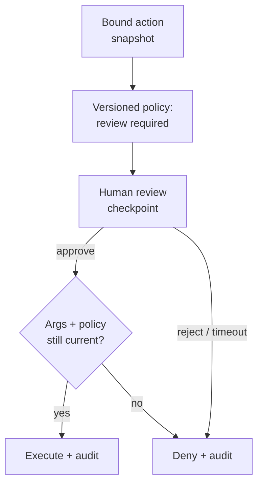

A **policy gate** is executable logic, outside the model, that decides whether a request, retrieved document, tool call, export, or deployment step may continue. It takes a structured snapshot of who is acting, what they want to do, on which resource, under which policy version, and returns a discrete outcome such as **allow**, **deny**, **route**, or **require review**, plus a reason and an audit event.

The model may *propose* text or tool calls. The gate *authorizes*. Prompts, RLHF refusals, and "never do X" system messages guide model behavior; they do not authorize downstream access. A policy gate is a runtime control: if the model is jailbroken, confused, or prompt-injected into emitting a fluent `shift_traffic`, trusted code still refuses to run it. Classical access control names the same split as a **policy enforcement point** (PEP: intercept and act) calling a **policy decision point** (PDP: evaluate rules). In agent stacks that perimeter is often a blocking `before_tool_call` hook, a tool proxy, or an application check immediately before side effects.

A [guardrail](glossary://guardrail) is the broader envelope of controls, including input filters, constrained decoding, output redaction, and tool rails. A policy gate makes a go/no-go decision at one named perimeter. An [eval gate](glossary://eval-gate) checks evaluation results, typically before a release. A runtime policy gate checks authorization and action-specific conditions; it can also require a passing eval artifact before a deployment.

## Intuition

Ask three questions for every sensitive path:

1. **Where** does irreversible work happen (private context enters the prompt, payment API runs, traffic shifts, CSV leaves the system)?
2. **What evidence** must be true before that work (role, tenant, spend cap, approval ticket, document ACL, policy version)?
3. **What happens** if the check cannot complete (timeout, missing attribute, stale policy): deny or hold ([fail closed](glossary://fail-closed)), never "proceed anyway."

If sensitive context or side effects run *before* the gate, the gate is decoration. Output classifiers cannot un-see HR docs already in the context window, and they cannot reverse a tool write that already committed.

Treat planner and tool-call JSON as untrusted input, the same way you treat a browser form. Schema validation, [action allowlists](glossary://action-allowlist), argument policy, and spend caps belong in code, not in the model's chain of thought. [OWASP's excessive-agency guidance](https://genai.owasp.org/llmrisk/llm062025-excessive-agency/) recommends downstream authorization, checking every extension request, and human approval for high-impact actions.

## How it works

A production policy gate is a small, versioned decision procedure:

1. **Intercept** at a trusted perimeter before the protected resource is used (retrieval pack, tool execute, deploy apply, export stream).
2. **Authenticate** the principal (user, service account, agent acting *on behalf of* a user). Do not invent a superuser "agent" identity that bypasses tenant scope.
3. **Assemble attributes**: actor, role, tenant, resource id, action name, args (or arg hash), risk tier, evidence state (ACL grants, eval coverage, approval ticket id), environment (prod vs shadow), policy version.
4. **Evaluate** rules: deterministic allowlists and ABAC/RBAC checks first; optional classifier scores only as inputs to product thresholds, not as the whole policy.
5. **Decide** one of: `allow`, `deny`, `route` (safer tool, read-only mode, different model), `require_review` ([human in the loop](glossary://human-in-the-loop)).
6. **Enforce** the decision at a trusted execution scope that can prevent the side effect, such as the tool service or gateway. Logging "denied" after the API already ran is not a gate.
7. **Audit** with enough fields to reconstruct the decision later: request id, principal, action, sanitized args, rule id, policy version, decision, reason, latency, trace id.

Formally, the gate is a function from a request context $x$ and a policy package $\Pi$ to a decision $d$:

$$
d = G(x, \Pi) \in \{\mathrm{allow},\,\mathrm{deny},\,\mathrm{route},\,\mathrm{require\_review}\}
$$

For high-impact $x$, a missing attribute, timeout, or unknown policy version maps to $\mathrm{deny}$ or $\mathrm{require\_review}$. Classifier scores can inform thresholds; trusted policy code mediates the action and returns the final discrete outcome:

$$
\mathrm{flag}_c = \mathbb{1}[s_c \ge \tau_c], \qquad s_c \in [0,1]
$$

where $s_c$ is a risk score for category $c$ and $\tau_c$ is a product-chosen threshold. The gate still owns the final discrete outcome.

**Complete mediation** means every path that can cause the same side effect hits a gate: primary agent loop, retry workers, webhooks that re-enter tools, admin overrides, and shadow paths that must not write. A single happy-path check is not enough if a background job can call the same payment client.

## Diagram

This view follows an authenticated request whose versioned policy requires human review. Approval resumes execution only after the arguments and policy are checked again.



## Example

Internal release assistant for a payments service. Policy version `deploy-prod-v4`. The model can draft a change summary and propose `shift_traffic`, but production traffic moves only after the gate.

Required attributes before `shift_traffic` to production:

| Attribute | Rule |
| --- | --- |
| Principal role | `release_engineer` or `sre` |
| Target env | `prod` |
| Eval coverage | offline suite green for this candidate SHA ([eval gate](glossary://eval-gate) artifact present) |
| Human approval | open ticket `CHG-*` in approved state for this SHA |
| Blast radius | canary weight $\le 5\%$ unless dual approval |
| Policy service | must return explicit allow within $100\,\mathrm{ms}$ |

Concrete proposal the model emits:

```json
{
  "name": "shift_traffic",
  "args": {
    "service": "payment-api",
    "candidate_sha": "a1b2c3d",
    "weight_percent": 25,
    "env": "prod"
  }
}
```

Gate path:

1. Role ok (`release_engineer`).
2. Env is `prod` → high risk tier.
3. Eval artifact for `a1b2c3d` is missing → **deny** with reason `missing_eval_coverage`.
4. No traffic client is called. Audit event written with policy version, denial reason, and sanitized args.
5. Scaffold returns a structured error the model can explain: "I can't shift traffic until the offline suite is green and a change ticket is approved."

If eval is green but weight is $25\%$ without dual approval, the gate returns `require_review` rather than allow. After a human approves *this* hashed action (service, SHA, weight), the runtime re-validates policy and only then calls the rollout API. Approving a stale proposal after args changed must fail.

The following sketch assumes an authenticated principal, a policy-service client with a real timeout, and trusted evidence retrieved by the runtime for the exact service, SHA, environment, and weight. Evidence flags provided by the model are never accepted. The client also authorizes the principal on the target service. `audit` and `side_effect_clients` are application dependencies omitted here; execution must bind to the same validated argument snapshot.

```python
from dataclasses import dataclass
from typing import Literal

Decision = Literal["allow", "deny", "route", "require_review"]

@dataclass(frozen=True)
class GateResult:
    decision: Decision
    reason: str
    policy_version: str

POLICY_VERSION = "deploy-prod-v4"
MAX_AUTO_CANARY = 5

def policy_gate(principal, tool_name: str, args: dict, evidence: dict) -> GateResult:
    # Fail closed: only explicit allow continues to the side-effect client.
    if tool_name not in principal.allowed_tools:
        return _deny("action_not_allowlisted", principal, tool_name, args)

    if tool_name == "shift_traffic":
        required = {"service", "candidate_sha", "env", "weight_percent"}
        if not isinstance(args, dict) or set(args) != required:
            return _deny("invalid_args", principal, tool_name, args)
        if (args["env"] not in ("prod", "staging")
                or any(not isinstance(args[k], str) or not args[k]
                       for k in ("service", "candidate_sha"))
                or type(args["weight_percent"]) is not int
                or not 0 <= args["weight_percent"] <= 100):
            return _deny("invalid_args", principal, tool_name, args)
        if principal.role not in ("release_engineer", "sre"):
            return _deny("role_not_allowed", principal, tool_name, args)
        try:
            allowed = policy_service.allow(principal, tool_name, args, timeout_ms=100)
        except TimeoutError:
            allowed = False
        if allowed is not True:
            return _deny("policy_timeout_or_deny", principal, tool_name, args)
        if args["env"] == "staging":
            return GateResult("allow", "staging", POLICY_VERSION)
        if not evidence.get("eval_green"):
            return _deny("missing_eval_coverage", principal, tool_name, args)
        if not evidence.get("change_ticket_approved"):
            return GateResult("require_review", "missing_approval", POLICY_VERSION)
        weight = args["weight_percent"]
        if weight > MAX_AUTO_CANARY and not evidence.get("dual_approval"):
            return GateResult("require_review", "weight_needs_dual_control", POLICY_VERSION)
        return GateResult("allow", "ok", POLICY_VERSION)

    return _deny("unhandled_action", principal, tool_name, args)

def _deny(reason, principal, tool_name, args):
    return GateResult("deny", reason, POLICY_VERSION)

def execute_tool(principal, tool_name: str, args: dict, evidence: dict):
    result = policy_gate(principal, tool_name, args, evidence)
    audit(result, principal, tool_name, args)
    if result.decision != "allow":
        return result  # no side effect
    return side_effect_clients[tool_name](**args)
```

What fails in production without this gate: a jailbreak or confused summary that "approves" a deploy in natural language, a missing eval artifact ignored because the model sounded confident, or a policy service timeout treated as allow. What fails with a weak gate: checking only the tool *name* while args set `weight_percent: 100`, running the gate after the rollout client, or accepting human approval of a different SHA than the one in args.

## Placement

Put a policy gate **before**:

- private retrieval results enter the prompt (ACL / tenant / classification)
- tool calls with side effects execute (sends, writes, shell, deploys)
- traffic shifts, model promotions, or config rolls proceed
- data exports, logs, or traces leave the tenant perimeter
- elevated credentials or long-lived tokens are minted

Do **not** rely on post-hoc filters alone for irreversible work. A safety classifier on the final chat bubble is a different control: useful for user-visible text, useless for money already moved.

Exercise paths in tests and chaos drills: denial, timeout, stale policy version, missing attribute, override with expiry, concurrent double-submit, and retry after deny. If only the happy allow path is tested, the gate is unproven.

## Trade-offs

| Choice | Gain | Cost |
| --- | --- | --- |
| Central PDP + local PEP | One policy language, consistent audits | Network hop; need timeouts and fail-closed defaults |
| Inline checks in the scaffold | Low latency, simple deploy | Policy scatter; easy to miss a second entry point |
| Strict deterministic rules | Predictable, testable, hard to prompt-inject | Rigid on fuzzy intent; needs careful product design |
| Classifier-assisted risk tier | Softens pure keyword rules | Threshold tuning, false positives, still needs fail closed |
| Require review on high impact | Humans stop rare disasters | Latency, rubber-stamp risk, needs good evidence UI |

Keep hot paths deterministic (allowlist, schema, RBAC, spend caps). Use learned detectors as inputs to risk tiering, not as the only lock on money or secrets. Version $\Pi$ next to the code that enforces it; silent policy drift makes audits and incidents unreadable.

## Why it matters here

LLM and agent actions can expose private evidence, call tools, shift traffic, or export data. Policy gates turn safety, access, and change-management rules into behavior you can test, fail closed, and reconstruct from an [audit trail](glossary://audit-trail). Alignment and prompts can reduce bad proposals; gates enforce the product envelope when proposals are wrong, adversarial, or merely incomplete.

## Related terms

- [Action allowlist](glossary://action-allowlist)
- [Fail closed](glossary://fail-closed)
- [permission scope](glossary://permission-boundary)
- [Human in the loop](glossary://human-in-the-loop)
- [Audit trail](glossary://audit-trail)
