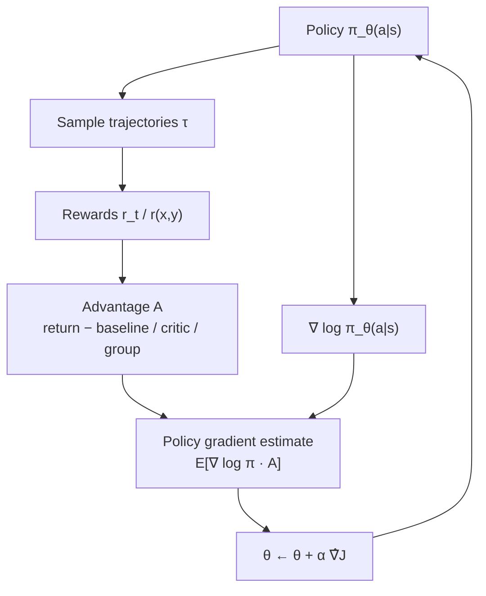

A **policy gradient** is the gradient of expected return (or average reward) with respect to the parameters of a *stochastic policy*. Instead of learning only a value function and acting greedily, you parameterize $\pi_\theta(a\mid s)$ directly and climb $\nabla_\theta J(\pi_\theta)$ with sampled trajectories. The score-function identity turns that gradient into an expectation you can estimate from experience: raise the [logprob](glossary://logprob) of actions that led to better-than-baseline outcomes, lower it for worse ones.

Classic foundations: Williams's REINFORCE (1992), the policy gradient theorem of Sutton, McAllester, Singh, and Mansour (2000), and later practical estimators used in Vanilla Policy Gradient, [PPO](glossary://ppo), and [GRPO](glossary://grpo). In LLM post-training the "action" is usually a token (or whole completion) and the "reward" is a [reward model](glossary://reward-model) score, a verifier, or a mix of both.

## Intuition

Supervised fine-tuning has a fixed label: push probability mass toward the demonstration token. Reinforcement learning does not. You only get a scalar (or delayed) score after sampling. Policy gradients answer: *given that score, how should I move the policy parameters?*

The log-derivative (score-function) trick is the engine. For any trajectory probability $P(\tau\mid\theta)$ that depends on $\theta$ only through the policy factors,

$$
\nabla_\theta P(\tau\mid\theta) = P(\tau\mid\theta)\,\nabla_\theta\log P(\tau\mid\theta).
$$

So $\nabla_\theta$ of expected return becomes an expectation of $\nabla_\theta\log\pi$ times a return weight. This derivation assumes the environment and reward have no direct parameter dependence. Explicit parameter-dependent regularizers, such as a KL penalty, need their own gradient treatment. [Spinning Up derives these assumptions and estimators](https://spinningup.openai.com/en/latest/spinningup/rl_intro3.html).

Sampled gradients can have high variance. A lucky high return on a mediocre action can push its probability up. Baselines and advantage estimates address variance; clipping and [KL](glossary://kl-divergence) penalties address update size or drift and can introduce bias. They serve different purposes.

## Formula

**Objective.** Maximize expected return of trajectories $\tau$ sampled from the policy:

$$
J(\pi_\theta)=\mathbb{E}_{\tau\sim\pi_\theta}\big[R(\tau)\big].
$$

**Simplest policy gradient** (finite-horizon form used in Spinning Up-style derivations):

$$
\nabla_\theta J(\pi_\theta)
=
\mathbb{E}_{\tau\sim\pi_\theta}
\Bigg[
\sum_{t=0}^{T}
\nabla_\theta\log\pi_\theta(a_t\mid s_t)\,R(\tau)
\Bigg].
$$

**Reward-to-go.** For the undiscounted finite-horizon objective above, past rewards do not credit an action. Removing them preserves the expectation and usually reduces variance:

$$
\nabla_\theta J(\pi_\theta)
=
\mathbb{E}_{\tau\sim\pi_\theta}
\Bigg[
\sum_{t=0}^{T}
\nabla_\theta\log\pi_\theta(a_t\mid s_t)\,\hat{R}_t
\Bigg],
\qquad
\hat{R}_t=\sum_{t'=t}^{T}r_{t'}.
$$

**Policy gradient theorem.** For the infinite-horizon discounted objective with discount $0\le\gamma<1$, define unnormalized occupancy $d^\pi(s)=\sum_{t\ge0}\gamma^t\Pr(s_t=s)$ and discounted action-value $Q^\pi$. This is the start-state formulation of [Sutton et al.'s theorem](https://proceedings.neurips.cc/paper/1999/file/464d828b85b0bed98e80ade0a5c43b0f-Paper.pdf):

$$
\nabla_\theta J(\pi_\theta)
=
\sum_s d^\pi(s)
\sum_a
\nabla_\theta\pi_\theta(a\mid s)\,Q^\pi(s,a)
=
\frac{1}{1-\gamma}\mathbb{E}_{s\sim (1-\gamma)d^\pi,\,a\sim\pi}
\big[
\nabla_\theta\log\pi_\theta(a\mid s)\,Q^\pi(s,a)
\big].
$$

**Baseline and advantage.** Any state-dependent baseline $b(s)$ can be subtracted without changing the *expected* gradient (Williams; Dayan; Spinning Up EGLP lemma). With $A^\pi(s,a)=Q^\pi(s,a)-V^\pi(s)$:

$$
\nabla_\theta J(\pi_\theta)
\approx
\mathbb{E}\big[
\nabla_\theta\log\pi_\theta(a\mid s)\,A(s,a)
\big].
$$

In code the usual surrogate "loss" whose gradient matches this estimator is

$$
L(\theta)=-\mathbb{E}\big[\log\pi_\theta(a\mid s)\,A(s,a)\big]
$$

(minimize $L$ = ascend the sampled policy-gradient direction). Hold sampled advantages fixed, typically with `detach()`, so gradients flow through the policy log-probability. Track return, reward, KL, and eval slices separately from optimizer loss; a falling loss measures behavior of the training objective.

**REINFORCE update** (episodic, Monte Carlo return $G$ as the weight): for each step in a sampled episode,

$$
\theta \leftarrow \theta + \alpha\, G_t\,\nabla_\theta\log\pi_\theta(a_t\mid s_t)
$$

(optionally $G_t - b(s_t)$). Actor-critic methods replace $G_t$ with a learned critic or GAE-style advantage.

## Worked numbers

Bandit-style LLM toy: one prompt, two sampled completions, scalar rewards (no discount). Treat each full answer as a single "action" with sequence logprob already summed.

| Sample | $\log\pi_\theta(y\mid x)$ | Reward $r$ |
|--------|--------------------------:|-----------:|
| $y_1$ (correct, concise) | $-18.0$ | $1.0$ |
| $y_2$ (wrong) | $-16.0$ | $0.0$ |

Batch mean reward as baseline: $\bar{r}=0.5$. Advantages $A_i=r_i-\bar{r}$. This illustrative baseline includes each sample's own reward; unlike an action-independent baseline, it scales the expected gradient by $(N-1)/N$ for $N$ independent samples from this same prompt. A leave-one-out mean avoids that particular bias:

$$
A_1=+0.5,\qquad A_2=-0.5.
$$

Surrogate scalar (batch mean, as in Spinning Up / PyTorch training loops; real systems may sum over tokens or use importance ratios):

$$
\ell
=
-\frac{1}{2}\big[(\log\pi_1)A_1 + (\log\pi_2)A_2\big]
=
-\frac{1}{2}\big[(-18)(0.5) + (-16)(-0.5)\big]
=
-\frac{1}{2}(-9+8)
=
0.5.
$$

Gradient of $\ell$ w.r.t. parameters (when $\log\pi$ depends on $\theta$) pushes **up** probability of $y_1$ and **down** probability of $y_2$. Without the baseline, both weights would be non-negative ($1$ and $0$), so the wrong sample would contribute almost no negative pressure and variance would stay higher across prompts.

```python
import torch

# Sequence logprobs already summed; advantages precomputed
logp = torch.tensor([-18.0, -16.0], requires_grad=False)
A = torch.tensor([0.5, -0.5])
# Surrogate whose gradient is the policy gradient estimator
loss = -(logp * A).mean()  # 0.5 for these numbers
# loss.backward() through a real logp graph; optimizer.step()
```

## Example

**RLHF / RLVR completion loop.** Start from an SFT policy. For each prompt $x$:

1. Sample completion $y\sim\pi_\theta(\cdot\mid x)$ (tokens are actions; prefix is state).
2. Score $r(x,y)$ with a [reward model](glossary://reward-model) or a verifier ([RLVR](glossary://rlvr): unit tests, exact math match, schema check).
3. Optionally subtract a baseline: value critic (classic [PPO](glossary://ppo)), group mean ([GRPO](glossary://grpo)), or batch mean (simple REINFORCE).
4. Form advantages $A$ and update with $\nabla_\theta\log\pi_\theta(y\mid x)\,A$, often with PPO clipping and a KL penalty to a frozen reference. Reward hacking remains possible, so evaluate the policy against independent quality criteria.

Concrete case: coding prompt, reward $1$ if tests pass else $0$. Eight samples, two pass. Group-relative methods give positive advantage to the two passes and negative to the six failures; the update raises logprob of the successful traces. If the verifier only checks the final answer, intermediate reasoning tokens still share the outcome advantage (credit assignment is coarse). If the reward model likes long answers, policy gradients will amplify verbosity unless length is regularized or the eval suite catches it.

## How it works

1. **Parameterize a stochastic policy.** In LLMs this is the autoregressive next-token distribution $\pi_\theta(y_t\mid x,y_{<t})$; sequence logprob is the sum of token logprobs.
2. **Roll out on-policy data.** Sample under the current $\pi_\theta$ for an unbiased estimator of the displayed gradient. Off-policy reuse needs appropriate distribution correction; clipping alone does not generally recover an unbiased on-policy gradient.
3. **Assign returns / advantages.** Monte Carlo return, reward-to-go, learned $V_\phi$, GAE, or group normalization.
4. **Estimate $\nabla_\theta J$.** Average $\nabla_\theta\log\pi_\theta\cdot A$ over the batch (or optimize the clipped surrogate in PPO/GRPO).
5. **Step parameters** with SGD/Adam; refresh the rollout policy; monitor reward, KL to reference, entropy, length, and held-out quality.

## Diagram



## Trade-offs

| Strength | Cost / failure |
|----------|----------------|
| Directly optimizes a differentiable stochastic policy | High-variance estimates; needs many samples or strong baselines |
| Works with non-differentiable rewards (RM, unit tests, humans) | Credit assignment is hard when reward is sparse or terminal-only |
| Natural for large discrete actions (tokens) | Outcome reward paints every token in a long CoT with the same $A$ |
| Foundation for PPO, GRPO, many agent loops | On-policy sampling is expensive at LLM scale |
| Small policy steps stay continuous (unlike pure argmax over $Q$) | No general global-optimum guarantee; can overfit a reward model or verifier |

**What fails in production**

- **Reward hacking.** The gradient is faithful to $r$, not to product intent. Length bias, format tags, sycophancy, and checker exploits all look like "high reward."
- **Noisy or biased $A$.** Broken critics, all-equal GRPO groups, and unnormalized rewards make updates random or one-sided.
- **KL / reference drift.** Policy updates can leave the distribution the reward model was trained on, making its scores less reliable.
- **Off-policy contamination.** Reusing stale rollouts while pretending they came from the current policy biases the estimator and can destabilize training.
- **Treating the surrogate loss as a metric.** Loss can fall while true return and human preference fall. Ship on eval slices, not on $-(\log\pi)A$.

Useful monitors: mean/std reward, advantage variance, KL to reference, entropy, response length, pass rate on held-out verifiers, and preference win rate vs a fixed baseline.

## Why it matters here

Policy gradients connect [PPO](glossary://ppo), [GRPO](glossary://grpo), and many [RLHF](glossary://rlhf), [RLVR](glossary://rlvr), and agent-training methods studied here. Reading $\nabla_\theta\log\pi\cdot A$ helps distinguish their reward, baseline, sampling, and update-control choices. Other post-training methods, including supervised fine-tuning and direct preference optimization, use different objectives. This distinction helps debug a rising reward curve that still produces worse answers.

## Related terms

- [PPO](glossary://ppo)
- [GRPO](glossary://grpo)
- [RLHF](glossary://rlhf)
- [Reward model](glossary://reward-model)
- [KL divergence](glossary://kl-divergence)
