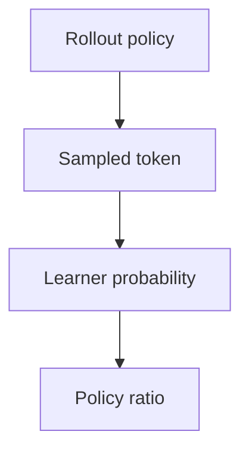

**Policy mismatch** means the policy that produced a trajectory and the policy used to evaluate its probabilities assign different action distributions to the same state. A changing learner is expected to differ from an older behavior policy. The bug is treating them as identical when the estimator requires their actual probability ratio.

## Sources

- **Version drift:** asynchronous rollout used older parameters.
- **Numerical drift:** FP8 serving and BF16 learner differ near discrete partitions.
- **Execution drift:** DSA positions or MoE experts differ.
- **Semantic drift:** tokenizer, chat template, stop rules, sampling support, masks, or tool serialization differ.

Policy ratios can look wrong even when weight versions match. Debug from token IDs and masks outward: align prompt perimeter, compare sampling support, replay DSA and routing decisions, compare logits/log probabilities, then inspect staleness.

Distinguish the behavior policy, the frozen training-side old policy, and the current learner. [verl's rollout-correction documentation](https://verl.readthedocs.io/en/latest/algo/rollout_corr.html) explains why a training-side old-policy log probability may not equal the actual rollout log probability. Temperature and top-k/top-p sampling also change the behavior distribution; recording only raw model log probabilities can hide that difference.

## Diagram

## Example

In a hypothetical MoE rollout, an FP8 inference backend and BF16 learner use the same checkpoint but select different experts near a routing perimeter. Their log probabilities differ even before an optimizer update. That is execution/numerical mismatch, whereas an intentional parameter update is learning drift. Replay can diagnose the former; it does not remove the need to account for the latter.

## Why it matters here

Asynchronous RL compares rollout and learner probabilities. Token, precision, DSA, router, and version mismatches can turn that comparison into false training signal.

## Related terms

- [Importance sampling](glossary://importance-sampling)
- [Policy ratio](glossary://policy-ratio)
- [Router replay](glossary://router-replay)
- [Policy entropy](glossary://policy-entropy)
- [RL rollout](glossary://rl-rollout)
