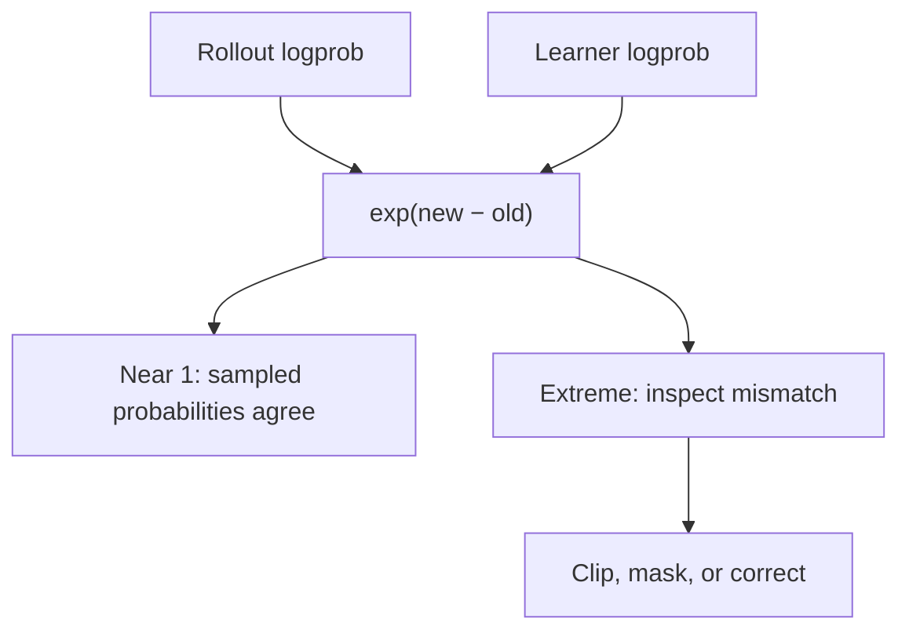

A **policy ratio** compares probabilities assigned by two policies to the same action in the same state. For the current learner and an old policy, with a positive denominator:

$$
\rho_t = \frac{\pi_\theta(a_t\mid s_t)}{\pi_{\mathrm{old}}(a_t\mid s_t)}
= \exp\!\left(\log\pi_\theta-\log\pi_{\mathrm{old}}\right)
$$

A ratio near 1 means the two probabilities agree for this sampled action. Check ratios across representative actions and prompts to assess distribution-wide agreement. A ratio above 1 means the learner favors that action more; below 1 means it favors it less. An importance-sampling denominator must describe the actual behavior policy, including sampling transformations. A frozen training-side old policy can differ from that behavior policy even at the same checkpoint.

## Why clipping exists

[PPO-Clip](https://spinningup.openai.com/en/latest/algorithms/ppo.html) uses the minimum of unclipped and clipped ratio-weighted advantages. It removes the incentive for further changes in the advantage-improving direction beyond the clip boundary; it does not constrain every ratio to that interval. Masking samples and correcting behavior-policy mismatch are separate choices, described in [verl's rollout-correction guide](https://verl.readthedocs.io/en/latest/algo/rollout_corr.html).

For a sequence, the probability ratio is the product of conditional token ratios, or the exponential of their summed log differences. A mean token ratio is a different statistic. Long sequences can amplify small per-token differences and overflow naive exponentiation.

## Diagram

## Example

If old log-probability is -2.0 and new log-probability is -1.9, the ratio is $e^{0.1}\approx1.105$. A much larger difference across many tokens signals drift or inconsistent model execution.

## Why it matters here

Fully asynchronous generation permits trajectories from older policy versions. Router replay and deterministic DSA selection aim to keep policy ratios meaningful when vLLM and Megatron recompute those tokens.

## Related terms

- [PPO](glossary://ppo)
- [GRPO](glossary://grpo)
- [Log probability](glossary://logprob)
- [Importance sampling](glossary://importance-sampling)
- [Router replay](glossary://router-replay)
