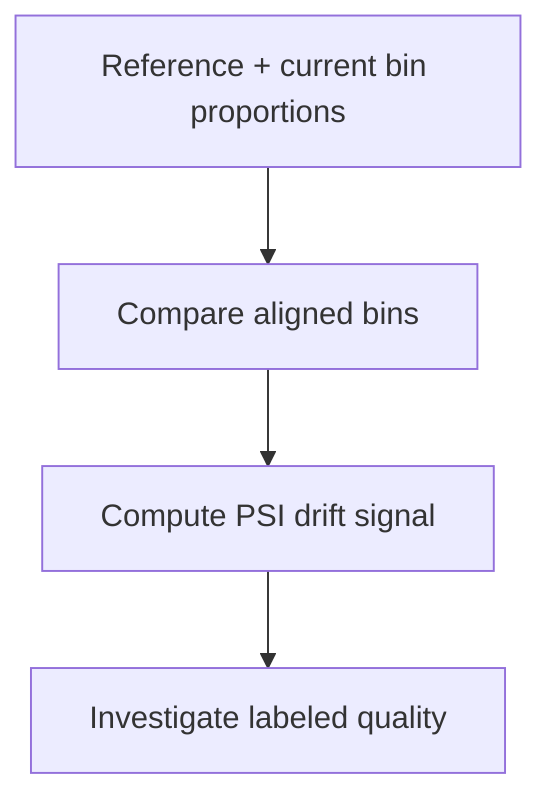

The population stability index (PSI) compares the distribution of a feature or model score in current traffic with a reference distribution. It partitions values into bins, computes the reference and current proportions in each bin, and sums a divergence-like contribution from their differences. PSI flags distribution shifts; assess their effect on model accuracy with labeled evaluation data.

## Formula and operational caveats

For reference proportions $p_i$ and observed proportions $q_i$, $\operatorname{PSI}=\sum_i(q_i-p_i)\log(q_i/p_i)$. Both distributions need compatible bin definitions. Empty bins require explicit smoothing or another well-defined zero-handling policy. Common thresholds are heuristics that depend on sample size, binning, seasonality, and business risk; a universal retraining cutoff is unjustified.

Use natural logarithms and proportions that sum to one in each population. With positive proportions, PSI equals $D_{\mathrm{KL}}(q\|p)+D_{\mathrm{KL}}(p\|q)$: it is symmetric and nonnegative, but is not a distance metric. Freeze numerical bin edges from the reference population; separately computing current quantile bins would compare different value ranges and can conceal drift. Monitoring each feature separately can also miss changed relationships between features. [Statistical properties of PSI](https://files.wmich.edu/s3fs-public/attachments/u730/2022/PSIfinal.pdf)

## Example

Suppose a score has two reference-bin proportions of 0.8 and 0.2, while current traffic has proportions of 0.6 and 0.4. PSI equals $(0.6-0.8)\log(0.6/0.8)+(0.4-0.2)\log(0.4/0.2)$, approximately 0.196. That indicates a changed distribution, but the model might remain accurate if the feature-outcome relationship is unchanged. Check freshness, logging coverage, slices, and delayed labels before retraining.

## Why it matters here

Monitoring predictive models requires early indicators while outcome labels are delayed. PSI can prompt investigation of input or score drift, but safe promotion and rollback depend on reference ownership, enough samples, downstream outcomes, and separation between data drift and concept drift.

## Related terms

- [Data drift](glossary://data-drift)
- [Concept drift](glossary://concept-drift)
- [Feature freshness](glossary://feature-freshness)
