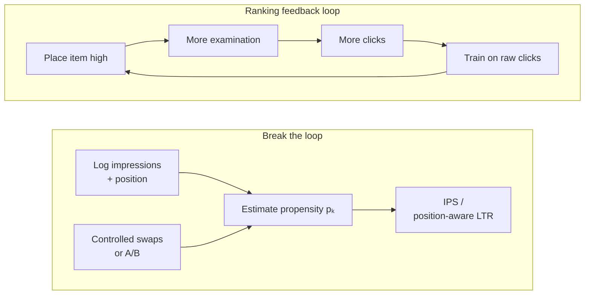

**Position bias** is the systematic effect that *where* an item appears has on whether it is seen, clicked, preferred, or used, independent of its true relevance or quality. The same product, chunk, or answer can look strong at the top of a list and invisible in the middle. The effect shows up in three places LLM engineers hit constantly: ranked search and recommendations (examination / click bias), pairwise [model judges](glossary://model-judge) (slot order), and long prompts (primacy, recency, and "lost in the middle").

Clicks and preferences mix quality with exposure when the interface orders items. Training, evaluation, and RAG packing that ignore position can produce self-reinforcing rankings and noisy eval numbers.

## Intuition

Humans and models both scan ordered lists. Top slots get more attention; bottom slots and the middle of a long pack get less. Three related mechanisms share the same root:

| Surface | What is ordered | What gets distorted |
| --- | --- | --- |
| Search / recsys SERP | Items at ranks $1,2,\ldots$ | Clicks, dwell, conversions used as relevance |
| Pairwise LLM judge | Answer $A$ then answer $B$ in the prompt | Win rates and leaderboards |
| Long context / RAG pack | Chunks, history, tools left-to-right | Whether the model actually uses gold evidence |

If you train only on raw clicks, the model learns yesterday's layout as much as user taste. If you judge only in one slot order, the "winner" may be the first slot. If you stuff 40 chunks into a prompt with the answer buried mid-list, accuracy can collapse even though the tokens are in the [context window](glossary://context-window).

## How it works

**1. Ranking (position-based examination).** A common generative story is that a click requires both *examination* of the slot and *relevance* of the item. Examination falls with rank. Observed click-through rates therefore mix quality with placement. Classic unbiased learning-to-rank (Joachims et al., WSDM 2017) treats logged clicks as biased observations and reweights them by the probability that the slot was examined (inverse propensity scoring). Wang et al. (WSDM 2018) estimate position propensities from personal-search logs without always requiring invasive full shuffles.

**2. Pairwise judges.** Zheng et al. (NeurIPS 2023, MT-Bench / Chatbot Arena) document position bias in LLM judges: the preferred answer can change when the two answers swap places. Measure that behavior on the actual judge model, rubric, decoding settings and task slice. Mitigation is dual-order judging (win only if the same identity wins both orders) or random slot assignment across cases. Randomization reduces systematic aggregate slot advantage; assess individual verdict reliability with consistency checks on the target slice. [MT-Bench judge study](https://arxiv.org/abs/2306.05685)

**3. Long context.** Liu et al. (TACL 2024, "Lost in the Middle") show multi-document QA accuracy is often highest when the gold passage sits at the start or end of the prompt and drops when it sits in the middle (U-shaped curve), even for the long-context models they studied. This is a positional use-of-context effect in a long prompt. Control passage order and test how the actual model uses the pack. [Lost in the Middle](https://arxiv.org/abs/2307.03172)

## Formula

**Position-based click model.** Let $c_{q,d}\in\{0,1\}$ be a click on document $d$ for query $q$ shown at rank $k$. Under examination propensity $p_k = P(\text{examined}\mid k)$ and relevance $r_{q,d}$:

$$
P(c_{q,d}=1 \mid k) = p_k \cdot r_{q,d}
$$

(assuming examination depends only on rank and relevance only on the pair). Raw CTR at rank $k$ estimates $p_k r$, not $r$.

**Inverse propensity scoring (IPS).** For a ranking loss or gain $\ell$ of a scoring function $f$, a **simplified click-IPS sketch** over logged impressions $\mathcal{L}$ reweights clicks by $1/p_k$:

$$
\hat{R}_{\mathrm{IPS}}(f)
= \sum_{(q,d,k)\in\mathcal{L}}
\frac{c_{q,d}}{p_k}\,
\ell\big(f(q,d)\big)
$$

This is a pedagogical click-weighted sum (no $1/|\mathcal{L}|$ average; non-clicks contribute only via $c=0$), not a complete Joachims-style unbiased-risk recipe with full propensity estimation, non-click treatment, and clipping. Items rarely examined contribute more weight when they do get clicked. If $p_k$ is wrong or missing, "debiasing" reweights noise. Propensity estimates need [impression logs](glossary://impression-log) with positions, and ideally some randomization (RandPair swaps, multi-ranker diversity, or EM on click models) so $p_k$ is identified.

**Judge order-swap consistency.** For $N$ pairwise cases judged in both slot orders $(A,B)$ and $(B,A)$:

$$
\mathrm{consistency}
= \frac{1}{N}\sum_{i=1}^{N}
\mathbf{1}\{\text{decision}_i(A,B)\ \text{agrees with}\ \text{decision}_i(B,A)\}
$$

Inconsistent pairs should usually count as ties for release metrics. High flip rate means the judge is not ready to gate.

## Diagram



## Worked numbers

**Clicks.** Two equally relevant items each get 1,000 impressions, but A always sits at rank 1 and B at rank 2:

| item | rank | impressions | clicks | raw CTR |
| --- | ---: | ---: | ---: | ---: |
| A | 1 | 1000 | 400 | 0.40 |
| B | 2 | 1000 | 200 | 0.20 |

Raw CTR says A is twice as good. If examination propensities are $p_1=1.0$ and $p_2=0.5$, IPS-adjusted rates are $0.40/1.0=0.40$ and $0.20/0.5=0.40$: same estimated relevance once position is accounted for.

**Judge (hypothetical, no ties).** On $100$ pairs, a judge prefers the first slot $70$ times in order $(A,B)$ and $65$ times after swap (now favoring $B$). Those marginal counts alone do not determine identity agreement: depending on which cases flip, agreement can range from $5\%$ to $65\%$. Under the additional assumption that the two slot decisions are independent, expected agreement is $0.70\times 0.35 + 0.30\times 0.65=44\%$. Log paired outcomes to measure actual agreement; do not infer it from two aggregate win rates.

## Example

**Search training.** Request `req-1042` for `"waterproof hiking boot"` shows three SKUs. Log each impression with its position and any later click:

```python
impressions = [
    {"request_id": "req-1042", "item_id": "sku_41", "position": 1, "clicked": 1},
    {"request_id": "req-1042", "item_id": "sku_77", "position": 2, "clicked": 0},
    {"request_id": "req-1042", "item_id": "sku_12", "position": 3, "clicked": 0},
]
# Naive: treat sku_41 as relevant, others as irrelevant.
# Position-aware: weight clicks by 1/p_k (greater weight for rarer
# examination); do not treat unshown catalog items as negatives.
```

A pilot that occasionally swaps ranks $1$ and $k$ (RandPair-style) or mixes multiple production rankers can provide variation needed to estimate $p_k$. IPS requires positive examination probability for the target cases and an adequate click model; tiny propensities create high-variance weights, while clipping trades variance for bias. A constant position feature leaves exposure effects unmodeled and can bias ranking. [Unbiased learning-to-rank](https://arxiv.org/abs/1608.04468), [Google's Rules of ML](https://developers.google.com/machine-learning/guides/rules-of-ml)

**Model judge.** Two already-gated support replies enter a pairwise [LLM-as-a-judge](glossary://llm-as-judge) rubric. Run both orders; keep a win only if the same identity wins twice:

```python
def pairwise_verdict(judge, case, a, b) -> str:
    r1 = judge.compare(case, first=a, second=b)  # "A" | "B" | "tie"
    r2 = judge.compare(case, first=b, second=a)
    id1 = {"A": "a", "B": "b", "tie": "tie"}[r1]
    id2 = {"A": "b", "B": "a", "tie": "tie"}[r2]
    if id1 == id2 and id1 != "tie":
        return id1
    return "tie"
```

**RAG pack.** For long multi-doc QA, place critical evidence near the start or end of the packed context (or rerank hard so gold is not mid-list), and measure answer quality while sweeping the gold document's index. A model that only works when the answer is at position $0$ is not "long-context robust."

## Trade-offs

- **Randomization vs UX.** Full top-$N$ shuffles identify $p_k$ cleanly but hurt users. Neighbor swaps, score noise, multi-ranker diversity, or offline EM on click models trade identification power for milder interventions.
- **IPS vs position features.** IPS corrects labels for training and offline eval when propensities are known. Feeding rank as a feature and setting it to a constant at serve (Google's "Rules of ML" style) is operationally simple but can leak if serving never sees varied ranks.
- **Dual-order judges vs cost.** Conservative dual-order cuts position bias at about $2\times$ judge spend. Random single order is cheaper at huge $N$ if you measure residual flip rate on gold first.
- **Packing for primacy/recency vs faithfulness.** Moving the best chunk to the edges helps use-of-context; it must not reorder citations in a way that misleads the user about source priority. Log final pack order for audit.

## Why it matters here

LeetLLM ranking, retrieval, eval, and long-context lessons all account for exposure effects. Position bias motivates impression logs before click-based LTR, careful interpretation of [NDCG](glossary://ndcg) and offline metrics against online CTR, pairwise judges that swap order before gating, and RAG packers that track evidence order alongside token count. In production, the failure modes are concrete: self-reinforcing head items, eval leaderboards that flip under slot swap, and "we retrieved the right chunk" tickets where the chunk sat in the dead middle of a 30k-token prompt.

## Related terms

- [Impression log](glossary://impression-log)
- [Model judge](glossary://model-judge)
- [LLM-as-a-judge](glossary://llm-as-judge)
- [NDCG](glossary://ndcg)
- [Context engineering](glossary://context-engineering)
