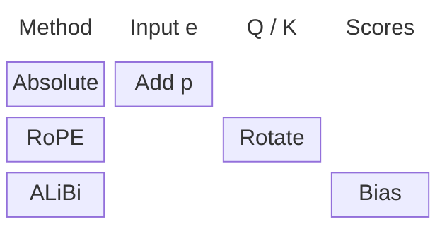

**Positional encoding** is any mechanism that injects token order or distance into a transformer so that [self-attention](glossary://self-attention) is not order-blind. Without it, unmasked self-attention is **permutation equivariant**: if you permute the input sequence, the outputs permute the same way while absolute order remains invisible. "dog bites man" and "man bites dog" therefore produce the same computation up to that row/column reordering. Mean pooling maps them to a permutation-invariant vector; attention preserves token interactions but still needs an explicit position signal. Encodings may be absolute (a vector per index) or relative (a function of distance), additive (summed into embeddings) or multiplicative / score-side (rotations of $Q$/$K$, or biases on attention logits).

The original Transformer (Vaswani et al., 2017) added fixed sinusoids to token embeddings. Modern decoder LLMs mostly use [RoPE](glossary://rope) (Su et al., 2021) or, in some open models, [ALiBi](glossary://alibi) (Press et al., 2021). The *family* is part of the model contract: serving must apply the same scheme, indexing, base frequency, and any long-context scaling that training used.

## Intuition

Self-attention scores are functions of content vectors alone:

$$
\mathrm{Attention}(Q,K,V)=\mathrm{softmax}\!\left(\frac{QK^\top}{\sqrt{d_k}}\right)V
$$

If you permute the sequence and apply the same permutation to $Q$, $K$, and $V$, the outputs permute the same way. Order is invisible unless you put it somewhere: into the embeddings before the stack (absolute PE), into $Q$/$K$ geometry (RoPE), or into the logits after $QK^\top$ (ALiBi and many relative biases).

A useful mental model for absolute PE is a multi-frequency clock: each position $pos$ gets a unique pattern of phases across dimensions, so nearby positions look similar and far positions look different. Relative methods instead answer "how far is key $j$ from query $i$?" which matches how language often depends on distance and order, not on the absolute index $17$.

## How it works

**1. Absolute additive (classic Transformer, BERT-style learned tables).**  
Token embedding $e_t$ and position vector $p_t$ combine before layers:

$$
x_t = e_t + p_t
$$

$p_t$ is either a fixed sinusoid or a learned table of size $L_{\max} \times d_{\mathrm{model}}$. Learned tables cannot natively index past $L_{\max}$; sinusoids are defined for any $pos$ but still only saw limited lengths in training.

**2. Relative methods.**
Leave $e_t$ free of absolute indices and inject distance into attention: relative key/value vectors (Shaw et al.), learned score biases with distance buckets (T5), or fixed linear penalties (ALiBi). Pure score-side forms (T5, ALiBi) change only who attends to whom; $V$ stays position-free.

**3. Rotary (RoPE).**  
After projecting to $q$ and $k$, rotate coordinate pairs by angles proportional to absolute position. The dot product then depends on relative offset $m-n$ while norms stay stable. Values are typically left unrotated.

**Where it sits in the forward pass** depends on the family: additive PE is early (embedding sum); RoPE is mid (on $Q$/$K$ per layer or after projection); ALiBi is late (on logits, often folded into the attention mask).

## Formula

**Sinusoidal absolute PE** (Vaswani et al., *Attention Is All You Need*, §3.5). For position $pos$ and dimension index $i$:

$$
\begin{aligned}
\mathrm{PE}_{(pos,2i)} &= \sin\!\left(\frac{pos}{10000^{2i/d_{\mathrm{model}}}}\right) \\
\mathrm{PE}_{(pos,2i+1)} &= \cos\!\left(\frac{pos}{10000^{2i/d_{\mathrm{model}}}}\right)
\end{aligned}
$$

Wavelengths form a geometric progression from $2\pi$ toward $10000 \cdot 2\pi$; for even width $d$, the longest is $2\pi\,10000^{(d-2)/d}$. For any fixed offset $k$, each complete sine/cosine pair in $\mathrm{PE}_{pos+k}$ is a linear function of its pair in $\mathrm{PE}_{pos}$, which makes relative shifts representable from absolute codes. Useful extrapolation beyond finite-length training still depends on model behavior at those positions. [Original Transformer, §3.5](https://arxiv.org/abs/1706.03762)

**RoPE (pointer).** For even head dimension $d$, pair dimensions and rotate by $m\theta_i$ with $\theta_i = 10000^{-2i/d}$ (Su et al., arXiv:2104.09864). Then $\langle R_m q, R_n k\rangle$ depends on $m-n$. Details live under [RoPE](glossary://rope).

**ALiBi (pointer).** No position table; for head slope $m_h$,

$$
\mathrm{score}_h(i,j)=\frac{q_i\cdot k_j}{\sqrt{d}} - m_h\cdot(i-j)
$$

(for causal $j\le i$). Details live under [ALiBi](glossary://alibi).

## Diagram



The columns mark where each method first injects position. RoPE rotates Q and K while leaving V unrotated.

## Example

**Sinusoidal codes for a tiny model.** Let $d_{\mathrm{model}}=4$, so $i \in \{0,1\}$. For $pos=0$:

$$
\mathrm{PE}_0 = \big[\sin 0,\;\cos 0,\;\sin 0,\;\cos 0\big] = [0,\;1,\;0,\;1]
$$

For $pos=1$, with $\omega_0 = 10000^{0}=1$ and $\omega_1 = 10000^{2/4}=100$:

$$
\mathrm{PE}_1 = \big[\sin(1/1),\;\cos(1/1),\;\sin(1/100),\;\cos(1/100)\big]
\approx [0.8415,\;0.5403,\;0.0100,\;0.99995]
$$

Token embedding $e$ for the word "man" at index $0$ vs index $1$ becomes $e+\mathrm{PE}_0$ vs $e+\mathrm{PE}_1$: same content, different sum. The projections can use that difference to distinguish slots; learning a subject/object relationship still depends on the model and training data.

**Operational check (PyTorch-style frequencies):**

```python
import math
import torch

def sinusoidal_pe(seq_len: int, d_model: int) -> torch.Tensor:
    if seq_len < 0 or d_model <= 0:
        raise ValueError("seq_len must be nonnegative and d_model positive")
    pe = torch.zeros(seq_len, d_model)
    pos = torch.arange(seq_len, dtype=torch.float32).unsqueeze(1)
    # even dims: sin; odd dims: cos  (Vaswani layout)
    div = torch.exp(
        torch.arange(0, d_model, 2, dtype=torch.float32)
        * (-math.log(10000.0) / d_model)
    )
    pe[:, 0::2] = torch.sin(pos * div)
    pe[:, 1::2] = torch.cos(pos * div[:d_model // 2])
    return pe

print(sinusoidal_pe(2, 4)[0])  # ~ [0, 1, 0, 1]
```

An odd width leaves one final sine coordinate without a cosine partner; slicing the cosine frequencies above avoids a shape mismatch. RoPE's paired-coordinate rotation instead needs an even rotary width. [RoFormer](https://arxiv.org/abs/2104.09864)

**Family mismatch in production.** Loading a RoPE LLaMA checkpoint into a stack that still adds a learned absolute table (or applies ALiBi slopes) silently changes every attention map. Short prompts may look "fine"; long prompts, needle-in-haystack, and structured layout tasks break first.

## Worked numbers

Compare three families on the same conceptual job: encode that key position $j=3$ is $4$ steps behind query $i=7$.

| Family | Where position enters | Signal for $(i,j)=(7,3)$ |
|--------|----------------------|---------------------------|
| Sinusoidal absolute | $e_7+\mathrm{PE}_7$, $e_3+\mathrm{PE}_3$ | Distinct full vectors; relative offset only implicit |
| RoPE | Rotate $q_7$ by $7\theta$, $k_3$ by $3\theta$ | Dot product sees relative angle $(7-3)\theta$ |
| ALiBi, slope $m=1/2$ | Score bias only | Extra $-m\cdot(7-3)=-2.0$ on that logit |

If you **raise the max sequence length in config** from $4096$ to $32768$ without matching the checkpoint's method:

- **Learned absolute table:** indices $\ge 4096$ are undefined or zero-padded garbage unless you retrain or interpolate rows.
- **RoPE:** angles $m\theta_i$ enter regimes never seen in training; common fixes are position interpolation (map long indices into the trained range), NTK-aware base changes, and YaRN-style hybrid scaling (Peng et al., 2023). Increasing the input limit can still leave long-context behavior unreliable.
- **ALiBi:** the linear bias is defined for any distance; Press et al. studied training on shorter sequences and evaluation on longer ones. Recency bias and training data still limit what is retrieved. [ALiBi paper](https://arxiv.org/abs/2108.12409)

## Trade-offs

| Property | Absolute (sin / learned) | RoPE | ALiBi |
|----------|--------------------------|------|-------|
| Parameters | $0$ (sin) or $L_{\max}\cdot d$ (learned) | None extra (angles fixed) | None (fixed slopes) |
| Relative distance | Implicit | Explicit in $Q$·$K$ | Explicit linear penalty |
| Extrapolation | Sin: partial; learned: poor past $L_{\max}$ | Needs scaling recipes past train length | Strong in paper LM evals |
| Serving risk | Wrong table size / offset | Wrong base, pairing, or scale | Wrong slopes or RoPE kernel |
| Typical use | Original Transformer, BERT | Most modern decoder LLMs | BLOOM, MPT-style models |

## Why it matters here

Position handling is infrastructure for attention, not a cosmetic embedding detail. It decides whether order is visible, how far context remains usable, and whether two "compatible" weight files actually compute the same function. A **causal mask** alone already breaks full permutation equivariance (future tokens are invisible), and **NoPE** language models can still learn some positional behavior from the mask and data without an explicit PE table. When quality collapses only past a length boundary, after a format conversion, or after a "context extension" flag flip, inspect the position scheme first: absolute vs rotary vs bias, index origin (0 vs 1, padding side), RoPE base and scaling, and whether train and serve agree. Prompt layout, [context window](glossary://context-window) product claims, and long-context retrieval all sit on top of this choice.

## Related terms

- [RoPE](glossary://rope)
- [ALiBi](glossary://alibi)
- [Self-attention](glossary://self-attention)
- [Context window](glossary://context-window)
- [Transformer](glossary://transformer)
