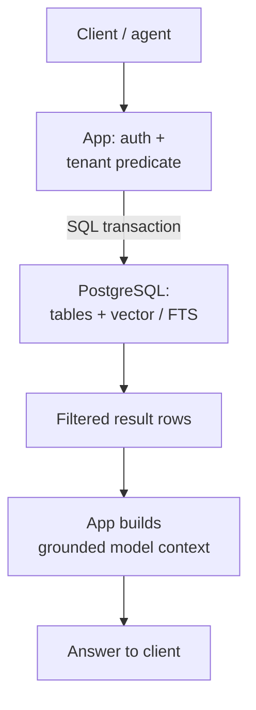

**PostgreSQL** (often **Postgres**) is an open-source object-relational database system: relational tables and [SQL](glossary://sql), plus rich types, constraints, indexes, transactions, and extensions. Origins go back to the POSTGRES research project at UC Berkeley (1986). The project has been ACID-compliant for production workloads for decades and is the usual durable store under product backends such as [Supabase](glossary://supabase).

For AI/ML/LLM engineers, Postgres stores **authoritative product state**: users, tenants, document versions, chunk text, permissions, tool-call logs, labels, eval runs, billing meters, and (with [pgvector](glossary://pgvector)) embeddings co-located with that metadata. The model generates prose; Postgres decides which rows exist, who may see them, and which writes survived a crash.

## Intuition

Treat Postgres as the **auditable source of truth** next to a probabilistic model:

| Layer | Job |
| --- | --- |
| Model / RAG / agent | Propose text, plans, tool calls |
| Application server | Auth, validation, orchestration |
| PostgreSQL | Durable rows, constraints, isolation, query plans |

If retrieval "hallucinates" a document id, the failure is often a missing or wrong row, a stale version join, or a filter that never hit the database. If two workers double-spend a quota, the failure is a missing transaction or uniqueness constraint. If tenant B sees tenant A's chunk, the failure is an [ACL](glossary://acl) or [tenant isolation](glossary://tenant-isolation) hole in SQL or [row-level security (RLS)](https://www.postgresql.org/docs/current/ddl-rowsecurity.html), not a prompt wording issue.

## How it works

### Tables, constraints, and SQL

Data is stored in tables (relations). Columns have types (`text`, `uuid`, `timestamptz`, `jsonb`, arrays, ranges, custom types). Integrity is enforced by:

- **Primary keys** and **unique** constraints (identity, no silent duplicates)
- **Foreign keys** (references must exist)
- **NOT NULL** / **CHECK** / exclusion constraints (impossible states rejected at write time)

Applications speak SQL (or an ORM that emits SQL). Parameterized queries keep user input out of the statement text. Indexes (B-tree by default; also GIN, GiST, BRIN, and extension indexes such as HNSW via pgvector) make filtered lookups and joins cheap when they match the predicates the app actually runs.

### Transactions and ACID

A **transaction** groups statements into one atomic unit: all commit or all roll back. The classic properties:

- **Atomicity:** partial multi-row updates do not stick after a crash or `ROLLBACK`
- **Consistency:** declared constraints hold; application invariants also need correct transaction logic and isolation
- **Isolation:** concurrent sessions do not see each other's uncommitted mess
- **Durability:** after a successful commit, the change survives process death (via WAL; below)

In an AI product this is how you co-update related facts: "mark document version 4 active, insert new chunks, mark old chunks superseded, enqueue re-embed" either all land or none do. Half-applied ingestion is a common cause of empty or duplicated retrieval.

### MVCC (Multiversion Concurrency Control)

Postgres keeps consistency with a **multiversion** model, not by locking every reader against every writer. Official docs: each SQL statement sees a **snapshot** of the data as of some point, so concurrent updates do not make readers observe half-written rows. Under MVCC, **reads do not block writes and writes do not block reads** (writers still lock the rows they modify against other writers).

Internally, updates create new **tuple versions**. Old versions remain until no transaction can still see them; **VACUUM** (including autovacuum) reclaims dead row versions. That is why heavy update churn without vacuuming can bloat tables and slow sequential scans of chunks or event logs.

Ordinary snapshot reads generally do not block row updates. Explicit row-locking reads (`SELECT ... FOR UPDATE`) and table-level locks such as those taken by some schema changes can block other operations; MVCC does not mean lock-free execution. [PostgreSQL locking documentation](https://www.postgresql.org/docs/current/explicit-locking.html)

Isolation levels map onto this snapshot machinery. The default is **Read Committed** (each statement sees a fresh snapshot of committed data). **Repeatable Read** and **Serializable** tighten what anomalies are possible; Serializable uses Serializable Snapshot Isolation (SSI). Choose locks, an atomic conditional update or stricter isolation when multi-statement "read then write" logic must not race (for example, "count remaining credits, then debit"). Serializable transactions can fail with SQLSTATE `40001`; retry the entire transaction, preserving idempotency for external side effects. [Transaction isolation](https://www.postgresql.org/docs/current/transaction-iso.html)

### Write-Ahead Logging (WAL)

**Write-ahead logging** means changes are recorded in an append-only log and flushed to durable storage **before** (or as the guarantee of) commit, and before relying on the heap pages alone. After a crash, Postgres can **REDO** from WAL. WAL also feeds physical replication, logical decoding, and point-in-time recovery. For product ops: backup + continuous WAL archive is how you recover after bad migrations or accidental `DELETE`s of production eval history.

Commit durability depends on configuration and storage honoring flushes. With `synchronous_commit=off`, an acknowledged commit can be lost in a crash before WAL is flushed, while database consistency is preserved. Disabling `fsync` can instead permit corruption. Replication durability also depends on the selected synchronization policy. [Asynchronous commit](https://www.postgresql.org/docs/current/wal-async-commit.html)

### Row-level security (RLS)

Besides table-level `GRANT`, Postgres can attach **row security policies**. With `ALTER TABLE ... ENABLE ROW LEVEL SECURITY`, normal roles only see or mutate rows that pass a policy expression (default deny if RLS is on and no policy matches). Policies use `USING` (which existing rows are visible/updatable) and optional `WITH CHECK` (which new row images may be written). Superusers and roles with `BYPASSRLS` skip policies; table owners usually do too unless you `FORCE ROW LEVEL SECURITY`.

In multi-tenant AI apps, RLS adds defense in depth when application code misses `WHERE tenant_id = $1`. Keep queries correct, use appropriate connection roles, and keep **service-role** keys off the client as well.

### Extensions (AI-relevant)

Postgres is designed to be extended: types, operators, index access methods, procedural languages. In LLM stacks the important ones are often:

- **pgvector:** `vector` columns, distance operators, HNSW/IVFFlat ANN indexes
- Full-text search (`tsvector` / GIN) for lexical retrieval next to dense search
- `jsonb` + GIN for flexible tool payloads and structured model outputs with path queries

## Example

A multi-tenant document QA product might keep product truth in Postgres:

```sql
CREATE TABLE tenants (
  id   uuid PRIMARY KEY,
  name text NOT NULL
);

CREATE TABLE documents (
  id         uuid PRIMARY KEY,
  tenant_id  uuid NOT NULL REFERENCES tenants(id),
  title      text NOT NULL,
  version    int  NOT NULL,
  checksum   text NOT NULL,
  deleted_at timestamptz,
  UNIQUE (id, tenant_id)
);

CREATE TABLE chunks (
  id          uuid PRIMARY KEY,
  document_id uuid NOT NULL,
  tenant_id   uuid NOT NULL REFERENCES tenants(id),
  version     int  NOT NULL,
  ordinal     int  NOT NULL,
  text        text NOT NULL,
  embedding   vector(768),  -- requires CREATE EXTENSION vector;
  UNIQUE (document_id, version, ordinal),
  FOREIGN KEY (document_id, tenant_id) REFERENCES documents(id, tenant_id)
);

CREATE INDEX chunks_tenant_doc_idx ON chunks (tenant_id, document_id);
-- ANN index chosen for the metric you query (see pgvector entry)
```

Serve path (simplified):

1. Authenticate user; resolve `tenant_id`.
2. Embed the question.
3. Retrieve candidates with ACL-safe SQL, for example cosine distance via pgvector's `<=>`:

```sql
SELECT c.id, c.text, c.embedding <=> $1::vector AS dist
FROM chunks c
JOIN documents d ON d.id = c.document_id
WHERE c.tenant_id = $2::uuid
  AND d.tenant_id = $2::uuid
  AND d.deleted_at IS NULL
  AND c.version = d.version
ORDER BY c.embedding <=> $1::vector
LIMIT 20;
```

Bind `$1` to the query embedding and `$2` to the tenant resolved from authenticated identity. The composite foreign key prevents a chunk's tenant from disagreeing with its parent document; two separate foreign keys would only prove that the document and tenant each exist. This example enforces tenant ownership, not finer per-document user permissions: add the relevant authorization join or RLS policies before calling it ACL-safe. [Constraints](https://www.postgresql.org/docs/current/ddl-constraints.html), [pgvector operators](https://github.com/pgvector/pgvector)

4. Optionally rerank, pack context, call the model.
5. In one transaction, insert `answer_events` (query, model version, cited chunk ids) and any usage meter rows.

When retrieval fails in production, inspect rows first: wrong `tenant_id`, `document.version` advanced while chunks still on the old version, soft-deleted parent, missing FK after a partial ingest, or ANN + filter interaction that empties the candidate set. The model is often fine; the join is not.

## Diagram



## Trade-offs

| Strength for AI products | Cost / limit |
| --- | --- |
| One ACID boundary for metadata + vectors (pgvector) | ANN + selective filters need careful index and `ef_search` / iterative scan tuning |
| Constraints and RLS as safety rails | Schema migrations and policy bugs are production incidents |
| SQL joins for evals, provenance, billing | Heavy analytics on the primary can starve interactive RAG latency |
| Mature backup, replica, PITR story | You still own pool sizing, vacuum, and disk for WAL and bloat |
| Better than inventing durability in app memory | Pure in-memory ANN libraries (e.g. FAISS) can win on raw vector throughput at huge scale |

## Sizing and ops (practical)

- **Connections:** each backend is a process; use a pooler (PgBouncer or managed pooling). LLM traffic is bursty; exhausted `max_connections` looks like random 5xx, not a model outage.
- **Indexes:** build indexes that match real predicates (`tenant_id`, foreign keys, time ranges). Unused indexes cost write amplification on every ingest.
- **Vacuum and bloat:** high-churn tables (session state, job queues, embedding refresh) need healthy autovacuum or explicit maintenance.
- **Replicas:** route long eval aggregates and export jobs off the primary when possible.
- **Secrets and roles:** least-privilege DB roles per service; never put a `BYPASSRLS` or owner connection string in the browser or in an agent tool allowlist.

## Why it matters here

LeetLLM-style systems wrap model calls around ordinary product state. Postgres is where permissions, document versions, eval history, workflow state, and source-of-truth records stay joinable and auditable. Learning RAG without learning relational identity, transactions, and tenant filters produces demos that cannot explain a wrong citation or a cross-tenant leak.

## Related terms

- [pgvector](glossary://pgvector)
- [SQL](glossary://sql)
- [Data model](glossary://data-model)
- [ACL](glossary://acl)
- [Supabase](glossary://supabase)
