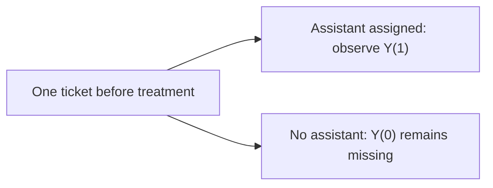

A potential outcome is the outcome that one unit would experience under a specified treatment choice. For a binary intervention, $Y(1)$ denotes that unit's outcome with treatment, and $Y(0)$ denotes its outcome without treatment. Only the outcome corresponding to the action actually taken is observed. The other branch is counterfactual and cannot be recovered merely by selecting another, potentially different, unit.

## Distinguish the observed action from the missing alternative

An individual treatment effect is $Y(1)-Y(0)$, but its two terms cannot both be directly measured for the same unit under the same conditions. Estimating an average effect therefore needs a target population, a treatment definition, a consistent outcome window, and assumptions that make observed comparison groups informative about missing alternatives.

For actual assignment $A\in\{0,1\}$, consistency gives $Y=A\,Y(1)+(1-A)Y(0)$ when the received treatment matches the specified intervention. Identifying an average effect from observational groups requires exchangeability after adjustment and positive probability of each treatment in the target strata. A risk score can be part of the adjustment set when it supports those assumptions. When shared queue capacity lets one ticket's assistance affect other tickets, model that interference explicitly. [Hernán and Robins, Causal Inference: What If](https://miguelhernan.org/whatifbook)

## Example

A difficult support ticket is routed to an AI assistant and resolves successfully, so its observed treated outcome is $Y(1)=1$. Its untreated outcome $Y(0)$ remains unknown. The average success rate of an easy-ticket control group is not a valid substitute because easy tickets do not represent the same untreated alternative. Randomization or justified adjustment for pre-treatment risk can improve the comparison.

## Why it matters here

AI product evaluations often compare assisted and unassisted workflows with different ticket mixes. Potential outcomes make the missing comparison explicit and prevent observed associations from being presented as established causal effects.

## Related terms

- [Counterfactual](glossary://counterfactual)
- [Average treatment effect](glossary://average-treatment-effect)
- [Causal inference](glossary://causal-inference)
- [Confounder](glossary://confounder)
