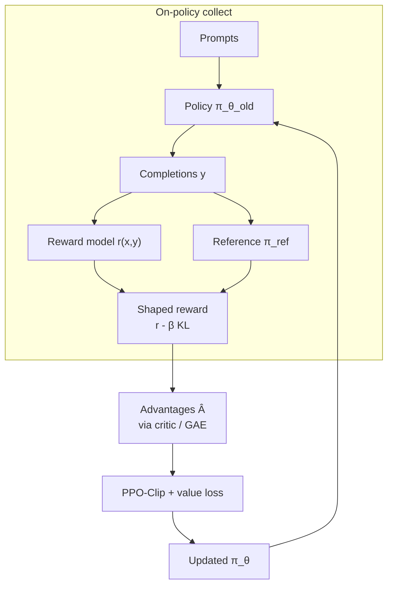

Proximal Policy Optimization (PPO; Schulman et al., 2017) is a family of on-policy [policy gradient](glossary://policy-gradient) algorithms designed to improve a policy while discouraging large changes from the policy that collected the data. The common **PPO-Clip** form replaces TRPO's hard second-order trust region with a first-order *clipped surrogate*: excessive probability-ratio changes in an action's improving direction stop earning further gain for that sample. This supports several minibatch epochs on a rollout. KL divergence can still grow and policy performance can still collapse, so track both during training. [PPO paper](https://arxiv.org/abs/1707.06347)

PPO was built for general RL (Atari, continuous control, games). In LLM post-training it became a baseline for classic [RLHF](glossary://rlhf): InstructGPT trained a [reward model](glossary://reward-model), then used PPO with a [KL](glossary://kl-divergence) penalty against an SFT reference. [DPO](glossary://dpo), [GRPO](glossary://grpo), and related methods provide alternatives to the full actor-critic PPO loop; understanding the clipped surrogate and KL-anchored reward helps compare what each alternative changes. [InstructGPT study](https://arxiv.org/abs/2203.02155)

## Intuition

Vanilla policy gradient uses each on-policy batch once: one gradient step, then throw the data away. Taking many steps on the same batch is tempting for sample efficiency, but the importance weights $\pi_\theta / \pi_{\mathrm{old}}$ drift and the update can destroy a good policy.

PPO's answer is a soft trust region *inside the loss*:

- Raise probability of actions with positive advantage.
- Lower probability of actions with negative advantage.
- Once the probability *ratio* leaves $[1-\varepsilon, 1+\varepsilon]$ in the improving direction, **clip** so further movement no longer helps the surrogate.

So the optimizer is not forbidden from large steps in parameter space; it is simply not *rewarded* for excessive improving ratio changes on that sample. The clip width $\varepsilon$ (often $0.1$-$0.2$) acts alongside learning rate, update epochs and other losses. Shared parameters can still move a clipped sample's probability through gradients from other samples or objectives. [Spinning Up PPO explanation](https://spinningup.openai.com/en/latest/algorithms/ppo.html)

Two different "stay close" ideas get mixed in LLM stacks and must stay distinct:

| Constraint | Measures distance between | Role |
|---|---|---|
| **PPO clip** | $\pi_\theta$ and $\pi_{\theta_{\mathrm{old}}}$ (last rollout policy) | Stabilize multi-epoch updates on one batch |
| **RLHF KL penalty** | $\pi_\theta$ and $\pi_{\mathrm{ref}}$ (usually frozen SFT) | Limit reward-model over-optimization and style collapse |

Clip is about optimization stability. The reference KL is about not gaming an imperfect judge.

## Formula

**Probability ratio.** For state $s_t$, action $a_t$, current parameters $\theta$, and the policy that collected the data $\theta_{\mathrm{old}}$:

$$
r_t(\theta)=\frac{\pi_\theta(a_t\mid s_t)}{\pi_{\theta_{\mathrm{old}}}(a_t\mid s_t)}.
$$

For autoregressive LMs, $a_t$ is a token (or, in some trainers, a whole completion treated with product of token probabilities). Sequence log-prob is the sum of token logprobs.

**PPO-Clip surrogate** (Schulman et al., 2017; maximize this expectation):

$$
L^{\mathrm{CLIP}}(\theta)
=
\mathbb{E}_t\Big[
\min\big(
r_t(\theta)\,\hat{A}_t,\;
\mathrm{clip}\big(r_t(\theta),\,1-\varepsilon,\,1+\varepsilon\big)\,\hat{A}_t
\big)
\Big].
$$

$\hat{A}_t$ is an advantage estimate (often GAE). The $\min$ of unclipped and clipped terms is a *pessimistic* bound: you only get credit for ratio changes that still look good after clipping.

Equivalent case view (Spinning Up form):

- If $\hat{A}_t > 0$, the term is $\min\big(r_t(\theta),\,1+\varepsilon\big)\,\hat{A}_t$ (no extra gain past $r_t=1+\varepsilon$).
- If $\hat{A}_t < 0$, the term is $\max\big(r_t(\theta),\,1-\varepsilon\big)\,\hat{A}_t$ (no extra gain from driving $r_t$ below $1-\varepsilon$).

**Full actor-critic loss** in practice is usually

$$
L(\theta,\phi)
=
\mathbb{E}_t\Big[
L_t^{\mathrm{CLIP}}(\theta)
-c_v\big(V_\phi(s_t)-\hat{R}_t\big)^2
+c_e\,H\big[\pi_\theta(\cdot\mid s_t)\big]
\Big]
$$

(with sign conventions depending on whether code maximizes $L^{\mathrm{CLIP}}$ or minimizes $-L^{\mathrm{CLIP}}$). $V_\phi$ is the critic, $\hat{R}_t$ a return or bootstrapped target, $H$ an entropy bonus.

**PPO-Penalty** (less common in modern stacks) uses an adaptive KL coefficient instead of clip:

$$
L^{\mathrm{KLPEN}}(\theta)=\mathbb{E}_t\Big[r_t(\theta)\,\hat{A}_t-\beta\,\mathrm{KL}\big(\pi_{\theta_{\mathrm{old}}}(\cdot\mid s_t)\,\|\,\pi_\theta(\cdot\mid s_t)\big)\Big],
$$

with $\beta$ adjusted so that realized KL tracks a target.

**LLM RLHF objective** (InstructGPT / Stiennon-style bandit). Prompt $x$, completion $y\sim\pi_\phi^{\mathrm{RL}}$, reward model $r_\theta$, frozen SFT reference $\pi^{\mathrm{SFT}}$:

$$
\begin{aligned}
\mathrm{objective}(\phi)
&=
\mathbb{E}_{(x,y)\sim D_{\pi_\phi^{\mathrm{RL}}}}
\Big[
r_\theta(x,y)
-\beta\log\frac{\pi_\phi^{\mathrm{RL}}(y\mid x)}{\pi^{\mathrm{SFT}}(y\mid x)}
\Big]
\\
&\quad
+\gamma\,\mathbb{E}_{x\sim D_{\mathrm{pretrain}}}\big[\log\pi_\phi^{\mathrm{RL}}(x)\big].
\end{aligned}
$$

The second term is a per-token (or sequence) KL *reward penalty* against the SFT model; $\beta$ is the KL coefficient. The third term (coefficient $\gamma$) is optional **PPO-ptx** mixing of pretraining likelihood to reduce capability regression ("alignment tax"). This outer objective is what the RL environment scores; **inside** the optimizer step you still run PPO-Clip (and a value head) on advantages built from those scores.

The sampled log ratio $\log\pi(y\mid x)-\log\pi_{\mathrm{ref}}(y\mid x)$ is not itself a nonnegative KL divergence: it can be negative for one completion. Its expectation under the current policy is the sequence-level KL when both probabilities have the appropriate support. Summing token log ratios gives that completion's sequence log ratio, while exact conditional KL would sum over the vocabulary at each prefix. Keep these estimators distinct in reward plumbing and dashboards.

## Worked numbers

One token (or one completion-level ratio), $\varepsilon=0.2$.

| Case | $r_t$ | $\hat{A}_t$ | Unclipped $r_t A$ | Clipped $r_t$ | Clipped product | $\min$ (surrogate) |
|---|---:|---:|---:|---:|---:|---:|
| Good action, modest step | $1.10$ | $+2.0$ | $2.20$ | $1.10$ | $2.20$ | $2.20$ (no clip bind) |
| Good action, huge step | $1.50$ | $+2.0$ | $3.00$ | $1.20$ | $2.40$ | $2.40$ (clip caps gain) |
| Bad action, modest cut | $0.90$ | $-1.0$ | $-0.90$ | $0.90$ | $-0.90$ | $-0.90$ |
| Bad action, huge cut | $0.50$ | $-1.0$ | $-0.50$ | $0.80$ | $-0.80$ | $-0.80$ (clip stops "over-punishing" for free) |

Reading the last row: unclipped wants $r_t\to 0$ to make $r_t A$ less negative ($-0.5$ looks better than $-0.9$ when maximizing). Clip forces the surrogate to use $r_t=0.8$, so the optimizer does not get free improvement from driving probability of the bad action to zero on this batch alone.

Clipping is directional. A positive-advantage action with $r_t=0.5$ still contributes $0.5\times2=1.0$, and a negative-advantage action with $r_t=1.5$ contributes $1.5\times(-1)=-1.5$. Both remain unclipped so the objective can penalize movement in the wrong direction.

```python
import torch

def ppo_clip_loss(logp, logp_old, advantages, epsilon=0.2):
    # logp, logp_old, advantages: shape [batch]
    # Returns mean *loss* to minimize (= negative clipped surrogate)
    # Rollout probabilities and advantage targets stay fixed for actor updates.
    logp_old = logp_old.detach()
    advantages = advantages.detach()
    ratio = torch.exp(logp - logp_old)
    unclipped = ratio * advantages
    clipped = torch.clamp(ratio, 1.0 - epsilon, 1.0 + epsilon) * advantages
    return -torch.min(unclipped, clipped).mean()
```

## How it works

**Classic PPO loop** (control / games):

1. Collect trajectories with $\pi_{\theta_{\mathrm{old}}}$.
2. Compute rewards-to-go and advantages $\hat{A}_t$ (GAE with $\lambda$ near $1$ is standard).
3. For several epochs, minibatch-maximize $L^{\mathrm{CLIP}}$ (and fit the value function).
4. Optionally early-stop policy updates if approximate KL$(\pi_{\theta_{\mathrm{old}}}\|\pi_\theta)$ exceeds a target (common safety rail even with clipping).
5. Set $\theta_{\mathrm{old}}\leftarrow\theta$ and repeat.

**LLM RLHF loop** (bandit episodes: one prompt, one response, terminal reward):

1. Start from an SFT policy; freeze a **reference** copy for KL.
2. Train a **reward model** on preference pairs (or use a frozen judge / verifier).
3. Roll out completions for a batch of prompts from the current policy (on-policy sampling is expensive at LLM scale).
4. Score each $(x,y)$ with the reward model; subtract $\beta$ times token-level KL to the reference to form the shaped reward.
5. Estimate advantages with a **critic** / value head (often initialized from the reward model, as in InstructGPT).
6. Run PPO-Clip (and value regression, optional entropy) for a few epochs on that batch.
7. Evaluate offline slices: preference win rate, safety, length, KL, entropy. Do **not** ship on reward alone.

At LLM scale you effectively keep **policy**, **value**, **reference**, and **reward** models in play (sometimes with shared bases or adapters). That memory and engineering cost is a main reason GRPO drops the critic and DPO drops the online RL loop.

## Diagram



## Example

You have an SFT chat model and a reward model trained on "helpful, honest, concise" pairwise rankings. For the prompt *"Summarize this 2-page contract in five bullets"*:

1. Sample $y$ from the current policy (temperature $>0$ so rollouts explore).
2. In this hypothetical trace, the reward model returns $r=1.8$. Sampled token log ratios to SFT average $0.04$ over $120$ tokens, summing to $4.8$. With $\beta=0.02$, the shaped score is $1.8 - 0.02\cdot 4.8=1.704$ (plumbing depends on whether penalties enter token rewards or one sequence term). This is a trajectory-level sampled value; estimate population KL across completions drawn from the current policy.
3. Critic baseline says similar prompts yield $\approx 1.2$, so $\hat{A}>0$: PPO increases log-prob of this completion's tokens, but if some token ratios already exceed $1+\varepsilon$, those tokens stop receiving extra push this epoch.
4. After many prompts, reward rises and answers get more structured. If KL and length both explode while humans start preferring the old SFT on a held-out set, the policy is **reward hacking** (verbosity, sycophancy, empty bullet decoration). Fix data and RM calibration first; only then retune $\beta$, $\varepsilon$, and learning rate.

A minimal operational checklist for one run:

| Signal | Healthy | Suspicious |
|---|---|---|
| Mean RM score | Up slowly | Jumps while human win rate flat |
| KL to SFT | Bounded / near target | Spike then free-fall quality |
| Completion length | Stable or intentional | Steady inflation |
| Entropy | Gentle decay | Collapse to near-deterministic spam |
| Slice evals | Move with reward | Safety or factuality reverse |

## Trade-offs

| Approach | Online rollouts | Critic | Preference / reward form | Cost profile |
|---|---|---|---|---|
| **PPO (+ RM)** | Yes | Yes | Scalar RM (or verifier) | Highest engineering and GPU cost; flexible rewards |
| **[GRPO](glossary://grpo)** | Yes (group per prompt) | No | Group-normalized scores | Cheaper than actor-critic PPO; strong for RLVR math/code |
| **[DPO](glossary://dpo)** | No (offline pairs) | No | Chosen / rejected pairs | Simplest train loop; no on-policy RM optimization |

Choose PPO when you need online optimization against a scalar reward that is not easily turned into fixed preference pairs (multi-objective shaped rewards, tool outcome rewards, iterative RM refresh). Prefer DPO when offline preferences already encode the goal. Prefer GRPO / related group methods when verifiable rewards and multi-sample-per-prompt are natural and you want to drop the value model.

## Why it matters here

PPO is the canonical bridge from classical RL to LLM alignment: clipped importance sampling, advantages, critics, and KL anchors all show up in modern post-training literature even when the trainer is no longer named PPO. Reading PPO carefully shows how DPO's reparameterization and GRPO's group baseline simplify related parts of the same trust-region and preference story.

## Related terms

- [Policy gradient](glossary://policy-gradient)
- [RLHF](glossary://rlhf)
- [Reward model](glossary://reward-model)
- [DPO](glossary://dpo)
- [GRPO](glossary://grpo)
