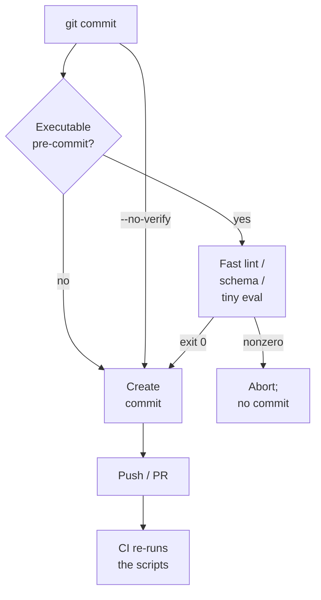

A **pre-commit hook** is a local Git program that runs **before** a commit object is created. Git looks for an executable named `pre-commit` under `$GIT_DIR/hooks` (usually `.git/hooks/pre-commit`), or under the directory set by `core.hooksPath`. The hook takes no parameters. If it exits non-zero, `git commit` aborts and no commit is written. You can skip it with `git commit --no-verify`.

In Git's own docs, the hook exists so you can inspect the snapshot about to be recorded: style, secrets, missing files, tests you insist on before history moves. It is a **client-side** gate that stays local and is not enforced on a fresh clone by default. Use CI or a server-side [validation gate](glossary://validation-gate) for repository-wide enforcement.

Two layers people mix up:

| Layer | What it is |
|---|---|
| **Git hook** | The executable Git runs at a lifecycle point (`pre-commit`, `pre-push`, `commit-msg`, …) |
| **pre-commit framework** | A popular multi-language manager ([pre-commit.com](https://pre-commit.com/)) that installs a managed `.git/hooks/pre-commit` and runs checks listed in `.pre-commit-config.yaml` |

Both end at the same Git schema: non-zero exit blocks the commit. The framework solves sharing, language isolation, and "only run on staged files." A bare shell script in `.git/hooks/` is enough for a tiny AI eval gate and is what many reproducible-AI lessons start with.

## Intuition

Move **cheap, deterministic** failures left. Formatting, metadata, lockfile drift, missing test cases, and a three-row exact-match score should fail on the laptop before they burn CI minutes or a GPU job. Keep the hook fast and boring. If developers routinely wait minutes or hit flakes, they will disable the hook and the gate dies.

Treat the hook as a **local convenience wrapper** around the same scripts CI runs. One source of truth (`scripts/run_eval.sh`, a lint entrypoint, a schema check). The hook calls it. CI calls it. A clean-clone `repro` command calls it. If only `.git/hooks/pre-commit` on one machine knows the check, the team does not have a gate.

## How it works

1. **Developer stages changes** and runs `git commit`.
2. **Git invokes** `.git/hooks/pre-commit` (or `core.hooksPath/pre-commit`) if that path is executable. Non-executable files are ignored.
3. **The script runs** against the worktree/index (plain hooks see the full tree; the pre-commit framework typically stashes unstaged changes and runs only on staged paths).
4. **Exit status decides history:**
   - exit $0$ → Git continues (message editor / `-m`, then creates the commit)
   - exit $\neq 0$ → commit aborted; this attempt creates no commit object
5. **Bypass:** `git commit --no-verify` skips `pre-commit` (and `commit-msg`). Important policy still belongs in CI and merge protection.

Hooks under `.git/` are **local machine state**, not normal tracked files. Version the *source* of the hook and an installer (or commit `.pre-commit-config.yaml` and document `pre-commit install`). A fresh clone needs an installer, configured hooks path or template that makes the hook executable in Git's chosen location. Tracking its source alone does not activate it. [Git hook schema](https://git-scm.com/docs/githooks)

```bash
# Pattern used in AI repos: tracked source + one-time install
# Assumes a conventional .git directory and default hooks path.
# scripts/pre-commit-ai-eval.sh  →  .git/hooks/pre-commit
cp scripts/pre-commit-ai-eval.sh .git/hooks/pre-commit
chmod +x .git/hooks/pre-commit
```

With the pre-commit framework instead:

The framework normally hides unstaged tracked edits while checking the staged snapshot. Individual hooks can modify files, skip filenames or run repository-wide checks; configuration still determines what is examined. Untracked files are another reason to make an eval's input list explicit. [pre-commit framework documentation](https://pre-commit.com/)

```yaml
# .pre-commit-config.yaml (tracked)
repos:
  - repo: local
    hooks:
      - id: tiny-ai-eval
        name: three-row exact-match gate
        entry: ./scripts/run_eval.sh
        language: system
        pass_filenames: false
        always_run: true
```

```bash
pre-commit install   # writes managed .git/hooks/pre-commit
pre-commit run --all-files
```

## Diagram



## Example

An access-policy scorer must stay at exact-match accuracy $2/3$ on a three-row JSONL [test case](glossary://fixture) (curriculum-style micro [eval gate](glossary://eval-gate)):

Here the pinned row count and score check reproduce a known teaching test case. A production quality gate needs task-specific acceptance criteria and enough evaluation evidence; this three-row exact score is a reproducibility schema.

```text
# eval/access_requests.jsonl  (pinned tiny suite)
# 3 rows; scorer must print accuracy 0.667 and exit 0
```

Tracked gate script:

```bash
#!/usr/bin/env bash
# scripts/run_eval.sh
set -euo pipefail
EVAL_FILE="eval/access_requests.jsonl"
[[ -f "$EVAL_FILE" ]] || { echo "ERROR: $EVAL_FILE missing"; exit 1; }
python scripts/score_access_requests.py   # exits non-zero on regression
```

Pre-commit wrapper installed from the repo:

```bash
#!/usr/bin/env bash
# scripts/pre-commit-ai-eval.sh  → installed to .git/hooks/pre-commit
set -euo pipefail
echo "Running AI eval gate before commit..."
./scripts/run_eval.sh
echo "Eval gate passed."
```

Healthy commit path (abbreviated):

```text
Running AI eval gate before commit...
Eval rows: 3
Exact-match accuracy on tiny test case: 0.667 (2/3)
Gate passed. You may commit.
Eval gate passed.
[main abc1234] feat: keep access scorer at 0.667
```

Broken path after someone "simplifies" the scorer or drops a test case row:

```text
Running AI eval gate before commit...
Eval rows: 2
Exact-match accuracy on tiny test case: 1.000 (2/2)
ERROR: expected accuracy 0.667 on 3 rows; got 1.000 on 2 rows
```

Git never creates the commit. The same `./scripts/run_eval.sh` should fail the PR job if someone used `--no-verify` or never ran `install_hooks.sh` after cloning.

## What belongs in the hook (and what does not)

| Good in pre-commit | Leave for CI / slower gates |
|---|---|
| Formatters, linters, typecheck of changed files | Full training runs, multi-GPU regression |
| Schema / frontmatter / lockfile consistency | Large golden suites and model judges |
| Tiny deterministic [unit tests](glossary://unit-test) or micro evals | Nightly [regression suite](glossary://regression-suite) / full [eval gate](glossary://eval-gate) |
| Block secrets, huge accidental binaries | Load tests, cost SLOs, canary analysis |
| "Generated PNG matches source" checks | Multi-minute integration against live APIs |

Rule of thumb: if the check is not **fast, deterministic, and fixable in the same terminal session**, it will train people to bypass it. Put heavy checks behind PR CI and release gates; keep the hook as the thin front door.

## Production failure modes

- **Silent missing hook.** Fresh clone; nobody ran the installer; every bad commit lands until CI. Fix: document install in README, fail CI if the shared script fails, optionally use a template dir or managed framework install.
- **Bypass as culture.** `--no-verify` for "just this once" becomes permanent. Fix: CI is the source of truth; review diffs that weaken the shared script; track override rate if you care.
- **Hook only on one laptop.** Source lived only under `.git/hooks/`. Fix: track scripts under `scripts/` (or `.pre-commit-config.yaml`) and install from them.
- **Hook tests the wrong tree.** Unstaged edits pass/fail differently than what is staged. Frameworks stash unstaged changes for this reason; plain hooks should either check staged content deliberately or always run whole-repo invariants that do not depend on partial staging.
- **Slow or flaky hook.** Live model calls, network, clocks, GPU. People disable it. Fix: pin test cases, mock providers, keep wall time small (seconds, not minutes).
- **Drift from CI.** Local hook runs `ruff`; CI runs different flags or an old image. Fix: one entrypoint, same args, same lockfile-backed environment where possible.

## Why it matters here

AI repos fail in ways unit tests alone miss: a scorer returns a new float, a JSONL test case loses a row, generated diagrams go stale, prompt templates ship with broken frontmatter. A pre-commit hook is the earliest automatic place to protect those **small specifications** so hours of later model debugging are not spent on avoidable local mistakes. LeetLLM's reproducible Git chapter wires the same three-row eval through `repro.sh`, the pre-commit hook, and later CI so the score $0.667$ is a shared invariant, not a one-off notebook cell.

## Related terms

- [Eval gate](glossary://eval-gate)
- [Validation gate](glossary://validation-gate)
- [Unit test](glossary://unit-test)
- [Smoke test](glossary://smoke-test)
- [test case](glossary://fixture)
